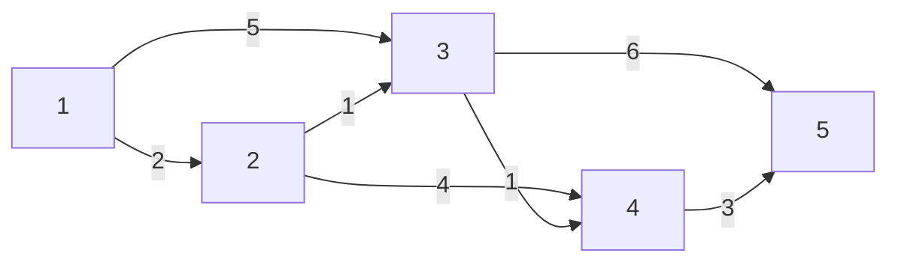

다익스트라(Dijkstra) 알고리즘은 **한 출발점에서 다른 모든 노드까지의 최단 거리**를 구하는 방법이다. 지도 앱이 "집에서 각 장소까지 가장 빠른 길"을 찾는 것과 같은 문제다.

간선마다 거리나 시간 같은 비용이 붙어 있을 때, 지금까지 알려진 거리 중 가장 가까운 노드부터 처리하며 최단 거리를 구한다. 단, 간선 가중치에 음수가 없어야 한다.

---

## 개념

- **가중치가 있는 그래프**에서 쓴다. 간선마다 거리나 시간 같은 비용이 붙어 있다.
- 핵심 아이디어: 지금까지 알려진 거리 중 **가장 가까운 노드**부터 확정하고, 그 노드를 거쳐 가는 길로 다른 노드의 거리를 줄여 나간다.
- 간선 가중치에 **음수가 없을 때만** 정확하다.
- 이름은 1959년에 이 방법을 발표한 네덜란드의 컴퓨터 과학자 에츠허르 다익스트라(Edsger W. Dijkstra)에서 왔다.

## 필요한 배경지식

| 배경지식 | 종류 | 다익스트라에서 쓰이는 곳 |
| --- | --- | --- |
| 가중치 그래프 | 이론 | 간선마다 비용이 붙은 그래프. 다익스트라가 다루는 대상 |
| 인접 리스트 | 자료구조 | `graph.get(a).add(new int[]{b, w})`처럼 도착 노드와 가중치를 함께 저장 |
| BFS | 알고리즘 | 큐에서 꺼내 이웃을 살피는 처리 흐름이 비슷함 |
| 우선순위 큐(힙) | 자료구조 | 거리가 가장 짧은 노드를 빠르게 꺼냄. Java `PriorityQueue` |
| 람다식과 Comparator | Java 문법 | `PriorityQueue`의 정렬 기준 지정 (Java 8부터) |
| 그리디 | 알고리즘 설계 | "지금 가장 가까운 것부터 확정"하는 방식이 그리디 |

## 동작 원리

`dist[v]`는 "출발점에서 v까지 지금까지 찾은 가장 짧은 거리"다.

1. 출발점의 `dist`는 0, 나머지는 ∞(무한대)로 둔다.
2. 출발점을 우선순위 큐에 넣는다.
3. 큐에서 거리가 가장 짧은 노드를 꺼낸다. 이미 더 짧은 거리를 찾은 노드면 건너뛴다.
4. 꺼낸 노드를 거쳐 가는 길이 더 짧으면 이웃의 `dist`를 줄이고(**갱신**), 그 이웃을 큐에 넣는다.
5. 큐가 빌 때까지 반복한다.

### 예시

1번에서 출발한다. 화살표 위 숫자가 가중치(거리)다.



| 단계 | 꺼낸 노드 (거리) | 한 일 | dist[1..5] |
| --- | --- | --- | --- |
| 시작 | - | 1번을 거리 0으로 큐에 넣음 | 0, ∞, ∞, ∞, ∞ |
| 1 | 1 (0) | 2번을 2로, 3번을 5로 갱신 | 0, 2, 5, ∞, ∞ |
| 2 | 2 (2) | 3번을 5 → 3으로, 4번을 6으로 갱신 | 0, 2, 3, 6, ∞ |
| 3 | 3 (3) | 4번을 6 → 4로, 5번을 9로 갱신 | 0, 2, 3, 4, 9 |
| 4 | 4 (4) | 5번을 9 → 7로 갱신 | 0, 2, 3, 4, 7 |
| 5 | 3 (5) | 이미 3으로 처리했으니 건너뜀 | 0, 2, 3, 4, 7 |
| 6 | 4 (6) | 이미 4로 처리했으니 건너뜀 | 0, 2, 3, 4, 7 |
| 7 | 5 (7) | 나가는 간선 없음 | 0, 2, 3, 4, 7 |
| 8 | 5 (9) | 이미 7로 처리했으니 건너뜀 | 0, 2, 3, 4, 7 |

5~8단계처럼 큐에는 예전 거리가 남아 있을 수 있다. 꺼냈을 때 `dist`보다 크면 건너뛰면 된다. 최종 답은 1번에서 각각 0, 2, 3, 4, 7이다.

## 코드

다익스트라도 BFS처럼 큐에서 노드를 꺼내고 이웃을 살핀다. 핵심 차이는 다음과 같다.

- **큐:** BFS는 들어온 순서대로 꺼내는 큐, 다익스트라는 거리가 짧은 것부터 꺼내는 우선순위 큐를 쓴다.
- **큐에 넣는 조건:** BFS는 "아직 방문 안 했으면", 다익스트라는 "더 짧은 길을 찾으면" 넣는다.

아래 코드는 노드를 1번부터 n번까지 사용한다. 가중치는 0 이상이며, 계산 중 더하는 거리 합은 `Integer.MAX_VALUE`보다 작다고 가정한다.

```java
import java.util.*;

public class Dijkstra {
    // 아직 도달하지 못한 노드의 거리
    static final int INF = Integer.MAX_VALUE;

    // n: 노드 수, edges: {a, b, w} = a → b, 가중치 w
    // start: 출발 노드
    static int[] dijkstra(int n, int[][] edges, int start) {
        // graph.get(a): a에서 나가는 간선 목록. 각 원소는 {도착 노드, 가중치}
        List<List<int[]>> graph = new ArrayList<>();
        // 1번부터 n번까지 사용하므로 0번을 포함해 n + 1개 준비
        for (int i = 0; i <= n; i++) graph.add(new ArrayList<>());
        // e[0]: 출발 노드, e[1]: 도착 노드, e[2]: 가중치
        for (int[] e : edges) graph.get(e[0]).add(new int[]{e[1], e[2]});

        // dist[v]: 출발점에서 v까지 지금까지 찾은 가장 짧은 거리
        int[] dist = new int[n + 1];
        Arrays.fill(dist, INF);

        // {거리, 노드}, 거리가 짧은 것부터 꺼냄
        PriorityQueue<int[]> pq = new PriorityQueue<>((x, y) -> Integer.compare(x[0], y[0]));
        dist[start] = 0;
        pq.offer(new int[]{0, start});

        while (!pq.isEmpty()) {
            int[] top = pq.poll();
            // d: 큐에 넣었을 때의 거리, cur: 현재 노드
            int d = top[0], cur = top[1];
            if (d > dist[cur]) continue; // 예전 거리는 건너뜀

            for (int[] edge : graph.get(cur)) {
                // next: 다음 노드, w: cur → next 간선의 가중치
                int next = edge[0], w = edge[1];
                if (dist[cur] + w < dist[next]) { // 더 짧은 길 발견
                    dist[next] = dist[cur] + w;
                    pq.offer(new int[]{dist[next], next});
                }
            }
        }
        return dist;
    }

    public static void main(String[] args) {
        int[][] edges = {{1, 2, 2}, {1, 3, 5}, {2, 3, 1}, {2, 4, 4}, {3, 4, 1}, {3, 5, 6}, {4, 5, 3}};
        int[] dist = dijkstra(5, edges, 1);
        System.out.println(Arrays.toString(Arrays.copyOfRange(dist, 1, 6))); // [0, 2, 3, 4, 7]
    }
}
```

## 시간복잡도와 주의할 점

우선순위 큐를 쓰는 위 구현은 큐에 예전 거리도 남기므로, 큐 원소가 최대 O(E)개까지 생길 수 있다. 시간복잡도는 **O(V + E log(E + 1))**이며, 중복 간선이 없는 일반적인 그래프에서는 **O((V + E) log V)**로 표현한다. 우선순위 큐 없이 매번 배열을 다 뒤져 가장 가까운 노드를 찾으면 O(V²)다.

- **음수 간선이 있으면 쓸 수 없다.** 한 번 확정한 거리가 나중에 음수 간선 때문에 더 줄어들 수 있기 때문이다. 이때는 벨만-포드 알고리즘을 쓴다.
- **오버플로:** 거리 합이 int 범위(약 21억)를 넘을 수 있으면 `dist`와 큐에 저장하는 거리를 `long`으로 바꾼다. `INF`와 비교 기준도 함께 바꿔야 한다.
- **INF 더하기:** 위 코드는 큐에서 꺼낸 노드만 다루므로 `dist[cur]`가 INF일 일이 없다. 다른 방식으로 짤 때는 `INF + w`가 음수로 넘치지 않는지 확인한다.
- **방향 없는 그래프:** 간선을 양쪽(a → b, b → a)으로 두 번 넣는다.
- **도달할 수 없는 노드:** 끝까지 `dist`가 INF로 남는다. 출력 전에 따로 처리한다.

## BFS와 비교

두 알고리즘 모두 "큐에서 꺼내고, 이웃을 살피고, 조건이 맞으면 넣는다"는 비슷한 흐름이다. 큐의 종류와 넣는 조건이 다르다.

| 비교 | BFS | 다익스트라 |
| --- | --- | --- |
| 푸는 문제 | 간선 수가 가장 적은 길 | 가중치 합이 가장 작은 길 |
| 그래프 | 가중치 없음 | 음수 없는 가중치 |
| 큐 | `ArrayDeque` | `PriorityQueue` |
| 시작할 때 넣는 것 | 출발점 | 출발점 (거리 0) |
| 큐에 넣는 조건 | 아직 방문 안 함 | 더 짧은 길을 찾음 |
| 시간복잡도 | O(V + E) | O((V + E) log V), 중복 간선이 없는 경우 |

가중치가 모두 1이면 다익스트라와 BFS는 같은 답을 낸다. 그럴 때는 더 빠른 BFS를 쓴다.
