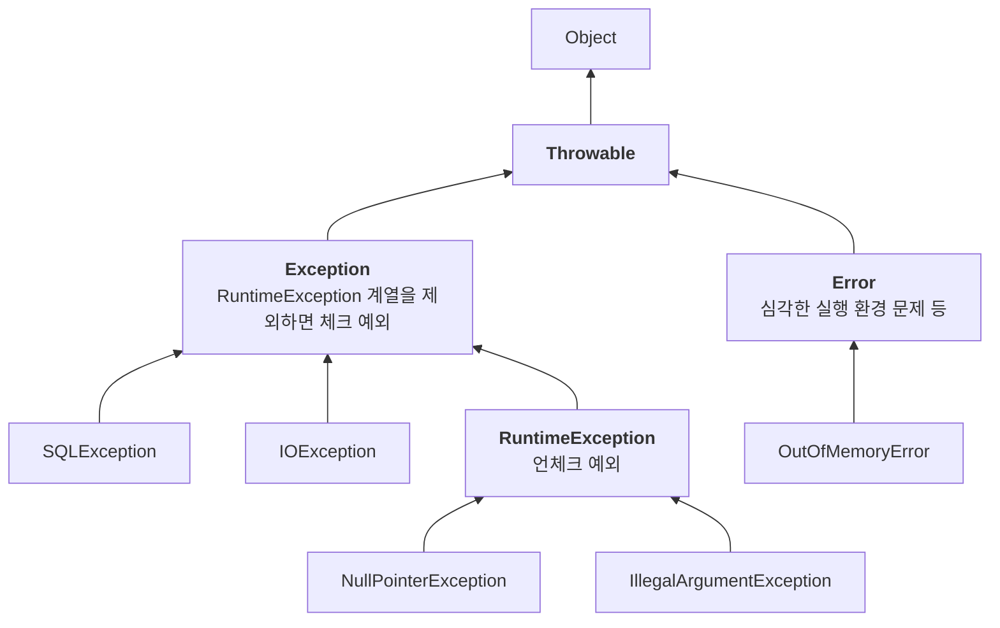
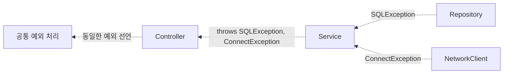
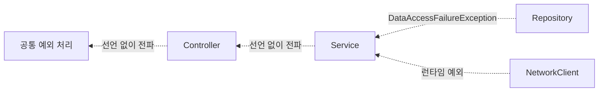

애플리케이션은 보통 컨트롤러, 서비스, 리포지토리로 역할을 나눈다. 서비스는 비즈니스 로직을 담는 곳이라, DB 접근 기술이 바뀌어도 영향을 적게 받는 것이 좋다.

그런데 JDBC 리포지토리가 `SQLException`을 그대로 던지면 서비스까지 이 예외가 올라온다. 서비스는 복구할 방법이 없는데도 예외를 처리하거나 메서드에 `throws SQLException`을 선언해야 한다. 비즈니스 로직을 담은 코드가 JDBC에 의존하는 것이다.

자바 예외의 기본 규칙부터 체크 예외와 언체크 예외의 차이, 기술 의존을 줄이는 예외 전환 전략까지 살펴보자.

---

## 예외 계층



- **Throwable**: 자바에서 던지거나 잡을 수 있는 타입의 최상위 클래스다.
- **Error**: 메모리 부족처럼 일반적인 애플리케이션 로직에서 복구하기 어려운 문제를 나타낸다. 보통 정상적인 업무 예외처럼 잡아 처리하지 않는다.
- **Exception**: 애플리케이션에서 다루는 예외의 기반 클래스다. `RuntimeException` 계열을 제외한 `Exception`과 하위 타입은 체크 예외다.
- **RuntimeException**: 컴파일러가 처리 여부를 강제하지 않는 예외다. 그 하위 타입도 언체크 예외다. `Error` 계열 역시 언체크 예외로 분류된다.

> **Throwable을 넓게 잡지 않는 이유**: 상위 타입으로 잡으면 하위 타입도 함께 잡힌다. `catch (Throwable e)`는 `Error`까지 잡으므로, 일반 업무 코드에서는 처리할 수 있는 구체적인 예외를 선택하는 편이 좋다. 프레임워크가 정리 후 다시 던지는 등 제한적인 용도로 잡는 경우는 별개다.

## 예외의 기본 규칙

예외가 발생하면 현재 실행 흐름이 중단되고, 호출 경로에서 해당 타입을 처리할 `catch`를 찾는다. 없으면 호출한 쪽으로 계속 전파된다.

1. **잡으면 해당 catch로 이동한다.** 처리 후 다시 던지지 않으면 그 예외의 전파는 멈춘다. 실패한 문장으로 돌아가 재실행하는 것은 아니다.
2. **상위 타입으로 하위 예외도 잡을 수 있다.** `catch (Exception e)`는 `RuntimeException`을 포함한 하위 예외를 잡는다. 다만 너무 넓게 잡으면 서로 다른 실패를 구분하기 어렵다.
3. **체크 예외를 전파하려면 선언이 필요하다.** `throws`에는 해당 타입이나 그 상위 타입을 선언한다. 선언 자체가 예외를 발생시키는 것은 아니며, 실제 발생에는 `throw`를 쓴다.

> **아무도 처리하지 않으면**: 일반적인 자바 실행에서는 해당 스레드의 미처리 예외 처리기로 전달되고 스레드가 종료된다. `main` 스레드의 실패가 항상 모든 스레드의 즉시 종료를 뜻하지는 않는다. 웹 요청에서는 보통 프레임워크나 서블릿 컨테이너가 예외를 받아 오류 응답을 만든다.

## 체크 예외

체크 예외는 잡거나 `throws`로 선언해야 한다. 이를 빠뜨리면 컴파일 오류가 난다.

다음은 `repository`와 SLF4J 로거 `log`가 준비되어 있다고 가정한 예제다.

```java
class MyCheckedException extends Exception {
    public MyCheckedException(String message) {
        super(message);
    }
}

class Repository {
    public void call() throws MyCheckedException {
        throw new MyCheckedException("ex");
    }
}
```

```java
// 잡아서 처리하기
public void callCatch() {
    try {
        repository.call();
    } catch (MyCheckedException e) {
        log.info("예외 처리, message={}", e.getMessage(), e);
    }
}

// 밖으로 전파하기
public void callThrow() throws MyCheckedException {
    repository.call();
}
```

| 장점 | 단점 |
| --- | --- |
| 호출자가 예외 처리를 검토하도록 컴파일러가 강제한다 | 처리할 수 없는 계층도 선언을 이어 가며 예외 타입에 의존할 수 있다 |

로그만 남긴다고 실패가 복구되는 것은 아니다. 예외를 잡고 정상 종료해도 호출자가 성공으로 오해하지 않는지 확인해야 한다.

## 언체크 예외

`RuntimeException` 계열은 잡거나 `throws`로 선언할 의무가 없다. 잡지 않으면 호출한 쪽으로 전파된다.

```java
class MyUncheckedException extends RuntimeException {
    public MyUncheckedException(String message) {
        super(message);
    }
}

class Repository {
    public void call() {
        throw new MyUncheckedException("ex");
    }
}
```

```java
public void callThrow() {
    repository.call();
}
```

언체크 예외도 `throws MyUncheckedException`으로 선언할 수 있다. 필수는 아니지만 API를 읽는 사람과 도구에 정보를 줄 수 있다. Javadoc의 `@throws`도 유용하다.

| 장점 | 단점 |
| --- | --- |
| 처리하지 않는 계층에 예외 선언을 강제하지 않는다 | 컴파일러가 처리를 강제하지 않으므로 중요한 실패를 놓칠 수 있다 |

예외 전파 자체의 동작은 같다. 핵심 차이는 잡지 않을 때 **throws 선언을 컴파일러가 요구하는지**다.

## 체크 예외가 만드는 문제

서비스가 JDBC 리포지토리와 외부 네트워크 클라이언트를 호출한다고 하자. 각각 `SQLException`, `ConnectException`을 던지며 서비스에서는 복구하지 못하는 상황이다.



### 복구할 수 없는 계층에는 선언만 남는다

SQL 문법 오류나 DB 장애는 일반적인 비즈니스 코드에서 즉시 복구하기 어렵다. 중간 계층에서 할 일이 없다면 공통 경계에서 응답과 로깅을 일관되게 처리하는 편이 낫다.

- 사용자에게 내부 SQL이나 접속 정보 대신 안전한 오류 메시지를 제공한다.
- 예상하지 못한 서버 오류에는 보통 500을 사용한다. 장애 유형에 따라 503 등 다른 상태가 적합할 수도 있다.
- 필요한 로그와 모니터링으로 운영자가 실패를 확인할 수 있게 한다.

스프링 MVC 컨트롤러 처리 중 발생한 예외는 `@ControllerAdvice`나 `@RestControllerAdvice`에서 다룰 수 있다. 다만 필터에서 발생한 예외까지 자동으로 처리하는 것은 아니므로, 예외가 발생하는 경계에 맞는 처리가 필요하다.

> **복구 가능성은 상황에 따라 다르다**: 모든 네트워크나 DB 예외가 항상 복구 불가능한 것은 아니다. 멱등성이 보장되는 작업은 제한적으로 재시도할 수 있고, 데이터 충돌은 사용자에게 다른 입력을 요청할 수 있다. 어느 계층이 무엇을 복구할 수 있는지 먼저 판단해야 한다.

### 구현 기술에 의존한다

서비스에 `throws SQLException`을 선언하면 `java.sql.SQLException`이라는 JDBC 타입을 알게 된다. 데이터 접근 기술과 예외 계약이 바뀌면 선언이 퍼진 코드도 수정해야 한다.

모든 체크 예외가 나쁜 것은 아니다. 문제는 상위 계층에서 처리할 의미도 없는 구현 세부 타입이 API를 통해 노출된다는 점이다.

> **throws Exception으로 묶으면?**: 특정 기술 타입은 숨길 수 있지만, 어떤 실패를 예상해야 하는지 정보도 흐려진다. 호출자는 여전히 광범위한 체크 예외를 처리해야 한다. 일반적인 업무 API에서는 의도에 맞는 구체적인 예외 계약이 더 낫다.

## 언체크 예외로 전환하기

호출 계층에서 복구하지 못하는 기술 예외는 데이터 접근 경계에서 런타임 예외로 전환할 수 있다. 예외 이름도 특정 기술보다 상위 계층에 필요한 의미를 표현하도록 정하면 좋다.

```java
class DataAccessFailureException extends RuntimeException {
    public DataAccessFailureException(String message, Throwable cause) {
        super(message, cause);
    }
}
```

```java
public void call() {
    try {
        runSQL();
    } catch (SQLException e) {
        throw new DataAccessFailureException("데이터 접근에 실패했습니다.", e);
    }
}
```

```java
public void logic() {
    repository.call();
    networkClient.call();
}
```

이 예제의 `runSQL()`은 `SQLException`을 던지는 작업이며, 네트워크 클라이언트도 자체 경계에서 필요한 예외 전환을 한다고 가정한다.



서비스가 예외를 직접 처리하지 않으면 기술별 예외 선언 없이 전파할 수 있다. 단, 서비스가 변환된 예외를 구체적으로 잡는다면 그 타입과 의미에는 여전히 의존한다. 단순히 런타임으로 감싸는 것만으로 모든 결합이 사라지지는 않는다.

스프링의 데이터 접근 예외 계층은 기술별 실패를 공통된 런타임 예외로 표현한다. JPA도 주요 영속성 예외에 런타임 예외를 사용한다.

### 중요한 예외는 문서화한다

컴파일러가 처리를 강제하지 않으므로 호출자가 알아야 하는 실패는 문서에 남겨야 한다. 발생 조건, 복구 가능성, 재시도 여부 등을 설명하면 단순한 타입 나열보다 도움이 된다.

Javadoc의 `@throws`나 런타임 예외의 명시적인 `throws` 선언을 활용할 수 있다. 예를 들어 스프링의 JdbcTemplate은 `DataAccessException`을 API에 드러낸다.

### 체크 예외는 언제 쓸까

이 글의 전략에서는 런타임 예외를 기본으로 두되, 호출자가 반드시 실패 가능성을 검토하게 할 이유가 있다면 체크 예외를 고려한다.

포인트 부족이나 인증 실패처럼 예상 가능한 업무 결과도 후보가 될 수 있지만, 반드시 체크 예외로 만들어야 하는 것은 아니다. 런타임 예외나 결과 타입으로 표현하는 방식도 가능하다.

체크 예외가 강제하는 것은 **잡거나 선언하는 일**이지, 올바르게 복구하는 일은 아니다. 호출자의 대응 방식과 API 성격에 맞춰 선택해야 한다.

## 예외를 전환할 때는 원인을 보존한다

예외를 감쌀 때는 원래 예외를 생성자에 전달해 원인 체인을 유지한다.

```java
catch (SQLException e) {
    throw new DataAccessFailureException("회원 저장에 실패했습니다.", e);
}
```

다음처럼 메시지만 복사하면 원래 예외의 타입과 스택 정보가 원인 체인에 남지 않는다.

```java
catch (SQLException e) {
    throw new IllegalStateException(e.getMessage());  // 원인 예외 누락
}
```

원인을 포함하면 스택 트레이스에 `Caused by: java.sql.SQLException: ...`이 함께 표시되어 실제 실패 지점을 추적할 수 있다.

> **스택 트레이스는 로거로 남긴다**: SLF4J에서 마지막 인자로 예외를 전달하면 스택 트레이스를 기록할 수 있다. 예를 들어 `log.error("회원 저장 실패", e)`처럼 쓴다. `printStackTrace()`는 기본적으로 표준 오류 스트림인 `System.err`에 출력하며, 로깅 설정과 수집 정책을 일관되게 적용하기 어려워 운영 코드에서는 로거를 사용하는 편이 좋다.

같은 예외를 모든 계층에서 반복 기록하면 로그가 중복된다. 필요한 맥락을 보존해 전파하고, 최종 처리 경계에서 기록하는 등의 정책도 함께 정한다.

---

체크 예외와 언체크 예외의 핵심 차이는 처리하지 않을 때 선언을 강제하는지에 있다. 복구할 수 없는 기술별 체크 예외를 상위 계층까지 노출하면, 처리하지도 않는 코드가 구현 기술에 의존하게 된다.

기술 예외를 경계에서 의미 있는 런타임 예외로 전환하고 원인을 보존하면 이런 의존을 줄일 수 있다. 다음으로 살펴볼 문제는 변환한 예외를 어떻게 분류하고, 스프링의 데이터 접근 예외가 이를 어떻게 돕는가다.
