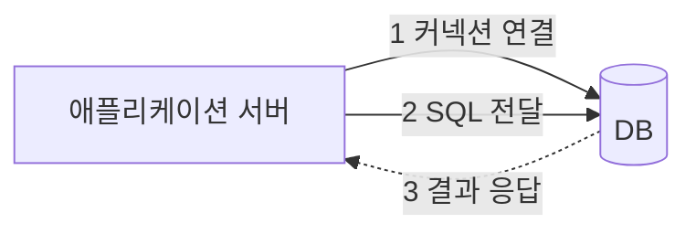
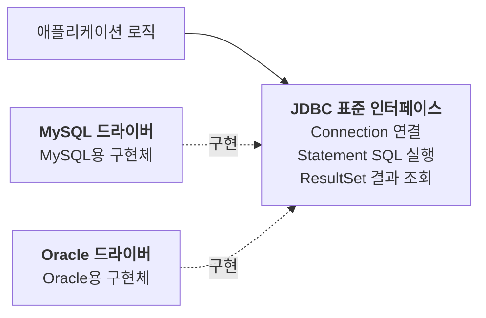
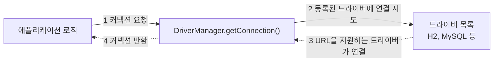
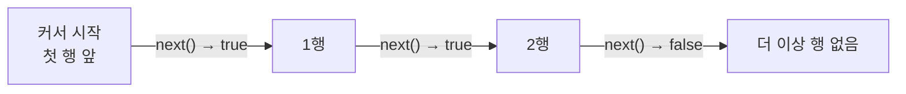

애플리케이션이 다루는 데이터는 대부분 데이터베이스에 저장된다. 회원을 가입시키고, 주문을 조회하고, 잔액을 바꾸는 일은 결국 DB에 SQL을 보내는 일이다. 자바에서 이 일을 맡는 표준 기술이 **JDBC**다.

일반적인 자바 관계형 DB 환경에서는 JPA나 MyBatis 같은 기술을 쓰더라도 내부에서 JDBC를 사용한다. 애플리케이션이 DB와 대화하는 방식부터 JDBC로 데이터를 저장하고 조회하는 기본 흐름까지 살펴보자.

---

## 애플리케이션 서버와 DB가 대화하는 방법

애플리케이션 서버가 DB를 사용할 때는 크게 세 단계를 거친다.



1. **커넥션 연결**: 주로 TCP/IP로 DB와 연결한다.
2. **SQL 전달**: 연결된 커넥션으로 실행할 SQL을 보낸다.
3. **결과 응답**: DB가 SQL을 실행하고 결과를 돌려준다. 서버는 그 결과를 받아 사용한다.

## DB마다 사용법이 다르다는 문제

이 세 단계의 구체적인 통신 방식은 DB마다 다르다. DB별 API에 직접 의존한다면 두 가지 문제가 생긴다.

- DB를 바꾸면 애플리케이션의 DB 접근 코드도 함께 바꿔야 한다.
- 개발자가 DB마다 연결하고 SQL을 보내는 방법을 새로 배워야 한다.

## JDBC 표준 인터페이스

**JDBC**(Java Database Connectivity)는 자바에서 DB에 접근하기 위한 표준 API다. 주요 작업을 다음 인터페이스로 제공한다.

| 인터페이스 | 역할 |
| --- | --- |
| `java.sql.Connection` | DB 연결과 트랜잭션 제어 |
| `java.sql.Statement` | SQL 실행 |
| `java.sql.ResultSet` | 조회 결과 읽기 |

인터페이스만으로는 동작하지 않는다. 실제 구현은 DB에 맞는 라이브러리가 제공한다. 이를 **JDBC 드라이버**라고 한다. MySQL에 접근하려면 MySQL용 드라이버를, Oracle에 접근하려면 Oracle용 드라이버를 쓴다.



애플리케이션은 DB별 구현체 대신 JDBC 인터페이스를 사용한다. 덕분에 DB를 바꾸더라도 연결하고 SQL을 실행하는 기본 코드는 상당 부분 유지할 수 있다. 개발자도 JDBC 사용법을 공통으로 활용한다.

> **표준화의 한계**: 드라이버만 바꾸면 모든 변경이 끝나는 것은 아니다. 접속 URL과 설정을 바꿔야 하고, SQL 문법이나 데이터 타입도 확인해야 한다. 특히 페이징 SQL 등은 DB마다 다를 수 있다. JPA는 DB 방언을 통해 이런 차이를 상당 부분 흡수하지만, 모든 차이를 없애 주지는 않는다.

## JDBC를 편하게 쓰는 기술

JDBC는 1997년에 등장한 오래된 기술이다. 직접 쓰면 반복 코드가 많아, 보통은 이를 줄여 주는 상위 기술을 사용한다.

| 방식 | 대표 기술 | 특징 |
| --- | --- | --- |
| SQL 중심 접근 | JdbcTemplate, MyBatis | 개발자가 SQL을 작성하고, 실행과 결과 매핑 등의 도움을 받는다 |
| ORM | JPA 구현체인 Hibernate, EclipseLink | 객체와 테이블의 매핑을 바탕으로 SQL 생성과 객체 관리를 맡긴다 |

MyBatis는 SQL 매퍼이고, JdbcTemplate은 JDBC의 반복 작업을 줄이는 도구다. 둘 다 SQL을 직접 제어한다는 공통점이 있다. ORM은 객체 중심으로 개발할 수 있지만, 제대로 사용하려면 SQL과 매핑, 영속성 관리에 대한 이해가 필요하다.

> **기본 원리는 JDBC**: 이 글에서 다루는 관계형 DB 접근 환경에서는 이런 기술도 내부적으로 JDBC를 사용한다. JDBC를 알아 두면 상위 기술이 무엇을 대신 처리하는지 이해하고 문제의 원인을 찾는 데 도움이 된다.

## 커넥션 얻기

가장 기본적인 방법은 `DriverManager`를 사용하는 것이다. 접속 URL과 사용자 이름, 비밀번호를 넘기면 커넥션을 반환한다.

```java
Connection con = DriverManager.getConnection(
        "jdbc:h2:tcp://localhost/~/test",  // 접속 URL
        "sa",                            // 사용자 이름
        "");                             // 비밀번호
```

예제는 H2 서버가 실행 중이고 해당 DB에 접속할 수 있다고 가정한다. 반환 타입은 `Connection`이지만 실제 객체는 드라이버가 제공하는 구현체다. H2에서는 `org.h2.jdbc.JdbcConnection` 같은 객체가 반환된다.

애플리케이션은 구현체의 구체적인 타입을 몰라도 `Connection` 인터페이스로 사용할 수 있다.

### DriverManager가 드라이버를 고르는 방법



1. 애플리케이션이 `DriverManager.getConnection()`을 호출한다.
2. `DriverManager`가 등록된 드라이버를 순서대로 확인하며 연결을 시도한다.
3. 각 드라이버는 URL을 지원하는지 판단한다. H2 드라이버는 `jdbc:h2:` URL을 처리하고, 지원하지 않는 드라이버는 다음 드라이버로 넘길 수 있도록 `null`을 반환한다.
4. 연결에 성공하면 `DriverManager`가 커넥션을 애플리케이션에 반환한다.

현대적인 JDBC 드라이버는 보통 서비스 제공자 메커니즘을 통해 자동 로딩된다. 예를 들어 의존성 버전이 별도로 관리되는 Gradle 프로젝트라면 다음처럼 H2 드라이버를 추가할 수 있다.

```groovy
runtimeOnly 'com.h2database:h2'
```

실무에서는 커넥션 풀을 사용하는 `DataSource`로 커넥션을 얻는 경우가 많다. 여기서는 JDBC의 기본 흐름에 집중한다.

## JDBC로 데이터 다루기

저장, 조회, 수정, 삭제의 기본 흐름은 비슷하다.

1. 커넥션을 얻는다.
2. SQL을 준비하고 파라미터를 채운다.
3. SQL을 실행한다.
4. 조회라면 결과를 읽는다.
5. 사용한 자원을 닫는다.

데이터를 저장하는 코드로 확인해 보자. 아래 예제는 `member(member_id, money)` 테이블과 `Member` 객체, 커넥션을 반환하는 `getConnection()`이 준비되어 있다고 가정한다.

```java
public Member save(Member member) throws SQLException {
    String sql = "insert into member(member_id, money) values(?, ?)";

    Connection con = null;
    PreparedStatement pstmt = null;

    try {
        con = getConnection();
        pstmt = con.prepareStatement(sql);
        pstmt.setString(1, member.getMemberId());
        pstmt.setInt(2, member.getMoney());
        pstmt.executeUpdate();
        return member;
    } finally {
        close(con, pstmt, null);
    }
}
```

### 파라미터 바인딩

SQL에서 값이 들어갈 자리는 `?`로 비워 두고, `setString()`, `setInt()`처럼 타입에 맞는 메서드로 채운다. 첫 번째 인자는 몇 번째 `?`인지를 뜻하고, **1부터 센다**.

> **PreparedStatement를 쓰는 이유**: `PreparedStatement`는 `Statement`를 상속하며 파라미터 바인딩을 지원한다. 사용자 입력을 SQL 문자열에 이어 붙이면 SQL 인젝션에 노출될 수 있다. 바인딩한 값은 SQL 코드가 아닌 데이터로 처리된다. 다만 테이블명이나 정렬 방향 등 SQL 구조를 입력으로 조립하는 부분까지 보호해 주는 것은 아니므로 별도 검증이 필요하다.

### SQL 실행

SQL의 종류에 따라 실행 메서드가 다르다.

| 메서드 | 주로 사용하는 SQL | 반환값 |
| --- | --- | --- |
| `executeUpdate()` | `insert`, `update`, `delete` | 영향받은 행의 수 (`int`) |
| `executeQuery()` | `select` | 조회 결과 (`ResultSet`) |

`executeUpdate()`의 반환값으로 처리된 행 수를 확인할 수 있다. 일반적인 단일 행 insert는 1을 반환한다. 다만 update의 행 수가 변경된 행 기준인지 조건에 일치한 행 기준인지는 DB와 드라이버 설정에 따라 차이가 있을 수 있다.

### 조회 결과 읽기

조회 SQL을 실행하면 `ResultSet`을 얻는다. 이를 통해 조회 결과를 행 단위로 읽는다. 내부의 **커서**는 현재 읽을 행을 가리킨다.

```java
ResultSet rs = pstmt.executeQuery();

if (rs.next()) {
    String memberId = rs.getString("member_id");
    int money = rs.getInt("money");
}
```

처음에 커서는 첫 행 앞에 있다. `rs.next()`를 한 번 호출해야 첫 행을 읽을 수 있다.



- `rs.next()`: 다음 행으로 이동한다. 읽을 행이 있으면 `true`, 없으면 `false`다.
- `rs.getString("컬럼명")`, `rs.getInt("컬럼명")`: 현재 행의 컬럼 값을 지정한 타입으로 읽는다.

기본 키로 조회하면 결과가 많아야 한 행이므로 `if`로 충분하다. 여러 행을 읽을 때는 `while (rs.next())`로 반복한다. 위 코드는 결과 읽기 부분만 발췌한 것으로, 실제 사용 시에는 `ResultSet`도 닫아야 한다.

## 자원 정리

커넥션, `PreparedStatement`, `ResultSet`은 다 쓰면 닫아야 한다. 닫지 않으면 DB 연결이나 관련 자원이 해제되지 않는 **리소스 누수**가 생길 수 있다. 누적되면 커넥션 부족 등 장애로 이어진다.

기본적인 정리 순서는 연 순서의 역순이다. `ResultSet` → `PreparedStatement` → `Connection` 순으로 닫는다.

```java
private void close(Connection con, Statement stmt, ResultSet rs) {
    if (rs != null) {
        try { rs.close(); } catch (SQLException e) { log.info("error", e); }
    }
    if (stmt != null) {
        try { stmt.close(); } catch (SQLException e) { log.info("error", e); }
    }
    if (con != null) {
        try { con.close(); } catch (SQLException e) { log.info("error", e); }
    }
}
```

`log`는 로거가 선언되어 있다고 가정한다. 예외가 발생해도 정리하도록 `finally`에서 호출하고, 하나를 닫다가 실패해도 나머지를 닫을 수 있도록 각각 예외를 처리한다.

### try-with-resources 사용하기

JDBC 자원은 `AutoCloseable`을 구현하므로 직접 정리 코드를 쓰는 대신 try-with-resources를 사용할 수 있다. 앞의 저장 코드를 이렇게 줄일 수 있다.

```java
public Member save(Member member) throws SQLException {
    String sql = "insert into member(member_id, money) values(?, ?)";

    try (Connection con = getConnection();
         PreparedStatement pstmt = con.prepareStatement(sql)) {
        pstmt.setString(1, member.getMemberId());
        pstmt.setInt(2, member.getMoney());
        pstmt.executeUpdate();
        return member;
    }
}
```

블록을 벗어나면 선언의 역순으로 자원을 닫는다. 예외가 발생한 경우에도 정리가 이뤄진다. 커넥션 풀의 커넥션이라면 `close()`는 일반적으로 물리 연결 종료가 아니라 풀 반환을 뜻한다.

> **트랜잭션과 커넥션 수명**: 위 코드는 메서드가 커넥션을 직접 얻고 닫는 단순한 예제다. 여러 작업이 하나의 트랜잭션을 공유한다면 커넥션 수명도 그 경계에 맞춰 관리해야 한다. 스프링의 트랜잭션 관리를 사용할 때는 프레임워크가 제공하는 자원 관리 방식을 따른다.

---

JDBC는 DB마다 다른 접근 방식을 `Connection`, `Statement`, `ResultSet` 같은 표준 인터페이스 뒤로 숨겼다. 애플리케이션은 커넥션을 얻고, SQL을 준비해 실행하고, 결과를 읽고, 자원을 닫는 공통 흐름으로 데이터를 다룬다.

직접 써 보면 커넥션을 얻고 자원을 정리하는 코드가 메서드마다 반복된다. JdbcTemplate이나 JPA 같은 상위 기술이 무엇을 줄여 주는지는, 이 기본 흐름을 알고 나면 더 분명하게 보인다.
