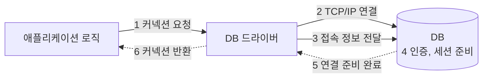
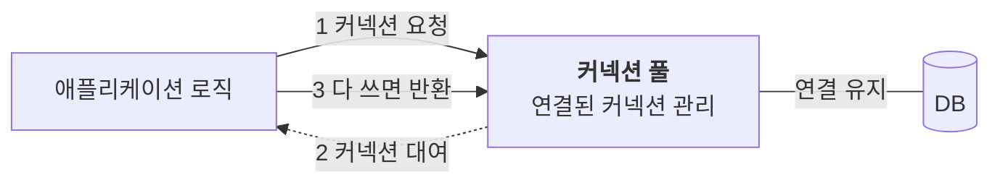
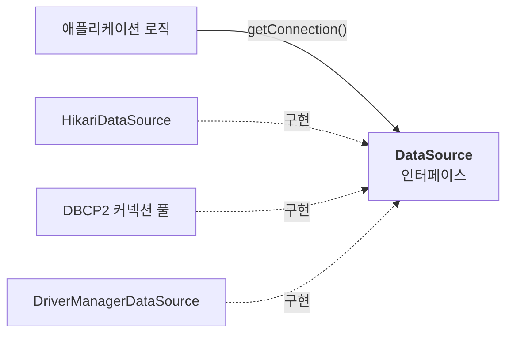

JDBC로 DB를 쓸 때 가장 먼저 하는 일은 커넥션을 얻는 것이다. `DriverManager.getConnection()`은 일반적으로 호출할 때마다 새 커넥션을 만든다. 요청이 많은 서버에서는 이 비용이 성능 문제가 된다.

이 비용을 줄이는 **커넥션 풀**과, 커넥션을 얻는 방법을 하나로 추상화한 **DataSource**를 살펴보자.

---

## 커넥션을 새로 만드는 비용

네트워크로 DB에 접속할 때는 생각보다 많은 일이 일어난다.



1. 애플리케이션이 DB 드라이버에 커넥션을 요청한다.
2. 드라이버가 DB와 네트워크 연결을 맺는다. TCP 연결이라면 3-way handshake 등의 과정이 필요하다.
3. DB 프로토콜에 따라 사용자 이름과 인증 정보 등을 주고받는다.
4. DB가 인증하고 세션을 준비한다.
5. 연결을 사용할 준비가 끝난다.
6. 드라이버가 커넥션 객체를 애플리케이션에 반환한다.

구체적인 순서는 DB와 인증 방식에 따라 다르다. 중요한 점은 요청마다 이 과정을 반복하면 SQL 실행 전 대기 시간이 늘고, DB와 애플리케이션 양쪽에서 연결을 만들고 정리하는 자원을 쓴다는 것이다.

> **얼마나 걸릴까**: 연결 시간은 네트워크 거리, TLS, 인증 방식과 DB 상태 등에 따라 달라진다. 고정된 수치보다는 실제 환경에서 측정해야 하지만, 이미 연결된 커넥션을 빌리는 것보다 비용이 크다는 점은 같다.

## 커넥션 풀

해결책은 커넥션을 **만들어 두고 돌려 쓰는 것**이다. 여러 커넥션을 보관하고 대여와 반환을 관리하는 저장소를 **커넥션 풀**이라고 한다. 시작 시점이나 필요할 때 연결을 만들고, 설정에 따라 일정 수의 유휴 커넥션을 유지한다.



- 사용 가능한 커넥션이 있으면 새로 연결하지 않고 빌린다.
- 다 쓴 커넥션은 보통 물리 연결을 끊지 않고 풀에 반환한다.
- 모두 사용 중이면 반환을 기다린다. 설정된 대기 시간을 넘기면 커넥션 획득에 실패할 수 있다.
- 만료되거나 정상적으로 동작하지 않는 커넥션은 제거하고 필요에 따라 새로 만든다.

최대 커넥션 수를 정하면 애플리케이션 인스턴스 하나가 사용할 연결 수에 상한이 생긴다. 다만 풀만으로 DB 과부하를 막을 수 있는 것은 아니다. 서버 인스턴스 수, SQL 실행 시간, DB 처리 능력을 함께 고려해 크기를 정해야 한다.

> **어떤 풀을 쓸까**: 직접 구현하기보다 HikariCP, Apache Commons DBCP2, Tomcat JDBC Pool 같은 검증된 구현체를 사용한다. 스프링 부트는 일반적인 JDBC 스타터 구성에서 HikariCP를 우선 선택한다. 의존성이나 명시적 설정에 따라 다른 풀을 사용할 수도 있다.

## DataSource

커넥션을 얻는 방법은 여러 가지다. `DriverManager`로 새로 만들 수도 있고, HikariCP 같은 풀에서 빌릴 수도 있다. 애플리케이션이 각 구현체의 사용법에 직접 의존하면 방식을 바꿀 때 코드도 수정해야 한다.

자바는 이 연결 획득 기능을 `javax.sql.DataSource` 인터페이스로 추상화한다. 핵심 메서드만 보면 다음과 같다.

```java
public interface DataSource {
    Connection getConnection() throws SQLException;
}
```



- 주요 커넥션 풀은 `DataSource` 구현체를 제공한다.
- `DriverManager` 자체는 `DataSource`를 구현하지 않는다. 스프링은 이를 내부적으로 사용하는 `DriverManagerDataSource`를 제공한다.
- 애플리케이션은 `DataSource`에 의존하고, 구성하는 쪽에서 구현체를 선택한다.

> **패키지 이름**: `DataSource`는 자바 표준 API이므로 `javax.sql.DataSource`를 사용한다. 스프링 부트 3에서도 `jakarta.sql`로 바꾸지 않는다.

### 설정과 사용의 분리

`DriverManager`를 직접 쓰는 기본 형태는 호출할 때 접속 정보를 넘긴다.

```java
DriverManager.getConnection(URL, USERNAME, PASSWORD);
DriverManager.getConnection(URL, USERNAME, PASSWORD);
```

`DataSource` 구현체에는 미리 접속 정보를 설정하고, 사용하는 곳에서는 `getConnection()`만 호출할 수 있다.

```java
// 설정
DataSource dataSource = new DriverManagerDataSource(URL, USERNAME, PASSWORD);

// 사용
Connection con1 = dataSource.getConnection();
Connection con2 = dataSource.getConnection();
```

위 코드는 연결 획득 부분만 보여 준다. 실제로는 얻은 커넥션을 반드시 닫아야 한다. `DriverManagerDataSource`는 풀을 제공하지 않으므로 두 호출은 각각 새 연결을 만든다.

리포지토리에 `DataSource`를 주입하면 접속 URL과 비밀번호를 리포지토리에서 분리할 수 있다. 접속 설정이나 풀 구현체를 바꾸는 작업도 구성 코드에 모인다.

## HikariCP 커넥션 풀 쓰기

HikariCP는 `HikariDataSource`라는 구현체를 제공한다. 다음 예제는 접속 정보와 HikariCP 의존성이 준비되어 있다고 가정한다.

```java
try (HikariDataSource dataSource = new HikariDataSource()) {
    dataSource.setJdbcUrl(URL);
    dataSource.setUsername(USERNAME);
    dataSource.setPassword(PASSWORD);
    dataSource.setMaximumPoolSize(10);
    dataSource.setPoolName("MyPool");

    try (Connection con = dataSource.getConnection()) {
        // SQL 실행
    } // 커넥션 반환
} // 예제 종료 시 풀 종료
```

웹 애플리케이션에서는 요청마다 풀을 만들지 않는다. 풀은 애플리케이션 수명 동안 공유하고 종료할 때 닫는다. 위 코드는 독립 실행 예제에서 자원 수명을 보여 주기 위한 것이다. 스프링 빈으로 관리하면 일반적으로 컨테이너가 풀 종료도 관리한다.

### 초기화와 반환

- **풀을 채우는 시점은 설정에 따라 다르다.** HikariCP는 백그라운드에서 연결을 보충하지만, 초기화나 첫 연결 확인에는 호출 스레드가 기다릴 수 있다. 시작하자마자 최대 개수의 커넥션이 모두 준비된다고 가정하면 안 된다.
- **빌린 커넥션은 프록시다.** HikariCP는 실제 연결을 감싼 프록시를 반환한다. 프록시의 `close()`는 보통 물리 연결을 종료하는 대신 풀에 돌려준다. 사용자는 풀 여부와 관계없이 빌린 커넥션을 닫아야 한다.

### 풀 상태 확인하기

디버그 로그 등에서 다음과 같은 상태를 확인할 수 있다. 출력 형식과 시점은 버전에 따라 달라진다.

```text
MyPool - Pool stats (total=10, active=2, idle=8, waiting=0)
```

| 항목 | 뜻 |
| --- | --- |
| `total` | 풀이 관리하는 전체 커넥션 수 |
| `active` | 대여 중인 커넥션 수 |
| `idle` | 사용 가능한 유휴 커넥션 수 |
| `waiting` | 커넥션 획득을 기다리는 스레드 수 |

## 리포지토리에 DataSource 적용하기

리포지토리는 `DataSource`를 생성자로 주입받고, 커넥션이 필요할 때 `getConnection()`을 호출한다.

```java
public class MemberRepository {

    private final DataSource dataSource;

    public MemberRepository(DataSource dataSource) {
        this.dataSource = dataSource;
    }

    // save(), findById(), update(), delete() ...

    private Connection getConnection() throws SQLException {
        return dataSource.getConnection();
    }

    private void close(Connection con, Statement stmt, ResultSet rs) {
        JdbcUtils.closeResultSet(rs);
        JdbcUtils.closeStatement(stmt);
        JdbcUtils.closeConnection(con);
    }
}
```

`JdbcUtils`는 스프링이 제공하는 편의 클래스다. `null` 확인과 닫는 과정의 예외 처리를 맡긴다. 직접 `finally`에서 정리하는 구조라면 위 메서드를 사용하고, 단순한 자원 수명에서는 try-with-resources를 써도 된다.

어떤 구현체를 넣느냐에 따라 연결 획득 방식이 달라진다.

| 주입한 DataSource | 동작 |
| --- | --- |
| `DriverManagerDataSource` | 호출할 때마다 새 커넥션을 만든다 |
| `HikariDataSource` | 풀에서 커넥션을 빌리고, 반환된 연결을 재사용한다 |

순서대로 메서드를 호출하더라도 항상 같은 물리 커넥션을 받는다는 보장은 없다. 중요한 것은 특정 연결의 반복 사용 여부가 아니라, 연결을 매번 새로 만들지 않고 풀에서 관리한다는 점이다. 동시에 처리되는 요청은 각자 커넥션을 빌려 사용한다.

> **트랜잭션을 적용할 때**: 위 예제는 직접 커넥션을 얻고 닫는 구조다. 스프링이 관리하는 트랜잭션에 참여하려면 JdbcTemplate이나 `DataSourceUtils` 등 트랜잭션을 인식하는 접근 방식을 사용해야 한다. `DataSource`를 주입하는 것만으로 트랜잭션 참여가 자동 보장되지는 않는다.

> **DI와 OCP**: `DriverManagerDataSource`에서 `HikariDataSource`로 바꿔도 리포지토리의 연결 획득 코드는 그대로다. 리포지토리가 구현체가 아니라 `DataSource` 인터페이스에 의존하고, 구현체의 선택을 주입하는 쪽에 맡겼기 때문이다.

---

커넥션 풀은 연결을 반복해서 만드는 비용을 줄인다. 한 번 만든 연결을 재사용하되, 필요에 따라 보충하거나 교체하며 관리한다.

`DataSource`는 커넥션을 어디서 어떻게 가져오는지 인터페이스 뒤로 숨긴다. 리포지토리는 `getConnection()`을 사용하고, 연결 획득 방식은 구성하는 쪽에서 선택한다. 역할과 구현의 분리가 데이터 접근에도 그대로 적용되는 셈이다.
