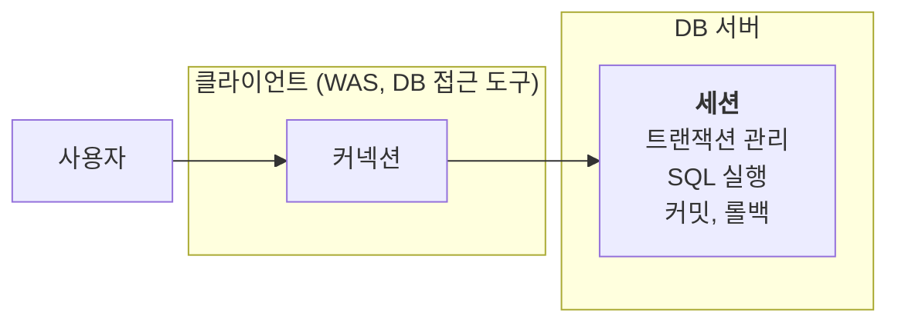
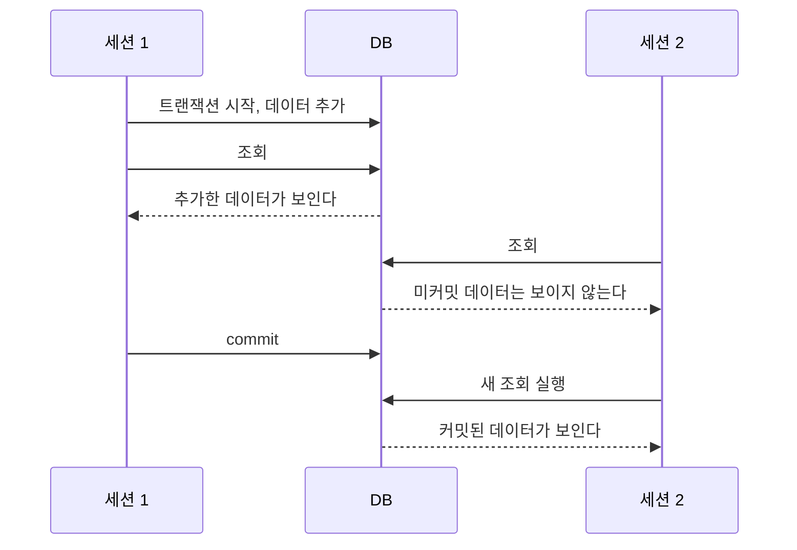
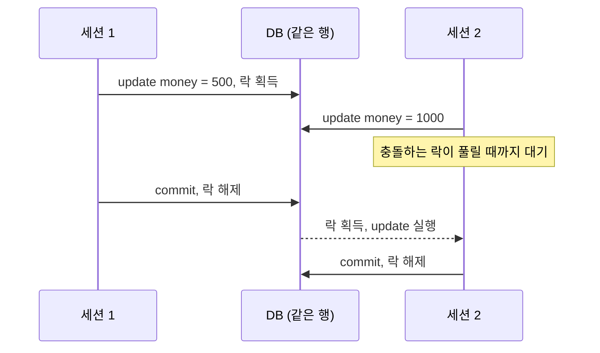
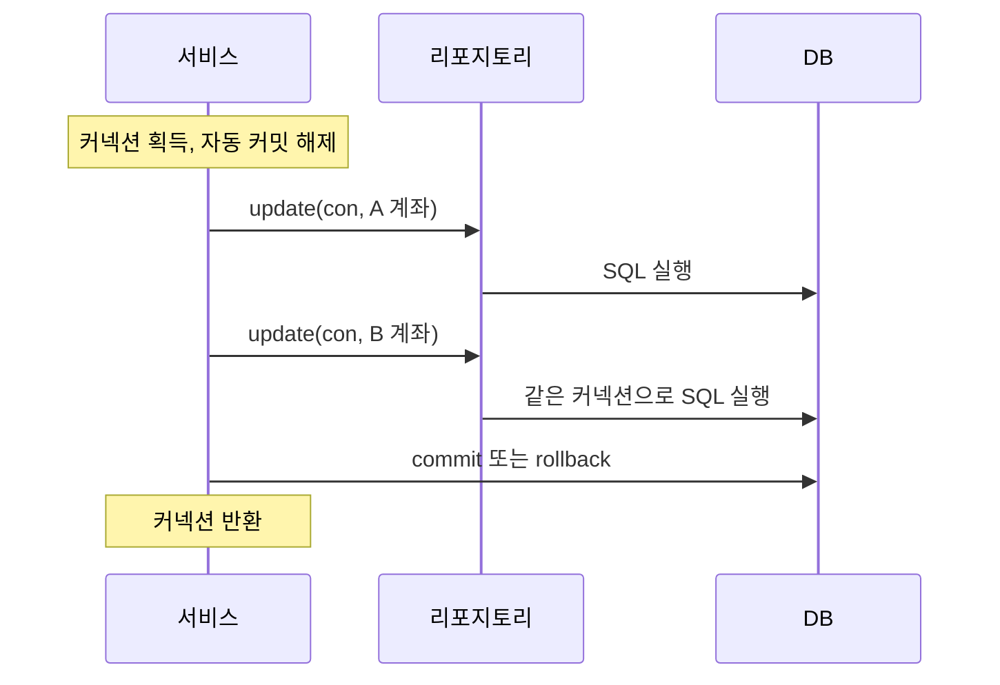

JDBC로 커넥션을 얻고 SQL을 실행하는 법을 알았다면, 다음 문제는 여러 SQL을 하나의 작업으로 묶는 것이다. 계좌이체처럼 두 SQL이 모두 성공하거나 모두 취소돼야 하는 일이 있다. 이때 필요한 것이 **트랜잭션**이다.

트랜잭션이 DB 안에서 어떻게 동작하는지, 같은 데이터를 동시에 고칠 때 락이 무슨 일을 하는지, JDBC 코드에는 어떻게 적용하는지 살펴보자.

---

## 트랜잭션이란

A가 B에게 5000원을 보낸다고 하자. DB에서는 두 작업이 일어난다.

1. A의 잔고를 5000원 줄인다.
2. B의 잔고를 5000원 늘린다.

1번은 성공했는데 2번이 실패하면 A의 돈만 사라진다. 두 작업은 함께 성공하거나 함께 실패해야 한다.

**트랜잭션**은 이처럼 작업을 하나의 단위로 묶는다.

- 성공하면 **커밋**(commit)으로 변경을 확정한다.
- 실패하면 **롤백**(rollback)으로 해당 트랜잭션의 변경을 취소한다.

## 트랜잭션이 보장하는 것, ACID

트랜잭션의 네 가지 성질을 머리글자를 따서 ACID라고 부른다.

| 성질 | 뜻 |
| --- | --- |
| 원자성(Atomicity) | 트랜잭션의 변경은 모두 반영되거나 모두 취소된다 |
| 일관성(Consistency) | 올바른 트랜잭션은 DB를 유효한 상태에서 다른 유효한 상태로 옮긴다 |
| 격리성(Isolation) | 동시 실행 간 간섭을 선택한 격리 수준에 따라 제한한다 |
| 지속성(Durability) | 커밋한 결과는 DB가 제공하는 복구 보장에 따라 유지된다 |

일관성은 DB 제약 조건만으로 완성되지 않는다. 잔고나 이체 금액 같은 업무 규칙은 애플리케이션도 올바르게 검증해야 한다.

격리성은 동시 처리 성능과 맞물린다. 모든 작업을 실제로 하나씩 실행해야만 격리할 수 있는 것은 아니지만, 더 엄격한 보장을 제공하려면 추가 제어가 필요하다. 이를 선택하는 기준이 **격리 수준**이다.

| 격리 수준 | 주요 의미 |
| --- | --- |
| `READ UNCOMMITTED` | 커밋되지 않은 변경을 읽는 것을 허용한다 |
| `READ COMMITTED` | 커밋되지 않은 변경은 읽지 않는다. 같은 조회의 결과는 달라질 수 있다 |
| `REPEATABLE READ` | 읽었던 행의 값이 같은 트랜잭션에서 달라지는 현상을 방지한다 |
| `SERIALIZABLE` | 트랜잭션을 차례로 실행한 것과 같은 결과를 보장한다 |

일반적으로 보장이 강할수록 동시 처리에 제약이 생길 수 있지만, 실제 성능은 DB 구현과 작업에 따라 다르다. 기본 격리 수준도 DB마다 다르다. 이 글의 가시성 예제는 **READ COMMITTED**를 기준으로 한다.

## 커넥션과 세션

트랜잭션의 동작을 이해하려면 **세션**을 알아야 한다.



- 일반적인 직접 연결에서는 물리 커넥션에 대응하는 DB 세션이 만들어진다.
- 그 연결로 전달한 SQL과 트랜잭션 제어는 해당 세션에서 처리한다.
- 물리 연결이 종료되면 세션도 종료된다. 풀의 커넥션을 반환하는 것은 물리 연결 종료와 다르다.

단순한 연결 구조에서 풀에 물리 커넥션이 10개 있다면 DB에도 대응하는 세션이 유지된다. JDBC의 로컬 트랜잭션은 같은 커넥션을 통해 제어한다.

## 커밋 전의 변경은 다른 세션에 보이지 않는다

READ COMMITTED에서는 자신이 바꾼 데이터를 같은 트랜잭션에서 읽을 수 있지만, 다른 트랜잭션은 그 미커밋 변경을 읽지 않는다.



위 흐름은 일반 조회가 이전 커밋 버전을 읽는 MVCC 방식의 예다. DB의 구현과 조회 방식에 따라 커밋을 기다릴 수도 있다.

- **커밋하면** 변경이 확정되고 다른 트랜잭션이 격리 수준에 따라 읽을 수 있다.
- **롤백하면** 자신의 트랜잭션에서 수행한 변경을 취소한다. DB 전체를 과거 시점으로 돌리는 것은 아니다.

> **왜 숨길까**: 다른 트랜잭션이 미커밋 데이터를 읽고 작업했는데 원래 트랜잭션이 롤백하면, 취소된 데이터를 근거로 처리한 셈이 된다. 이를 더티 리드라고 한다.

## 자동 커밋과 수동 커밋

JDBC 커넥션의 기본 모드는 자동 커밋이다. SQL 문장을 개별 트랜잭션으로 처리하므로, 여러 문장을 하나로 묶으려면 자동 커밋을 끈다.

다음은 H2에서 확인할 수 있는 SQL 예제다. 커밋 모드를 설정하는 문법은 DB나 접근 도구에 따라 다르다.

```sql
-- 자동 커밋
set autocommit true;
insert into member(member_id, money) values ('data1', 10000);
insert into member(member_id, money) values ('data2', 10000);

-- 수동 커밋
set autocommit false;
insert into member(member_id, money) values ('data3', 10000);
insert into member(member_id, money) values ('data4', 10000);
commit;
```

JDBC에서는 `con.setAutoCommit(false)`로 여러 SQL을 묶을 준비를 한다. 실제 DB 트랜잭션이 시작되는 시점은 드라이버와 DB에 따라 첫 SQL 실행 시점일 수 있다.

이후 `commit()`이나 `rollback()`으로 경계를 명확히 끝내야 한다. 수동 커밋 모드는 다음 트랜잭션에도 유지된다.

> **자동 롤백을 기대하면 안 된다**: 트랜잭션을 방치하면 항상 일정 시간 뒤 자동 취소되는 것은 아니다. 유휴 트랜잭션, 문장 실행, 락 대기 타임아웃은 서로 다른 설정이다. 애플리케이션이 직접 종료를 보장해야 한다.

## 중간에 실패하면 롤백한다

계좌이체 도중 두 번째 SQL이 실패하는 상황을 보자.

```sql
set autocommit false;
update member set money = money - 2000 where member_id = 'memberA';
update member set money = money + 2000 where member_iddd = 'memberB'; -- 컬럼 이름 오류
rollback;
```

첫 SQL은 성공하고 두 번째는 컬럼 이름 오류로 실패한다. 이때 애플리케이션은 계좌이체 전체를 실패로 보고 롤백해야 한다.

> **오류 뒤 동작은 DB마다 다르다**: 일부 DB는 실패한 문장만 취소하고 앞선 변경의 커밋을 허용한다. 다른 DB는 트랜잭션 전체를 실패 상태로 만든다. 어느 쪽이든 실패를 감지하면 해당 작업을 롤백하는 것이 기본 원칙이다.

## 락: 같은 데이터를 동시에 수정할 때

한 트랜잭션이 수정 중인 행을 다른 트랜잭션도 수정하려 하면 충돌이 생긴다. DB는 **락**(lock) 등 동시성 제어를 통해 이를 조정한다.

다음은 같은 행의 수정이 락으로 직렬화되는 일반적인 예다.



보통 변경에 사용한 락은 커밋이나 롤백까지 유지된다. 실제 잠금 범위는 DB와 실행 계획에 따라 행, 인덱스 범위, 테이블 등으로 달라질 수 있다.

락 대기는 타임아웃으로 실패할 수 있고, 서로 필요한 락을 잡고 기다리는 **데드락**도 생길 수 있다. H2에서는 다음과 같이 락 대기 제한을 밀리초 단위로 설정할 수 있다.

```sql
set lock_timeout 10000;
```

### 조회할 때 락 걸기

MVCC를 사용하는 DB의 일반 조회는 보통 수정 중인 행을 기다리지 않고 읽을 수 있는 버전을 조회한다. 하지만 조회한 값을 기준으로 계산한 뒤 저장하려면, 계산하는 사이 다른 작업이 값을 바꾸지 못하게 해야 할 수 있다.

이때 사용할 수 있는 방법이 `select ... for update`다.

```sql
set autocommit false;
select * from member where member_id = 'memberA' for update;
```

조회한 행에 변경과 충돌하는 락을 걸어 다른 트랜잭션의 수정을 제어한다. 락은 일반적으로 커밋이나 롤백까지 유지된다. 다른 세션의 모든 읽기까지 막는다는 뜻은 아니다.

## 애플리케이션에 트랜잭션 적용하기

리포지토리가 SQL마다 새 자동 커밋 커넥션을 사용하면, A의 잔고를 줄인 뒤 실패했을 때 앞선 변경을 되돌릴 수 없다. 로컬 JDBC 트랜잭션에서는 다음을 지킨다.

- **비즈니스 작업 전체를 트랜잭션 경계로 삼는다.** 보통 서비스 계층에서 경계를 정한다.
- **같은 트랜잭션의 SQL은 같은 커넥션을 사용한다.**



다음은 서비스가 직접 커넥션을 관리하는 학습용 예제다. `dataSource`, `memberRepository`가 준비되어 있고, 빌린 커넥션의 초기 모드는 자동 커밋이라고 가정한다.

```java
public void accountTransfer(String fromId, String toId, int money)
        throws SQLException {
    try (Connection con = dataSource.getConnection()) {
        con.setAutoCommit(false);
        try {
            bizLogic(con, fromId, toId, money);
            con.commit();
        } catch (SQLException | RuntimeException | Error e) {
            try {
                con.rollback();
            } catch (SQLException rollbackError) {
                e.addSuppressed(rollbackError);
            }
            // 롤백 실패 시에는 자동 커밋으로 전환하지 않는다.
            // 미완료 작업이 의도치 않게 커밋될 수 있기 때문이다.
            throw e;
        }
        con.setAutoCommit(true);
    }
}
```

성공하면 커밋 후 자동 커밋을 복원하고, 실패하면 롤백을 시도한 뒤 예외를 전달한다. 롤백 실패도 원래 예외에 첨부해 놓치지 않는다. 커넥션은 try-with-resources로 반환한다.

실패 경로의 연결 상태 초기화나 폐기는 사용하는 풀의 정책도 확인해야 한다. 특히 롤백 자체가 실패했다면 해당 연결을 재사용해도 되는지 판단이 필요하다. 실제 서비스에서는 이런 처리를 직접 반복 구현하기보다 검증된 트랜잭션 관리자를 사용하는 편이 안전하다.

### 원자성만으로 동시 수정까지 해결되지는 않는다

단순히 두 계좌를 읽고 계산한 값을 저장하면, 다른 이체가 중간에 잔고를 바꿔 갱신 내용이 유실될 수 있다. 이 예제에서는 두 계좌를 `for update`로 읽고, 잔고를 확인한 뒤 수정한다.

```java
private void bizLogic(Connection con, String fromId, String toId, int money)
        throws SQLException {
    if (money <= 0 || fromId.equals(toId)) {
        throw new IllegalArgumentException("이체 금액과 계좌를 확인해야 합니다.");
    }

    // 반대 방향 이체도 같은 순서로 잠그도록 계좌 ID 순서를 맞춘다.
    String firstId = fromId.compareTo(toId) < 0 ? fromId : toId;
    String secondId = firstId.equals(fromId) ? toId : fromId;
    Member first = memberRepository.findByIdForUpdate(con, firstId);
    Member second = memberRepository.findByIdForUpdate(con, secondId);

    Member from = firstId.equals(fromId) ? first : second;
    Member to = firstId.equals(toId) ? first : second;
    if (from.getMoney() < money) {
        throw new IllegalStateException("잔고가 부족합니다.");
    }

    int toMoney = Math.addExact(to.getMoney(), money);
    memberRepository.update(con, fromId, from.getMoney() - money);
    memberRepository.update(con, toId, toMoney);
}
```

`findByIdForUpdate()`는 전달받은 커넥션으로 `select ... where member_id = ? for update`를 실행하고, 계좌가 없으면 예외를 발생시키는 메서드라고 가정한다. 같은 순서로 락을 얻으면 데드락 위험을 줄일 수 있지만 모든 데드락을 제거하는 것은 아니다.

### 리포지토리는 받은 커넥션을 닫지 않는다

리포지토리는 커넥션을 파라미터로 받아 사용하고, 자신이 만든 Statement와 ResultSet만 정리한다. 커넥션을 얻고 트랜잭션을 끝내고 반환하는 책임은 바깥 서비스에 있다.

```java
public void update(Connection con, String memberId, int money)
        throws SQLException {
    String sql = "update member set money=? where member_id=?";
    try (PreparedStatement pstmt = con.prepareStatement(sql)) {
        pstmt.setInt(1, money);
        pstmt.setString(2, memberId);
        if (pstmt.executeUpdate() != 1) {
            throw new SQLException("수정할 계좌를 찾을 수 없습니다.");
        }
    }
}
```

> **커넥션 상태 복원**: 수동 커밋에서 자동 커밋으로 바꾸면 진행 중인 트랜잭션이 커밋될 수 있다. 반드시 커밋이나 롤백을 먼저 완료해야 한다. HikariCP 같은 풀은 반환 시 상태 초기화를 지원하지만, 모든 풀에 같은 정책이 있다고 가정해서는 안 된다.

---

트랜잭션은 여러 변경을 함께 반영하거나 함께 취소하게 한다. 격리 수준은 다른 트랜잭션의 변경을 어떻게 볼지 정하고, 락은 충돌하는 작업을 조정한다. 원자성과 동시성 제어는 관련되어 있지만 같은 문제는 아니다.

JDBC에서는 같은 커넥션을 공유해 트랜잭션을 유지했다. 그 대가로 서비스는 `Connection`, `commit()`, `rollback()` 같은 기술 코드에 의존하고, 리포지토리도 커넥션을 전달받아야 했다. 비즈니스 로직을 데이터 접근 기술에서 분리해야 한다는 이 문제가, 스프링의 트랜잭션 추상화를 이해하는 출발점이다.
