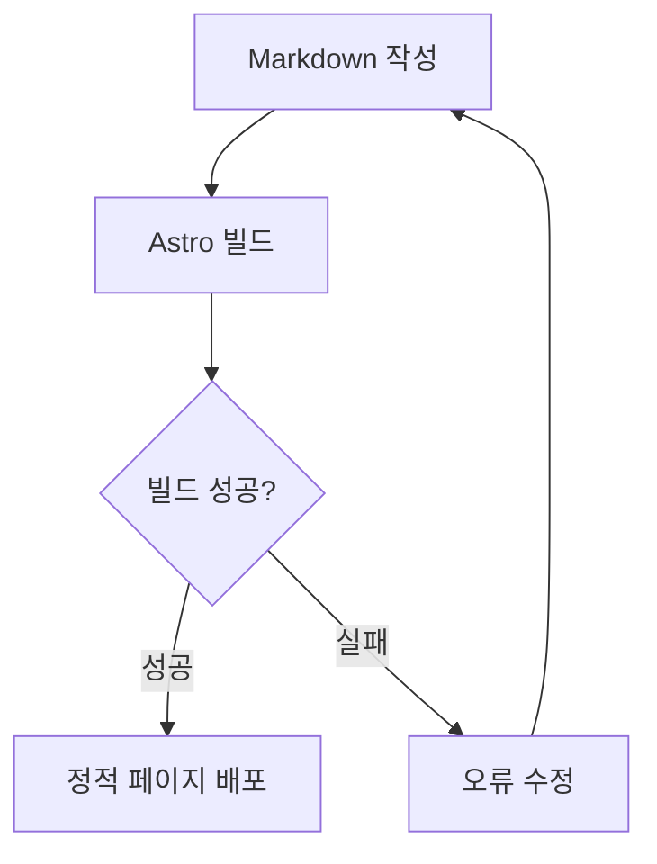
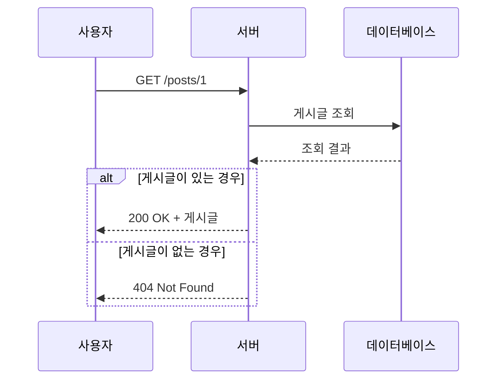
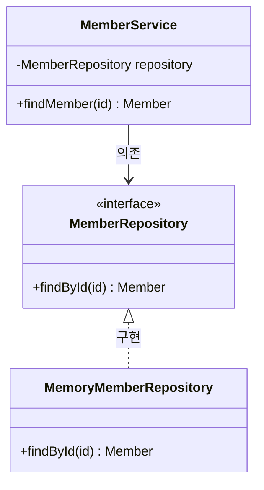
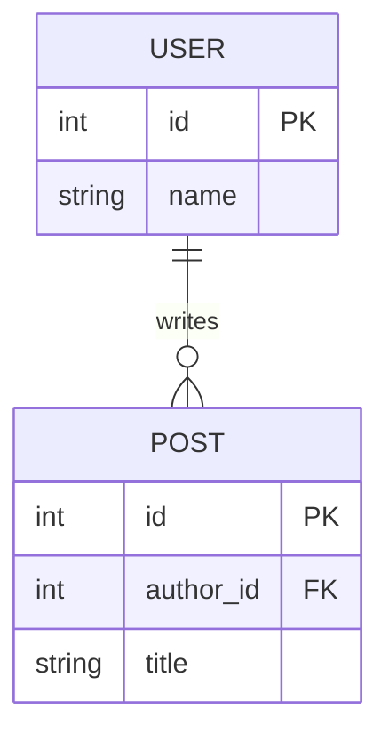

Markdown의 `mermaid` 코드블록을 Pele가 SVG로 변환한 예제다. 다이어그램은 빌드할 때 생성되므로 브라우저에서 JavaScript를 실행하지 않아도 표시된다.

## 흐름도

조건에 따라 작업이 나뉘거나 이전 단계로 돌아가는 흐름을 표현한다.

## 시퀀스 다이어그램

사용자, 서버, 데이터베이스가 어떤 순서로 메시지를 주고받는지 표현한다.

## 클래스 다이어그램

서비스가 구체적인 구현체 대신 인터페이스에 의존하는 구조를 표현한다.

## ER 다이어그램

한 명의 사용자가 여러 게시글을 작성할 수 있는 데이터 관계를 표현한다. `PK`는 기본 키, `FK`는 외래 키다.

