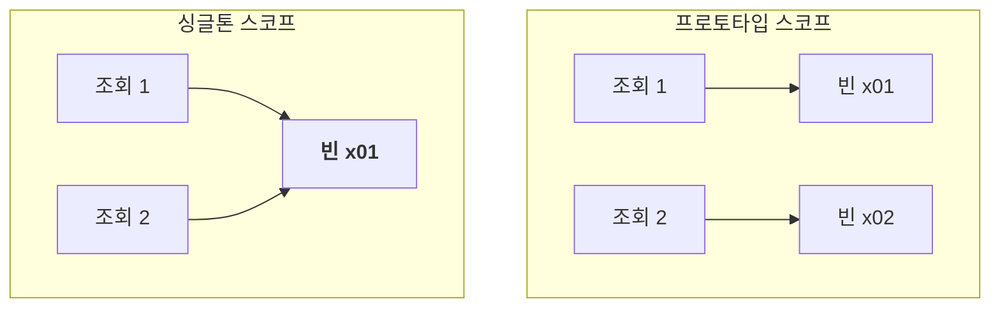
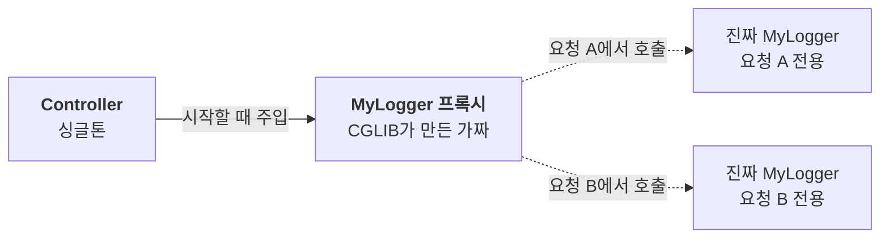

스프링 빈의 기본 스코프는 싱글톤이다. 하나의 컨테이너 안에서 빈 정의마다 하나의 인스턴스를 공유하고, 보통 컨테이너 초기화 과정에서 만들어져 종료될 때까지 관리된다. 지연 초기화를 설정하면 처음 필요할 때 생성된다. 이렇게 빈의 생성과 공유, 관리 범위를 정하는 것을 **스코프**라고 한다.

하지만 모든 빈이 컨테이너와 수명을 같이할 필요는 없다. 요청할 때마다 새로 만들어야 하는 빈도 있고, HTTP 요청 하나 동안만 살아 있어야 하는 빈도 있다. 그렇다면 싱글톤 말고 어떤 스코프가 있고, 언제 어떻게 쓸까?

---

## 스코프의 종류

| 스코프 | 빈이 살아 있는 범위 |
| --- | --- |
| `singleton` | 컨테이너 안에서 빈 정의마다 하나의 인스턴스를 공유한다. 기본값이다 |
| `prototype` | 생성, 의존관계 주입, 초기화까지만 컨테이너가 관리한다 |
| `request` | HTTP 요청 하나가 들어오고 나갈 때까지 |
| `session` | HTTP 세션이 생성되고 종료될 때까지 |
| `application` | 서블릿 컨텍스트와 같은 범위 |
| `websocket` | 스프링의 WebSocket 메시징에서 WebSocket 세션과 같은 범위 |

스코프는 `@Scope`로 지정한다. 컴포넌트 스캔이든 `@Bean`이든 같다.

```java
@Scope("prototype")
@Component
public class PrototypeBean { }

@Scope("prototype")
@Bean
public PrototypeBean prototypeBean() { return new PrototypeBean(); }
```

## 프로토타입 스코프

싱글톤 빈은 몇 번을 조회해도 같은 인스턴스가 나온다. 반면 프로토타입 빈은 **조회할 때마다 새 인스턴스**를 만들어 돌려준다.



더 중요한 차이는 관리 범위다. 스프링 컨테이너는 프로토타입 빈을 만들고, 의존관계를 주입하고, 초기화까지만 한 뒤 클라이언트에 넘긴다. 그 이후는 더 이상 관리하지 않는다.

```java
PrototypeBean a = ac.getBean(PrototypeBean.class);  // 새로 생성, @PostConstruct 호출
PrototypeBean b = ac.getBean(PrototypeBean.class);  // 또 새로 생성, @PostConstruct 호출
// a != b

ac.close();  // 컨테이너를 닫아도 @PreDestroy는 호출되지 않는다
```

- 조회할 때마다 새로 생성되고, 초기화 콜백(`@PostConstruct`)도 그때마다 호출된다.
- 컨테이너가 끝나도 소멸 전 콜백(`@PreDestroy`)이 호출되지 않는다. 정리가 필요하면 받은 쪽에서 직접 해야 한다.

## 싱글톤 빈 안의 프로토타입 빈

프로토타입 빈을 싱글톤 빈에 주입하면 의도와 다르게 동작한다. 싱글톤 빈은 만들어질 때 **한 번만** 의존관계를 주입받기 때문이다.

```java
@Component
public class ClientBean {  // 싱글톤
    private final PrototypeBean prototypeBean;  // 생성 시점에 한 번 주입된다

    public ClientBean(PrototypeBean prototypeBean) {
        this.prototypeBean = prototypeBean;
    }

    public int logic() {
        prototypeBean.addCount();  // 모든 호출이 같은 프로토타입 빈을 쓴다
        return prototypeBean.getCount();
    }
}
```

프로토타입 빈은 주입되는 순간 새로 만들어질 뿐, 쓸 때마다 새로 만들어지지는 않는다. 결국 싱글톤 빈과 함께 계속 같은 인스턴스가 유지된다. 프로토타입을 쓰는 이유는 쓸 때마다 새 객체를 받기 위해서인데, 그 의도가 사라진다.

## Provider로 필요할 때마다 꺼내기

해결 방법은 프로토타입 빈을 주입받아 두는 대신, **쓸 때마다 컨테이너에서 꺼내는 것**이다. 이렇게 필요한 빈을 직접 찾아오는 것을 DL(Dependency Lookup, 의존관계 조회)이라고 한다.

컨테이너 전체를 주입받아 `getBean()`을 부를 수도 있지만, 그러면 코드가 스프링 컨테이너에 강하게 묶인다. 필요한 건 딱 "지정한 빈을 대신 찾아 주는 기능"이고, 스프링은 이를 `ObjectProvider`로 제공한다.

```java
@Component
public class ClientBean {
    private final ObjectProvider<PrototypeBean> provider;

    public ClientBean(ObjectProvider<PrototypeBean> provider) {
        this.provider = provider;
    }

    public int logic() {
        PrototypeBean prototypeBean = provider.getObject();  // 호출할 때마다 새 프로토타입 빈
        prototypeBean.addCount();
        return prototypeBean.getCount();
    }
}
```

`getObject()`를 부르는 순간 컨테이너가 해당 빈을 찾아 준다. 프로토타입 빈이라면 그때마다 새로 만들어진다.

> **참고**: JSR-330에서 출발한 `jakarta.inject.Provider`나 스프링의 `@Lookup`으로도 필요한 시점에 빈을 조회할 수 있다. `Provider`는 스프링 전용 API가 아니지만 별도의 Jakarta Inject 의존성이 필요하다. 스프링 환경에서는 `ObjectProvider`를 사용하면 된다.

## 웹 스코프

웹 스코프는 이름 그대로 웹 환경에서만 동작한다. 프로토타입과 달리 스프링이 해당 스코프가 끝날 때까지 관리하므로, 소멸 전 콜백도 호출된다.

종류는 앞의 표에 정리한 request, session, application, websocket 네 가지다. 각 스코프는 활성화되는 환경과 종료 시점이 다르다. 아래에서는 HTTP 요청마다 별도의 인스턴스를 사용하는 request 스코프를 예로 든다.

### 요청이 없을 때는 request 빈을 만들 수 없다

request 스코프는 동시에 여러 요청이 들어와도 요청마다 따로 동작해야 할 때 쓴다. 예를 들어 요청마다 고유 ID를 붙여 로그를 남기는 빈을 만들 수 있다.

```java
@Component
@Scope(value = "request")
public class MyLogger {
    private String uuid;

    @PostConstruct
    public void init() { uuid = UUID.randomUUID().toString(); }  // 해당 요청에서 빈을 처음 생성할 때

    public void log(String message) { System.out.println("[" + uuid + "] " + message); }

    @PreDestroy
    public void close() { /* 요청이 끝날 때 */ }
}
```

그런데 이 빈을 애플리케이션 시작 시 생성되는 싱글톤 컨트롤러에 프록시 없이 직접 주입하면 시작에 실패한다. 컨트롤러는 애플리케이션이 시작될 때 만들어지는데, 그 시점에는 아직 HTTP 요청이 없어서 request 스코프 빈을 만들 수 없기 때문이다(`Scope 'request' is not active` 오류).

해결책은 앞에서 본 Provider다. `ObjectProvider<MyLogger>`를 주입받아 두고 요청을 처리할 때 `getObject()`로 꺼내면, 그 요청에 맞는 빈을 받는다. 같은 요청 안이라면 컨트롤러와 서비스가 각각 꺼내도 같은 인스턴스가 나온다.

## 프록시로 더 간단하게

Provider 코드조차 줄이고 싶다면 `proxyMode`를 쓴다.

```java
@Component
@Scope(value = "request", proxyMode = ScopedProxyMode.TARGET_CLASS)  // 인터페이스라면 INTERFACES
public class MyLogger { ... }
```

이제 컨트롤러는 Provider 없이 `MyLogger`를 그대로 주입받아 쓸 수 있다. 스프링이 CGLIB로 `MyLogger`를 상속한 가짜 프록시 객체를 만들어, 진짜 빈 대신 이 프록시를 먼저 주입해 두기 때문이다.



주입된 프록시는 공유되지만, 메서드가 호출되면 현재 요청에 해당하는 실제 `MyLogger`를 찾아 일을 넘긴다. 실제 빈이 아직 없으면 이때 생성된다. 클라이언트는 원본인지 프록시인지 몰라도 똑같이 쓸 수 있다. 다형성 덕분이다.

> **참고**: 프록시는 요청 스코프를 활성화해 주는 기능은 아니다. 요청이 없는 시작 단계나 별도 스레드에서 호출하면 여전히 스코프가 활성화되지 않았다는 오류가 날 수 있다.

> **핵심**: Provider든 프록시든 본질은 같다. **진짜 객체를 찾는 시점을 실제로 필요할 때까지 미루는 것**이다.

> **주의**: 프록시를 쓰면 싱글톤처럼 보이지만 실제로는 요청마다 다른 객체가 동작한다. 이런 특별한 스코프는 꼭 필요한 곳에만 최소한으로 쓰는 것이 좋다. 무분별하게 쓰면 유지보수와 테스트가 어려워진다.

---

스코프는 빈이 언제 만들어지고 언제까지 살아 있는지를 정한다. 대부분의 빈은 기본값인 싱글톤으로 충분하고, 쓸 때마다 새 객체가 필요하면 프로토타입을, 요청이나 세션 단위로 상태를 나눠야 하면 웹 스코프를 쓴다.

스코프가 다른 빈을 섞어 쓸 때는 주입 시점이 문제가 된다. 이때는 Provider나 프록시로 진짜 객체를 찾는 시점을 필요할 때까지 미루면 된다.

