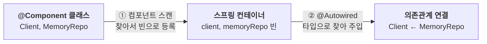

설정 클래스에 `@Bean`으로 빈을 하나씩 나열하는 방식은 빈이 수십, 수백 개가 되면 금방 한계에 부딪힌다. 등록하기 귀찮고, 설정 정보가 커지고, 빠뜨리는 빈도 생긴다.

그래서 스프링은 빈을 하나씩 나열하지 않고 자동으로 등록하는 **컴포넌트 스캔**과, 의존관계를 자동으로 주입하는 `@Autowired`를 제공한다.

---

## 컴포넌트 스캔과 @Autowired

설정 클래스에 `@ComponentScan`을 붙이면, 스프링이 `@Component`가 붙은 클래스를 찾아 빈으로 등록한다.

의존관계는 각 클래스의 생성자에 선언하고, `@Autowired`로 자동 주입을 요청할 수 있다. 생성자가 하나뿐이면 `@Autowired`를 생략해도 자동으로 주입된다.

```java
@Configuration
@ComponentScan
public class AutoAppConfig { }  // @Bean이 하나도 없다

@Component
public class MemoryRepo implements Repo { }

@Component
public class Client {
    private final Repo repo;

    @Autowired  // Repo 타입의 빈을 찾아 주입한다
    public Client(Repo repo) { this.repo = repo; }
}
```



- **빈 이름**: 기본은 클래스 이름의 맨 앞글자만 소문자로 바꾼 것이다(`MemoryRepo` → `memoryRepo`). 직접 정하려면 `@Component("이름")`처럼 쓴다.
- **주입 기준**: `@Autowired`는 기본적으로 필요한 타입에 할당할 수 있는 빈을 찾는다. 후보가 여러 개라면 `@Primary`, `@Qualifier` 등으로 선택할 수 있다.
- **여러 개도 가능**: 생성자 파라미터가 여러 개여도 모두 찾아 한 번에 주입한다.

### @Bean과 @Component는 무엇이 다를까

그런데 빈을 등록하는 방법이라면 이미 `@Bean`이 있다. 왜 따로 `@Component`가 필요할까? 둘 다 결과는 똑같이 스프링 빈이지만, 어디에 붙이고 누가 객체를 만드느냐가 다르다. 컴포넌트 스캔은 클래스를 훑어서 찾는 방식이라, 클래스에 붙는 `@Component` 애노테이션이 필요하다.

| 구분 | `@Bean` | `@Component` |
| --- | --- | --- |
| 붙이는 곳 | 설정 클래스의 메서드 | 클래스 |
| 객체 생성 | 메서드가 반환한 객체를 등록 | 컨테이너가 생성 |
| 등록 방식 | 수동 등록 | 자동 등록 (컴포넌트 스캔) |
| 주로 쓰는 경우 | 외부 라이브러리 클래스, 생성 로직을 직접 써야 할 때 | 직접 만든 클래스 |

```java
// @Component: 클래스에 붙인다. 객체는 컨테이너가 만든다
@Component
public class MemoryRepo implements Repo { }

// @Bean: 설정 클래스의 메서드에 붙인다. 객체는 직접 만들어 반환한다
@Configuration
public class AppConfig {
    @Bean
    public ObjectMapper objectMapper() {  // 외부 라이브러리 클래스라 @Component를 붙일 수 없다
        return new ObjectMapper();  // 이 객체가 빈으로 등록된다 (이름: objectMapper)
    }
}
```

### 같은 이름의 빈이 겹치면

이처럼 빈은 자동(`@Component`)으로도, 수동(`@Bean`)으로도 등록할 수 있다. 그렇다면 등록된 빈끼리 이름이 겹치면 어떻게 될까?

| 상황 | 결과 |
| --- | --- |
| 자동 등록 vs 자동 등록 | 서로 다른 클래스가 같은 빈 이름을 사용하면 일반적으로 `ConflictingBeanDefinitionException`이 발생한다 |
| 수동 등록 vs 자동 등록 | 설정과 충돌 대상에 따라 수동 빈이 우선하거나 오류가 발생할 수 있다 |

빈 덮어쓰기를 의도적으로 사용할 수도 있지만, 설정이 꼬여 우연히 발생하면 원인을 찾기 어렵다. 스프링 부트는 기본적으로 빈 정의 덮어쓰기를 허용하지 않는다.

`spring.main.allow-bean-definition-overriding=true`로 허용할 수 있지만, 모든 종류의 스캔 충돌을 해결하는 옵션은 아니다. 먼저 빈 이름과 등록 경로가 겹치는 원인을 확인하는 편이 좋다.

## 탐색은 어디서부터 시작할까

컴포넌트 스캔이 모든 클래스를 다 뒤지면 시간이 오래 걸린다.  
그래서 `@ComponentScan`에는 어느 패키지부터 찾을지 정하는 옵션이 있다. 이 애노테이션은 설정 클래스에 붙인다.

- `basePackages`: 탐색을 시작할 패키지를 문자열로 지정한다. 여러 개도 지정할 수 있다.
- `basePackageClasses`: 지정한 클래스가 속한 패키지부터 탐색한다.
- 아무것도 지정하지 않으면 `@ComponentScan`이 붙은 설정 클래스의 패키지부터 탐색한다.

```java
// basePackages: com.hello와 그 하위 패키지를 모두 탐색
@Configuration
@ComponentScan(basePackages = "com.hello")
public class AppConfig { }

// 여러 패키지도 지정할 수 있다
@ComponentScan(basePackages = {"com.hello.service", "com.hello.repository"})

// basePackageClasses: MemberService가 속한 패키지(com.hello.service)부터 탐색
@ComponentScan(basePackageClasses = MemberService.class)
```

하지만 실제로는 이 옵션들을 잘 쓰지 않는다. 권장하는 방법은 패키지를 지정하지 않고, 설정 클래스를 프로젝트 최상단(루트 패키지)에 두는 것이다.

그러면 따로 지정하지 않아도 내 프로젝트 코드만 스캔 범위에 들어가고, 외부 라이브러리는 자연스럽게 빠진다.

```java
// 프로젝트 구조
// com.hello              ← 설정 클래스를 여기(루트)에 둔다
// com.hello.service      ← 자동으로 스캔된다
// com.hello.repository   ← 자동으로 스캔된다

package com.hello;

@Configuration
@ComponentScan  // basePackages 생략 → com.hello부터 하위 전부 탐색
public class AppConfig { }
```

> **스프링 부트**: 부트의 시작 정보인 `@SpringBootApplication`을 루트 패키지에 두는 것이 관례다. 이 안에 `@ComponentScan`이 들어 있다.

## 스캔은 무엇을 찾을까

컴포넌트 스캔은 `@Component`뿐 아니라, `@Component`를 품고 있는 애노테이션도 대상으로 삼는다. 이 애노테이션들은 스캔 외에 부가 기능도 한다.

| 애노테이션 | 쓰는 곳 | 부가 기능 |
| --- | --- | --- |
| `@Component` | 일반 컴포넌트 | 없음 |
| `@Controller` | 스프링 MVC 컨트롤러 | MVC 컨트롤러로 인식 |
| `@Service` | 비즈니스 로직 | 특별한 처리는 없고, 비즈니스 계층임을 알려 준다 |
| `@Repository` | 데이터 접근 계층 | 예외 변환 후처리기가 설정된 경우, 지원되는 기술별 예외를 스프링 데이터 접근 예외로 변환 |
| `@Configuration` | 설정 클래스 | 기본 설정에서 `@Bean` 메서드 간 직접 호출을 가로채 컨테이너가 관리하는 빈을 반환 |

> **참고**: 이것은 클래스 상속이 아니라 메타 애노테이션을 활용한 구성이다. 스프링이 애노테이션에 붙은 다른 애노테이션까지 탐색해 컴포넌트로 인식한다. 자바의 `@Inherited`와는 별개의 기능이다.

## 필터로 대상을 더하고 빼기

`includeFilters`는 스캔 대상을 추가하고, `excludeFilters`는 스캔에서 제외한다.

```java
@ComponentScan(
    includeFilters = @Filter(type = FilterType.ANNOTATION, classes = MyIncludeComponent.class),
    excludeFilters = @Filter(type = FilterType.ANNOTATION, classes = MyExcludeComponent.class)
)
```

필터 종류(`FilterType`)는 다섯 가지다.

| FilterType | 무엇을 기준으로 고를까 | 예시 |
| --- | --- | --- |
| `ANNOTATION` | 특정 애노테이션이 붙은 클래스. 생략하면 이 방식이다(기본값) | `@MyExcludeComponent`가 붙은 클래스 제외 |
| `ASSIGNABLE_TYPE` | 지정한 타입과, 그 타입을 상속하거나 구현한 클래스 | `classes = BeanA.class` → BeanA와 그 자식들 |
| `ASPECTJ` | AspectJ 문법의 타입 패턴 | `pattern = "com.hello..*Service+"` → Service로 끝나는 타입과 그 자식 |
| `REGEX` | 클래스 이름(패키지 포함)에 대한 정규 표현식 | `pattern = ".*Stub.*"` → 이름에 Stub이 들어간 클래스 |
| `CUSTOM` | `TypeFilter` 인터페이스를 직접 구현해 코드로 판단 | 위 네 가지로 부족한 복잡한 조건일 때 |

> **참고**: `@Component`면 충분해서 `includeFilters`는 거의 쓰지 않고, `excludeFilters`도 가끔 쓴다. 옵션을 바꾸기보다 스프링의 기본 설정에 맞춰 쓰는 것이 좋다.

---

빈을 하나씩 등록하던 일을 이제 스프링이 대신한다. `@Component`가 붙은 클래스를 찾아 빈으로 등록하고, 필요한 의존관계는 `@Autowired`로 타입을 보고 채워 넣는다.

탐색 위치나 필터처럼 손댈 수 있는 옵션도 많지만, 설정 클래스를 루트 패키지에 두고 기본 설정을 따르는 것만으로 충분한 경우가 대부분이다. 다만 빈 이름이 겹치는 일만은 조심하자.

