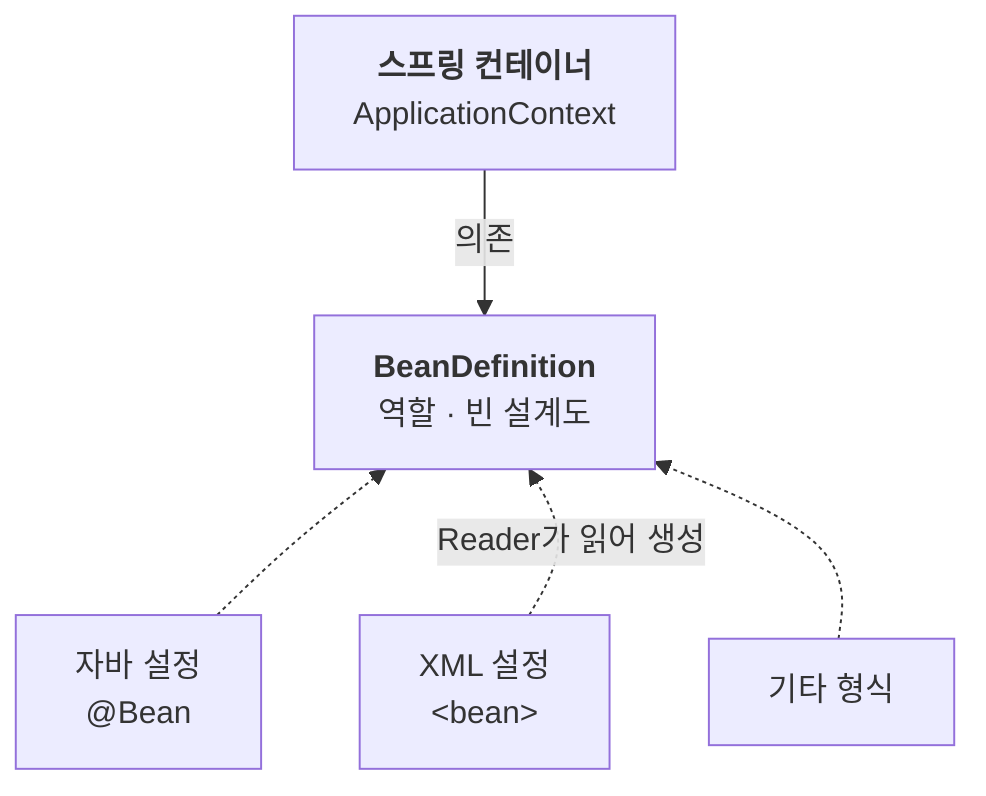

스프링 컨테이너는 객체의 생성·연결을 대신 맡는다. 그렇다면 컨테이너 안에서는 어떤 일이 일어날까?

빈이 어떻게 등록되고 꺼내지는지, 그리고 자바 코드와 XML처럼 형식이 다른 설정을 컨테이너가 어떻게 똑같이 읽어 내는지 차례로 살펴본다.

---

## 컨테이너가 만들어질 때 일어나는 일

스프링 컨테이너는 설정 정보를 받아 만들어지고, 그 설정 정보를 바탕으로 두 가지 일을 한다.

1. **빈 등록**: 설정 정보를 읽어 객체를 만들고, 빈 저장소에 ‘빈 이름 → 빈 객체’ 형태로 담는다.
2. **의존관계 주입**: 등록된 빈끼리 서로 연결한다.

개념상으로는 이렇게 두 단계로 나뉜다. 다만 생성자 주입을 사용하면 객체를 생성할 때 의존관계도 함께 전달하므로, 빈 생성과 주입이 동시에 이뤄진다.

> **빈 이름은 고유해야 한다**: 이름이 겹치면 설정에 따라 한쪽 빈이 무시되거나 덮어써지고, 오류가 나기도 한다.

## 빈을 꺼내 쓰는 법

컨테이너에 등록된 빈은 `getBean()`으로 꺼낸다. 찾는 기준은 **이름**과 **타입** 두 가지이고, 이를 어떻게 조합하느냐에 따라 방법이 세 가지로 나뉜다.

### 조회 방법

```java
// 1. 이름 + 타입
Repo namedRepo = ac.getBean("repo", Repo.class);

// 2. 타입만
Repo repo = ac.getBean(Repo.class);

// 3. 해당 타입 전부 (이름 → 빈)
Map<String, Repo> repos = ac.getBeansOfType(Repo.class);
```

| 방법 | 장점 | 단점 |
| --- | --- | --- |
| 이름 + 타입 | 같은 타입이 여럿이어도 하나를 정확히 꺼낸다 | 이름이 문자열이라 오타에 약하다 |
| 타입만 | 간결하다 | 같은 타입이 둘 이상이면 예외가 난다 |
| `getBeansOfType` | 해당 타입을 한 번에 받는다 | 하나만 필요할 땐 과하다 |

### 조회 규칙

어떤 방법을 쓰든, 조회가 실패하거나 예상보다 많은 빈이 나오는 경우가 있다.

- **단일 빈 조회에서 빈이 없으면** `NoSuchBeanDefinitionException`이 난다. `getBeansOfType()`은 일치하는 빈이 없으면 빈 Map을 반환한다.
- **같은 타입이 둘 이상이면** 타입만으로 찾을 때 `NoUniqueBeanDefinitionException`이 난다. 이름을 지정하거나 `getBeansOfType()`으로 전부 받으면 된다.
- **부모 타입으로 찾으면** 자식 타입까지 나온다. `Object`로 찾으면 모든 빈이 나온다.

### 빈은 역할로 찾는다

타입으로 찾을 때는 어떤 타입을 넘기느냐도 중요하다.

```java
Repo repo = ac.getBean(Repo.class);                   // 역할(인터페이스)로 조회
MemoryRepo memoryRepo = ac.getBean(MemoryRepo.class); // 구현(구체 클래스)로 조회
```

구체 타입으로도 찾을 수는 있지만, 구현이 바뀌면 조회 코드도 함께 고쳐야 한다. 클라이언트가 구현에 의존하지 않도록 하려면, 빈을 찾을 때도 역할(인터페이스)로 조회하는 편이 좋다.

> **참고**: 실무에서는 `getBean()`을 직접 부를 일이 거의 없다. 대부분 스프링이 의존관계를 자동으로 주입해 주기 때문이다. 조회 방법은 컨테이너 동작을 이해하거나 테스트할 때 주로 쓴다.

## BeanFactory와 ApplicationContext

앞에서 쓴 `getBean()`은 **BeanFactory**에서 나온다. BeanFactory는 스프링 컨테이너의 최상위 인터페이스로, 빈을 관리하고 조회하는 기본 기능을 맡는다.

하지만 실제 애플리케이션을 만들려면 빈 관리만으로는 부족하다. 그래서 BeanFactory를 상속한 **ApplicationContext**가 여기에 부가 기능을 더한다.

- **국제화**(`MessageSource`): 접속 지역에 맞는 언어로 메시지를 보여 준다.
- **환경 구분**(`EnvironmentCapable`): 로컬·개발·운영 환경을 나눠 설정을 달리 쓴다.
- **이벤트**(`ApplicationEventPublisher`): 이벤트를 발행하고 구독한다.
- **리소스 조회**(`ResourceLoader`): 파일, 클래스패스, 외부 URL 등에서 리소스를 읽는다.

그래서 BeanFactory를 직접 쓸 일은 거의 없고, 보통 스프링 컨테이너라고 하면 ApplicationContext를 가리킨다.

## 설정 형식은 자유롭게: BeanDefinition

스프링 컨테이너는 자바 코드, XML 등 여러 형식의 설정을 받을 수 있다. 형식마다 구현 클래스만 다르다. 자바 설정은 `AnnotationConfigApplicationContext`, XML은 `GenericXmlApplicationContext`가 받는다.

이게 가능한 이유는 **BeanDefinition**이라는 추상화 덕분이다. BeanDefinition은 빈을 어떻게 만들지 적어 둔 설계도(빈 설정 메타정보)로, `@Bean`이나 `<bean>` 하나당 하나씩 생긴다. 형식마다 있는 Reader가 설정을 읽어 이 설계도를 만들고, 컨테이너는 설계도만 보고 빈을 생성한다.

참고로 BeanFactory와 ApplicationContext는 상속 관계였지만, BeanDefinition은 컨테이너의 부모가 아니다. 컨테이너가 갖고 사용하는(의존하는) 설계도다.



여기서도 역할과 구현의 분리가 그대로 보인다. 컨테이너는 역할(BeanDefinition)에만 의존하고, 설정 형식이라는 구현은 모른다. 스프링 자신도 역할과 구현을 나눈 덕분에 확장에 열려 있다.

> **참고**: 실무에서 BeanDefinition을 직접 다룰 일은 거의 없다. 스프링 코드에서 이 이름을 만나면, ‘설정 정보를 추상화한 것’ 정도만 떠올리면 된다.

---

스프링 컨테이너는 설정 정보를 읽어 빈을 등록하고, 빈끼리 연결한 뒤, 필요할 때 꺼내 준다. 보통은 이 일을 ApplicationContext가 맡는다.

설정이 자바 코드든 XML이든 상관없는 것도, 컨테이너가 BeanDefinition이라는 역할에만 의존하기 때문이다. 스프링이 강조하는 역할과 구현의 분리는 스프링 자신의 구조에도 그대로 녹아 있다.

