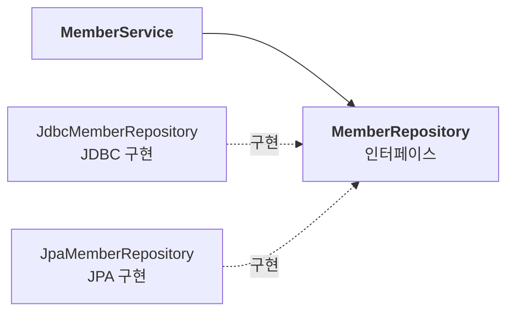
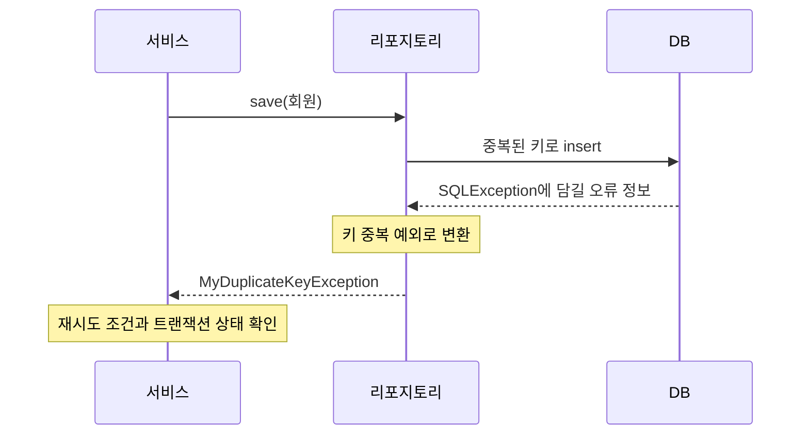
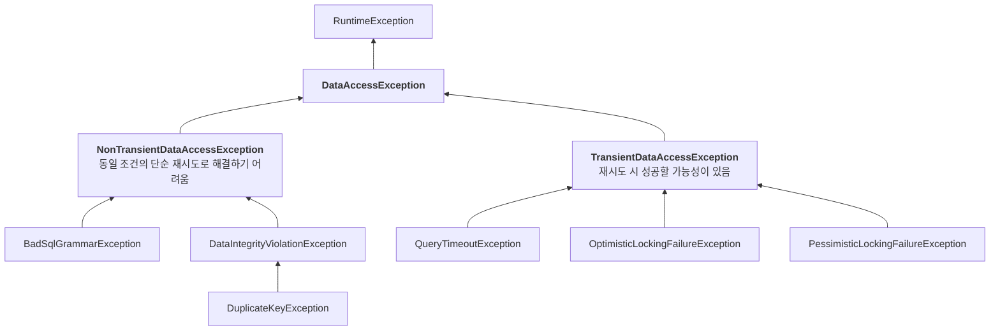

애플리케이션을 컨트롤러, 서비스, 리포지토리로 나눌 때 서비스는 데이터 접근 기술의 영향을 적게 받는 것이 좋다. 그런데 JDBC를 직접 사용하면 두 가지 문제가 생긴다.

- `SQLException`이 서비스까지 노출되어 JDBC에 의존하게 된다.
- 리포지토리마다 커넥션을 얻고 SQL을 실행하고 자원을 닫는 코드가 반복된다.

스프링은 첫 번째 문제를 **예외 추상화** 로, 두 번째 문제를 **JdbcTemplate** 으로 해결한다. 리포지토리 인터페이스부터 예외 변환, 반복 코드 제거까지 연결해 보자.

---

## 인터페이스로 구현 기술 감추기

서비스가 데이터 접근 기술에 직접 의존하지 않도록 리포지토리를 인터페이스로 분리한다.



```java
public interface MemberRepository {
    Member save(Member member);
    Member findById(String memberId);
    void update(String memberId, int money);
    void delete(String memberId);
}
```

서비스는 이 인터페이스를 주입받는다. 구현을 바꿀 때 메서드의 의미와 예외 계약까지 유지한다면 서비스의 변경을 줄일 수 있다.

> **체크 예외라면 인터페이스도 묶인다**: 구현체가 `SQLException`을 그대로 전파하려면 인터페이스에도 그 예외나 상위 체크 예외를 선언해야 한다. 구현 메서드가 선언하지 않은 체크 예외를 임의로 추가할 수는 없기 때문이다. 런타임 예외에는 이 선언 제약이 없다.

## 런타임 예외로 감싸기

리포지토리에서 `SQLException`을 잡아 런타임 예외로 바꾸면 인터페이스와 서비스에 기술별 `throws`를 선언하지 않아도 된다.

```java
public class MyDbException extends RuntimeException {
    public MyDbException(Throwable cause) { super(cause); }
}
```

```java
// 리포지토리의 SQL 실행 부분
try { runSQL(); }
catch (SQLException e) { throw new MyDbException(e); }
```

원인 예외도 함께 전달한다. 서비스에는 다음처럼 트랜잭션 선언과 비즈니스 로직만 남길 수 있다.

```java
@Transactional
public void accountTransfer(String fromId, String toId, int money) {
    bizLogic(fromId, toId, money);
}
```

다만 모든 오류를 `MyDbException` 하나로 묶으면 상위 계층이 복구 가능한 오류만 구분하기 어렵다.

## 특정 예외만 골라 복구하기

회원 ID가 중복되면 새 ID를 만들어 다시 저장하고 싶다고 하자. 서비스는 여러 DB 오류 중 **키 중복** 을 구분할 수 있어야 한다.

JDBC의 `SQLException`에는 벤더 오류 코드와 SQLState 등이 담긴다. 벤더 코드는 `getErrorCode()`로 조회한다.

| 오류 | H2 오류 코드의 예 | MySQL 오류 코드의 예 |
| --- | --- | --- |
| 키 중복 | 23505 | 1062 |
| SQL 문법 오류 | 42000 등 | 1064 등 |

정확한 코드는 DB 버전과 오류 종류에 따라 달라질 수 있다. H2를 기준으로 직접 분류하면 다음과 같다.

```java
public class MyDuplicateKeyException extends MyDbException {
    public MyDuplicateKeyException(Throwable cause) { super(cause); }
}
```

```java
// 리포지토리의 예외 처리
catch (SQLException e) {
    if (e.getErrorCode() == 23505) throw new MyDuplicateKeyException(e);
    throw new MyDbException(e);
}
```



서비스는 벤더 코드를 직접 비교하는 대신 의미 있는 예외를 처리할 수 있다.

```java
try { repository.save(new Member(memberId, 0)); }
catch (MyDuplicateKeyException e) {
    String retryId = generateNewId(memberId);
    repository.save(new Member(retryId, 0));
}
```

이 코드는 재시도 가능한 실행 환경에서 한 번 더 시도하는 흐름만 보여 준다. 다른 DB 오류는 잡지 않으면 그대로 전파되므로, 단순히 다시 던지기 위한 `catch (MyDbException e)`는 필요 없다.

> **같은 트랜잭션에서 바로 재시도해도 될까?**: DB나 영속성 기술에 따라 첫 실패로 트랜잭션이 이미 실패 상태이거나 롤백 전용이 될 수 있다. 재시도는 필요하면 새로운 트랜잭션에서 수행해야 한다. 새 ID의 재충돌, 최대 시도 횟수와 멱등성도 고려해야 한다.

직접 정의한 예외는 JDBC 타입을 API에서 숨길 수 있다. 하지만 DB마다 오류 코드가 다르고 분류할 오류도 많다. 모든 변환 규칙을 직접 관리하는 것은 부담스럽다.

## 스프링 데이터 접근 예외 계층

스프링은 데이터 접근 실패를 공통 의미로 분류하는 예외 계층을 제공한다. 주요 분류만 보면 다음과 같다. 그림의 일부 중간 상속 타입은 생략했다.



- 최상위는 `DataAccessException`이며 런타임 예외다.
- JDBC 등 구현 기술의 예외를 공통된 실패 의미로 다룰 수 있다.
- **Transient** 는 일시적인 실패로, 상태가 달라지면 재시도가 성공할 가능성이 있다. 안전한 자동 재시도를 보장한다는 뜻은 아니다.
- **NonTransient** 는 같은 조건에서 단순히 다시 실행해도 해결되기 어려운 실패다. SQL이나 입력, 설정 등의 수정이 필요할 수 있다.

## 스프링 예외 변환기

`SQLExceptionTranslator`는 JDBC 예외를 스프링의 데이터 접근 예외로 변환한다. 벤더 오류 코드 기반 변환기를 명시적으로 사용하면 다음과 같다.

```java
SQLExceptionTranslator translator =
        new SQLErrorCodeSQLExceptionTranslator(dataSource);
DataAccessException translated = translator.translate("회원 저장", sql, e);
```

첫 인자는 작업 설명, 두 번째는 SQL, 마지막은 원래 예외다. 변환 결과는 오류에 맞는 `DataAccessException` 하위 타입이다. 다만 `SQLExceptionTranslator`의 계약상 분류할 수 없으면 `null`을 반환할 수 있다.

```java
catch (SQLException e) {
    DataAccessException translated = translator.translate("save", sql, e);
    if (translated != null) throw translated;
    throw new UncategorizedSQLException("save", sql, e);
}
```

### DB마다 다른 오류 코드를 해석하기

`SQLErrorCodeSQLExceptionTranslator`는 DB 제품 정보를 바탕으로 벤더별 오류 코드 규칙을 선택한다. 스프링은 주요 DB의 규칙을 `sql-error-codes.xml`에 제공하며, 사용자 정의도 가능하다.

예를 들어 다음 중복 키 코드를 같은 의미로 분류할 수 있다.

| DB | 벤더 오류 코드 | 변환 예 |
| --- | --- | --- |
| H2 | 23505 | `DuplicateKeyException` |
| MySQL | 1062 | `DuplicateKeyException` |

변환은 벤더 코드만 사용하는 것은 아니다. JDBC 예외의 하위 타입이나 SQLState를 활용하는 변환기도 있다. 최근 스프링의 기본 변환 전략은 버전과 사용자 설정에 따라 달라지므로, JdbcTemplate이 항상 XML의 벤더 코드만 확인한다고 생각하면 안 된다.

### 예외 추상화의 범위

서비스가 `DuplicateKeyException`을 잡으면 DB별 숫자를 알 필요가 없다. 그러나 JDBC에서 JPA로 바꿔도 모든 실패가 동일한 세부 예외로 변환된다는 보장은 없다. 예를 들어 JPA의 제약 조건 위반은 더 넓은 `DataIntegrityViolationException`으로 변환될 수 있고, 실패가 저장 호출이 아닌 flush나 커밋 시점에 나타날 수도 있다.

기술을 바꿀 때는 예외 계약과 발생 시점도 확인해야 한다. 정말 동일한 업무 계약이 필요하다면 리포지토리 경계에서 도메인에 맞는 예외로 다시 변환할 수 있다.

> **스프링에는 의존한다**: 서비스가 스프링 예외를 직접 잡으면 JDBC 의존 대신 스프링 예외 계층에 의존한다. 이 정도의 의존을 허용할지, 자체 예외로 감출지는 경계와 비용을 고려해 결정한다.

## JdbcTemplate으로 반복 제거

예외 변환을 맡겨도 JDBC에는 반복되는 작업이 남는다.

- 커넥션 획득과 반환
- Statement 준비와 실행
- 결과 순회
- 예외 변환과 자원 정리

달라지는 부분은 주로 SQL, 파라미터, 결과 매핑이다. `JdbcTemplate`은 고정된 실행 흐름을 제공하고 달라지는 부분을 인자와 콜백으로 받는다.

다음은 `member(member_id, money)` 테이블과 생성자·접근자를 갖춘 `Member`, 앞의 `MemberRepository` 인터페이스를 사용한 예제다.

```java
public class JdbcMemberRepository implements MemberRepository {

    private final JdbcTemplate template;

    public JdbcMemberRepository(DataSource dataSource) {
        this.template = new JdbcTemplate(dataSource);
    }

    @Override
    public Member save(Member member) {
        String sql = "insert into member(member_id, money) values(?, ?)";
        template.update(sql, member.getMemberId(), member.getMoney());
        return member;
    }

    @Override
    public Member findById(String memberId) {
        String sql = "select member_id, money from member where member_id = ?";
        return template.queryForObject(sql, memberRowMapper(), memberId);
    }

    @Override
    public void update(String memberId, int money) {
        String sql = "update member set money=? where member_id=?";
        template.update(sql, money, memberId);
    }

    @Override
    public void delete(String memberId) {
        String sql = "delete from member where member_id=?";
        template.update(sql, memberId);
    }

    private RowMapper<Member> memberRowMapper() {
        return (rs, rowNum) -> new Member(
                rs.getString("member_id"),
                rs.getInt("money"));
    }
}
```

- `update()`로 insert, update, delete를 실행하고 영향받은 행 수를 받을 수 있다.
- `queryForObject()`는 정확히 한 행을 기대한다. 결과가 없으면 `EmptyResultDataAccessException`, 여러 행이면 `IncorrectResultSizeDataAccessException`이 발생한다.
- `RowMapper`는 현재 행을 객체로 바꾸는 방법만 정의한다. 직접 `rs.next()`를 호출하지 않는다.
- JdbcTemplate은 연결 획득과 반환, 트랜잭션에 연결된 자원 사용, 예외 변환을 처리한다. 트랜잭션에 참여하려면 매니저와 데이터소스 구성도 맞아야 한다.

> **트랜잭션 경계는 별도다**: JdbcTemplate이 여러 메서드 호출을 자동으로 하나의 트랜잭션으로 묶지는 않는다. 계좌이체 같은 비즈니스 작업 전체의 경계는 `@Transactional`이나 TransactionTemplate 등으로 정한다.

메서드마다 반복하던 코드가 SQL과 실행, 필요한 결과 매핑 중심으로 줄었다. 다만 수정 대상이 없는 경우의 처리처럼 업무에 필요한 행 수 검증은 별도로 추가해야 한다.

## 문제와 해결 한눈에 보기

| 문제 | 해결 |
| --- | --- |
| 서비스가 구체적인 데이터 접근 구현에 의존한다 | 리포지토리 인터페이스와 DI |
| 기술별 체크 예외가 상위 계층에 노출된다 | 원인을 보존한 런타임 예외 전환 |
| 실패의 의미를 구분하기 어렵다 | 데이터 접근 예외 계층 |
| DB별 오류 코드가 다르다 | 예외 변환기 |
| JDBC 코드가 반복된다 | `JdbcTemplate` |

---

서비스는 DB별 오류 코드를 직접 비교하지 않고, 필요한 경우 공통 예외의 의미를 보고 대응할 수 있다. 리포지토리는 JDBC의 반복 작업을 JdbcTemplate에 맡기고 SQL과 매핑에 집중한다.

이렇게 하면 구현 기술의 변경 영향을 줄일 수 있다. 다만 추상화가 모든 차이를 없애지는 않는다. 예외의 분류와 발생 시점, 트랜잭션 경계까지 계약에 포함해 확인해야 서비스와 데이터 접근 구현을 안정적으로 분리할 수 있다.
