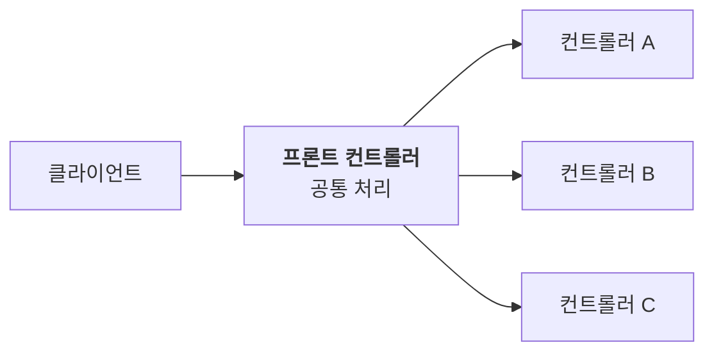
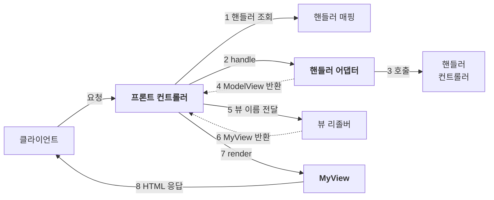

MVC 패턴에서 컨트롤러는 요청을 받아 로직을 호출하고 결과를 뷰로 넘긴다. 컨트롤러가 늘어나면 뷰로 넘기는 코드와 공통 처리가 컨트롤러마다 반복된다.

이 반복을 하나씩 걷어 내면 스프링 MVC의 핵심 구조와 닮은 형태가 된다.

---

## 프론트 컨트롤러란

출입구가 여러 개인 건물은 문마다 경비원이 필요하지만, 대표 출입구가 하나면 경비도 한 곳에만 두면 된다. **프론트 컨트롤러**는 웹 애플리케이션의 대표 출입구다.



- 매핑된 요청을 서블릿 하나가 먼저 받는다.
- 요청 URL에 맞는 컨트롤러를 찾아 호출한다.
- 공통 처리를 한곳에 둘 수 있고, 나머지 컨트롤러는 서블릿일 필요가 없다.

> **예제의 범위**: 코드는 구조를 설명하기 위한 일부이며, 단계마다 컨트롤러 인터페이스가 달라진다. import, 예외 처리와 일부 구현은 생략했다.

## 1단계 프론트 컨트롤러 도입

**문제**: 컨트롤러마다 요청을 받는 입구가 따로 있다.

모든 컨트롤러가 같은 인터페이스를 구현하게 하고, 프론트 컨트롤러는 URL과 컨트롤러를 짝지은 **매핑 정보**를 갖는다.

```java
public interface Controller {
    void process(HttpServletRequest request, HttpServletResponse response);
}

// 프론트 컨트롤러가 들고 있는 매핑 정보 (URL → 컨트롤러)
controllerMap.put("/members/new-form", new MemberFormController());
controllerMap.put("/members/save", new MemberSaveController());

// 요청이 오면
Controller controller = controllerMap.get(request.getRequestURI());  // URL로 컨트롤러 찾기
controller.process(request, response);                               // 대신 호출
```

인터페이스가 같으므로 어떤 컨트롤러든 같은 방식으로 호출할 수 있다. 실제 구현에서는 매핑된 컨트롤러가 없는 경우의 404 처리도 필요하다.

## 2단계 뷰 분리

**문제**: 모든 컨트롤러에 forward 코드가 들어 있다.

forward를 전담하는 **뷰 객체**(`MyView`)를 만든다. 뷰 객체는 화면 파일 경로를 갖고 있다가 `render()`가 호출되면 그 경로로 forward한다.

```java
public class MyView {
    private final String viewPath;

    public MyView(String viewPath) { this.viewPath = viewPath; }

    public void render(HttpServletRequest request, HttpServletResponse response)
            throws ServletException, IOException {
        request.getRequestDispatcher(viewPath).forward(request, response);
    }
}
```

컨트롤러의 반환 타입을 `MyView`로 바꾼다. 컨트롤러는 뷰 객체를 반환하고, 프론트 컨트롤러가 그 뷰에 화면 그리기를 맡긴다.

```java
// 컨트롤러: 뷰를 만들어 반환만 한다
return new MyView("/WEB-INF/views/new-form.jsp");

// 프론트 컨트롤러: 받은 뷰에게 화면 그리기를 맡긴다
MyView view = controller.process(request, response);
view.render(request, response);
```

## 3단계 모델 추가

**문제**: 컨트롤러가 서블릿에 의존하고, 뷰 경로를 매번 전부 적는다.

이 예제에서 컨트롤러에 필요한 것은 `request` 전체가 아니라 **요청 파라미터**다. 프론트 컨트롤러가 파라미터를 `Map`에 담아 넘기고, 컨트롤러는 `ModelView`를 반환한다.

`ModelView`에는 두 가지가 들어 있다.

- **뷰 이름**: 어떤 화면을 그릴지
- **모델**: 그 화면에 보여 줄 데이터

```java
public interface Controller {
    ModelView process(Map<String, String> paramMap);  // 서블릿 객체를 받지 않는다
}

// 컨트롤러
ModelView mv = new ModelView("save-result");  // 뷰 이름
mv.getModel().put("member", member);           // 화면에 넘길 데이터
return mv;
```

뷰 이름에는 전체 경로 대신 `save-result` 같은 **논리 이름**만 적는다. 이를 실제 파일 경로인 **물리 이름**으로 바꾸는 일은 **뷰 리졸버**가 한다.

```java
// 뷰 리졸버: "save-result" → "/WEB-INF/views/save-result.jsp"
private MyView viewResolver(String viewName) {
    return new MyView("/WEB-INF/views/" + viewName + ".jsp");
}
```

뷰를 렌더링할 때는 모델에 담긴 데이터를 request 속성으로 옮긴 뒤 forward한다. 이 처리를 뷰 객체에 맡기면 컨트롤러는 서블릿 API를 몰라도 된다.

> **논리 이름을 쓰는 이유**: 뷰 파일 위치가 바뀌면 뷰 리졸버의 경로 규칙을 고치고 컨트롤러는 그대로 둘 수 있다. 템플릿 엔진을 바꾸는 경우에도 컨트롤러의 논리 이름을 유지할 수 있지만, 뷰 구현과 템플릿 파일은 별도로 변경해야 한다.

## 4단계 단순한 컨트롤러

**문제**: 컨트롤러가 매번 `ModelView`를 직접 만든다.

프론트 컨트롤러가 빈 모델(`Map`)을 만들어 넘긴다. 컨트롤러는 모델에 데이터를 담고 뷰 이름만 문자열로 반환한다.

```java
public interface Controller {
    String process(Map<String, String> paramMap, Map<String, Object> model);
}

// 컨트롤러
model.put("member", member);  // 받은 모델에 담기만 한다
return "save-result";         // 뷰 이름만 반환
```

이제 컨트롤러는 로직 호출, 모델 채우기, 뷰 이름 반환만 한다.

## 5단계 어댑터로 여러 형태의 컨트롤러 지원

**문제**: 프론트 컨트롤러가 한 가지 형태의 컨트롤러만 호출할 수 있다.

`ModelView`를 반환하는 3단계 방식과 뷰 이름을 반환하는 4단계 방식은 인터페이스가 달라서 현재 구조로는 함께 쓸 수 없다.

**전원 어댑터**를 끼우면 모양이 다른 플러그도 같은 콘센트에 꽂을 수 있다. 프론트 컨트롤러도 컨트롤러를 직접 호출하지 않고 **핸들러 어댑터**를 거친다. 어댑터는 자신이 지원하는 컨트롤러를 호출하고 결과를 `ModelView`로 맞춰 돌려준다.

```java
public interface HandlerAdapter {
    boolean supports(Object handler);  // 이 컨트롤러를 내가 다룰 수 있나?

    // 호출하고 결과를 ModelView로 맞춰 반환
    ModelView handle(HttpServletRequest request, HttpServletResponse response, Object handler);
}
```

프론트 컨트롤러는 등록된 어댑터 중 `supports()`가 `true`인 어댑터에 처리를 맡긴다.

> **컨트롤러가 아니라 핸들러**: 대응하는 어댑터가 있으면 기존 컨트롤러 인터페이스와 다른 형태의 객체도 요청을 처리할 수 있다. 그래서 요청을 처리하는 대상을 **핸들러**라고 부르고, 매핑 정보도 URL과 핸들러를 짝짓는 **핸들러 매핑**이 된다.

전체 흐름은 다음과 같다.



새 형태의 컨트롤러가 생기면 어댑터를 추가하고 등록하면 된다. 프론트 컨트롤러의 호출 흐름은 고치지 않는다. OCP(개방-폐쇄 원칙)를 따르는 구조다.

## 다섯 단계 한눈에 보기

| 단계 | 해결한 문제 | 새로 생긴 것 |
| --- | --- | --- |
| 1 | 입구가 여러 개다 | 프론트 컨트롤러, 매핑 정보 |
| 2 | forward 코드가 반복된다 | 뷰 객체 |
| 3 | 서블릿에 의존하고 뷰 경로가 반복된다 | 모델을 담는 ModelView, 뷰 리졸버 |
| 4 | 컨트롤러가 번거롭다 | 뷰 이름만 돌려주는 컨트롤러 |
| 5 | 한 가지 형태의 컨트롤러만 쓸 수 있다 | 핸들러 어댑터 |

## 직접 만든 구조와 Spring MVC

직접 만든 부품은 역할 면에서 스프링 MVC의 다음 요소에 대응된다.

| 직접 만든 부품 | Spring MVC |
| --- | --- |
| 프론트 컨트롤러 | `DispatcherServlet` |
| 핸들러 매핑 | `HandlerMapping` |
| 핸들러 어댑터 | `HandlerAdapter` |
| `ModelView` | `ModelAndView` |
| 뷰 리졸버 | `ViewResolver` |
| `MyView` | `View` |

---

다섯 단계는 각각 문제 하나를 풀었다. 입구를 하나로 모으고, 뷰와 모델을 분리하고, 컨트롤러를 단순하게 만들고, 어댑터로 확장할 수 있게 했다. 그 결과가 스프링 MVC의 핵심 구조와 연결된다.

`DispatcherServlet`과 `HandlerAdapter`가 왜 있는지 알면, 스프링 MVC가 대신 해 주는 일이 분명하게 보인다.
