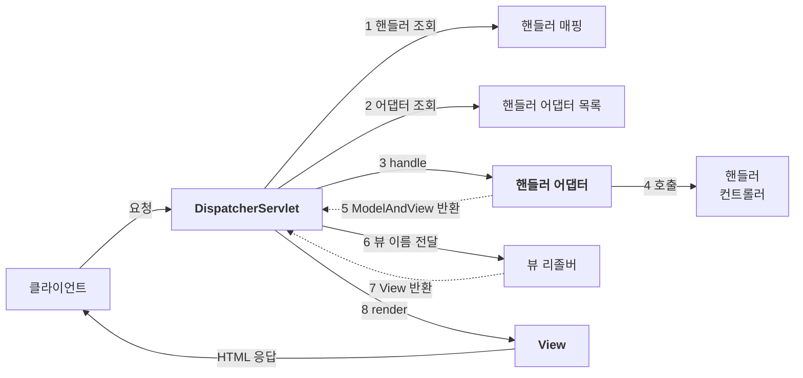

스프링 MVC의 중심에는 요청을 받아 알맞은 핸들러에 처리를 맡기는 `DispatcherServlet`이 있다. 화면을 반환하는 요청이라면 처리 결과를 뷰로 연결하는 일도 맡는다.

앞서 직접 만든 프론트 컨트롤러 구조가 실제 스프링 MVC에서는 어떻게 동작하는지 살펴보자. 요청 처리 흐름부터 애노테이션 기반 컨트롤러까지 연결하면, 스프링이 대신 해 주는 일이 보인다.

---

## DispatcherServlet

스프링 MVC도 프론트 컨트롤러 패턴으로 만들어져 있다. 그 프론트 컨트롤러가 **디스패처 서블릿**(`DispatcherServlet`)이다. dispatcher는 들어온 일을 알맞은 곳에 배정하는 담당자라는 뜻이다.

스프링 부트의 일반적인 서블릿 웹 애플리케이션에서는 기본적으로 `/`에 매핑된다. 별도로 더 구체적인 서블릿 매핑 등이 없다면 이 서블릿이 요청을 받아 처리한다. 요청 처리의 중심 메서드는 `doDispatch()`다.

예외 처리, 인터셉터, 비동기 처리 등을 생략하고 핵심 흐름만 옮기면 다음과 같다. 실제 소스 전체가 아니라 구조를 설명하기 위한 축약 코드다.

```java
protected void doDispatch(HttpServletRequest request, HttpServletResponse response)
        throws Exception {
    // 1. 핸들러 조회
    HandlerExecutionChain mappedHandler = getHandler(request);
    if (mappedHandler == null) {
        noHandlerFound(request, response);
        return;
    }

    // 2. 핸들러 어댑터 조회
    HandlerAdapter ha = getHandlerAdapter(mappedHandler.getHandler());

    // 3~5. 어댑터 실행 → 핸들러 실행 → ModelAndView 반환
    ModelAndView mv = ha.handle(request, response, mappedHandler.getHandler());

    // 6~8. 뷰 찾기 → 렌더링
    processDispatchResult(request, response, mappedHandler, mv, null);
}
```

핸들러 조회, 어댑터 실행, 뷰 렌더링의 세 덩어리로 읽으면 된다. 다만 모든 요청이 뷰 렌더링으로 끝나는 것은 아니다. `@ResponseBody`나 `@RestController`로 응답 본문을 직접 작성하는 경우에는 뷰 리졸버를 거치지 않는다.

## 요청 처리 8단계

컨트롤러가 논리 뷰 이름을 반환하는 요청은 다음 흐름으로 처리된다.



| 키워드 | Spring MVC | 하는 일 |
| --- | --- | --- |
| 핸들러 매핑 | `HandlerMapping` | URL, HTTP 메서드 등 요청 조건으로 처리할 핸들러를 찾는다 |
| 핸들러 어댑터 | `HandlerAdapter` | 찾은 핸들러를 실행하고, 뷰 처리가 필요하면 결과를 `ModelAndView`로 전달한다 |
| 모델과 뷰 정보 | `ModelAndView` | 화면에 보여 줄 데이터와 뷰 이름 또는 뷰 객체를 담는다 |
| 뷰 리졸버 | `ViewResolver` | 논리 뷰 이름을 해석해 뷰 객체를 반환한다 |

`HandlerMapping`, `HandlerAdapter`, `ViewResolver`, `View`는 인터페이스다. 구현체를 추가하거나 교체해 `DispatcherServlet`의 핵심 흐름을 바꾸지 않고 동작을 확장할 수 있다. 반면 `ModelAndView`는 모델과 뷰 정보를 담는 클래스다.

## 핸들러 매핑과 핸들러 어댑터

컨트롤러가 호출되려면 두 가지가 필요하다.

- **핸들러 매핑**: 요청에 대응하는 컨트롤러를 찾을 수 있어야 한다.
- **핸들러 어댑터**: 찾은 컨트롤러를 실행할 수 있어야 한다.

새 코드에서는 잘 사용하지 않는 과거 방식의 컨트롤러로 확인해 보자.

### Controller 인터페이스

스프링이 제공하는 `org.springframework.web.servlet.mvc.Controller` 인터페이스는 정해진 메서드를 구현하는 방식이다. `@Controller` 애노테이션과는 다르다.

```java
@Component("/springmvc/old-controller")  // 빈 이름 = URL
public class OldController implements Controller {
    @Override
    public ModelAndView handleRequest(HttpServletRequest request,
                                      HttpServletResponse response) {
        System.out.println("OldController.handleRequest");
        return null;
    }
}
```

빈 이름을 `/springmvc/old-controller`로 등록했다. 이 이름을 URL 매핑에 사용할 수 있다. 예제는 호출 여부만 확인하므로 `null`을 반환하며, 화면은 렌더링하지 않는다.

### 기본 구성에서 사용하는 구현체

스프링 MVC의 기본 구성과 스프링 부트의 자동 설정에서 사용하는 주요 구현체는 다음과 같다. 실제 목록과 우선순위는 버전이나 설정에 따라 달라질 수 있으므로, 숫자보다는 각 구현체의 역할을 구분하는 것이 중요하다.

| HandlerMapping | 찾는 방법 |
| --- | --- |
| `RequestMappingHandlerMapping` | `@RequestMapping` 등 애노테이션에 선언된 요청 조건으로 찾는다 |
| `BeanNameUrlHandlerMapping` | URL 형태의 스프링 빈 이름으로 찾는다 |

| HandlerAdapter | 처리하는 핸들러 |
| --- | --- |
| `RequestMappingHandlerAdapter` | 애노테이션으로 매핑된 컨트롤러 메서드 |
| `HttpRequestHandlerAdapter` | `HttpRequestHandler` 구현 객체 |
| `SimpleControllerHandlerAdapter` | `Controller` 인터페이스 구현 객체 |

핸들러 매핑은 우선순위에 따라 요청을 처리할 핸들러를 찾는다. 어댑터도 순서대로 확인하되, 각자의 `supports()`로 해당 핸들러를 실행할 수 있는지 판단한다.

앞의 `OldController`는 `BeanNameUrlHandlerMapping`이 찾고, `SimpleControllerHandlerAdapter`가 실행한다.

일반적인 애노테이션 기반 컨트롤러에서는 `RequestMappingHandlerMapping`과 `RequestMappingHandlerAdapter`가 이 역할을 맡는다.

## 뷰 리졸버

뷰 리졸버는 `new-form` 같은 **논리 이름**을 받아 실제 사용할 뷰 객체를 찾아 준다. resolver는 이름이나 조건을 해석해 대상을 결정하는 역할을 뜻한다.

JSP를 사용한다면 논리 이름을 `/WEB-INF/views/new-form.jsp` 같은 실제 파일 경로로 연결할 수 있다. 다른 템플릿 엔진에서는 해당 엔진에 맞는 뷰 리졸버와 뷰 구현을 사용한다.

뷰 리졸버도 여러 개를 등록할 수 있다. 대표적인 구현체는 다음과 같다.

| ViewResolver | 하는 일 |
| --- | --- |
| `BeanNameViewResolver` | 논리 이름과 같은 이름의 `View` 빈을 찾는다 |
| `InternalResourceViewResolver` | JSP 등 서버 내부 리소스로 처리를 넘기는 뷰를 반환한다 |

예를 들어 컨트롤러가 `new-form`이라는 이름만 반환한다고 하자.

```java
return new ModelAndView("new-form");
```

JSP용 경로 규칙은 스프링 부트의 `application.properties`에서 설정할 수 있다.

```properties
spring.mvc.view.prefix=/WEB-INF/views/
spring.mvc.view.suffix=.jsp
```

`InternalResourceViewResolver`가 이 설정으로 경로를 만든다. `new-form`은 `/WEB-INF/views/new-form.jsp`에 대응한다.

> **JSP 실행 환경**: 경로 설정만으로 JSP 지원이 추가되는 것은 아니다. JSP를 실행할 수 있는 의존성과 서블릿 컨테이너, 패키징 구성이 필요하다.

### JSP 뷰를 찾고 실행하는 과정

다른 뷰 리졸버가 처리하지 않고 `InternalResourceViewResolver`까지 도달하는 경우를 보면 다음과 같다.

1. 핸들러 어댑터를 통해 `new-form`이라는 논리 뷰 이름을 얻는다.
2. 앞선 뷰 리졸버가 처리할 수 없다면 다음 리졸버로 넘어간다. 예를 들어 `BeanNameViewResolver`는 같은 이름의 `View` 빈이 없으면 처리하지 않는다.
3. `InternalResourceViewResolver`가 접두사 + 뷰 이름 + 접미사로 경로를 만들고 `InternalResourceView` 계열 객체를 반환한다.
4. `view.render()`가 모델 데이터를 request 속성에 담고, 일반적인 흐름에서는 `forward()`로 JSP에 처리를 넘긴다.

`InternalResourceViewResolver`는 뷰를 만들 때 실제 파일의 존재 여부를 확인하지 않으므로, 여러 리졸버를 함께 쓸 때는 마지막에 두어야 한다.

## 애노테이션 기반 컨트롤러

같은 회원 관리 기능을 v1 → v2 → v3 순서로 간결하게 바꿔 보자. 아래 코드는 흐름을 보여 주기 위한 예제로, import와 일부 구현은 생략했다.

### v1 애노테이션 컨트롤러

```java
@Controller
public class SpringMemberFormControllerV1 {

    @RequestMapping("/springmvc/v1/members/new-form")
    public ModelAndView process() {
        return new ModelAndView("new-form");
    }
}
```

- `@Controller`: 컴포넌트 스캔 대상이 되어 빈으로 등록되고, 애노테이션 기반 컨트롤러로 인식된다.
- `@RequestMapping`: 요청 조건에 맞으면 해당 메서드를 실행한다. 메서드 이름은 자유다.
- `ModelAndView`: 모델과 뷰 정보를 담아 반환한다. 모델 데이터는 `mv.addObject("member", member)`로 넣는다.

> **컨트롤러 인식**: 스프링 부트 3에서 사용하는 스프링 프레임워크 6 기준으로, 클래스에 `@RequestMapping`만 붙이는 것으로는 컨트롤러로 인식되지 않는다. `@Controller`나 이를 포함하는 `@RestController`를 사용한다. `@RestController`는 응답 본문에 데이터를 직접 쓰는 방식이므로 일반적인 뷰 이름 반환과는 동작이 다르다.

### v2 컨트롤러 통합

기능마다 클래스를 만들 수도 있지만, 관련 기능을 한 클래스에 모을 수도 있다. 각 메서드에 매핑을 선언하면 폼, 저장, 목록을 구분할 수 있다.

겹치는 경로인 `/springmvc/v2/members`는 클래스에 한 번만 적는다. 클래스 경로와 메서드 경로가 조합된다.

```java
@Controller
@RequestMapping("/springmvc/v2/members")
public class SpringMemberControllerV2 {

    @RequestMapping("/new-form")
    public ModelAndView newForm() { ... }

    @RequestMapping("/save")
    public ModelAndView save(HttpServletRequest request,
                             HttpServletResponse response) { ... }

    @RequestMapping
    public ModelAndView members() { ... }
}
```

### v3 실용적인 방식

매번 `ModelAndView`를 만들고 `HttpServletRequest`에서 파라미터를 꺼내는 대신, 스프링 MVC가 제공하는 인자와 반환값 처리를 활용할 수 있다.

아래 예제는 `MemberRepository`가 스프링 빈으로 등록되어 있다고 가정하고 생성자로 주입받는다.

```java
@Controller
@RequestMapping("/springmvc/v3/members")
public class SpringMemberControllerV3 {

    private final MemberRepository memberRepository;

    public SpringMemberControllerV3(MemberRepository memberRepository) {
        this.memberRepository = memberRepository;
    }

    @GetMapping("/new-form")
    public String newForm() {
        return "new-form";
    }

    @PostMapping("/save")
    public String save(@RequestParam("username") String username,
                       @RequestParam("age") int age,
                       Model model) {
        Member member = new Member(username, age);
        memberRepository.save(member);
        model.addAttribute("member", member);
        return "save-result";
    }

    @GetMapping
    public String members(Model model) {
        model.addAttribute("members", memberRepository.findAll());
        return "members";
    }
}
```

| 편의 기능 | 하는 일 |
| --- | --- |
| `Model` 파라미터 | 스프링이 준비한 모델에 화면용 데이터를 담는다 |
| 뷰 이름 반환 | `ModelAndView` 대신 논리 이름을 문자열로 반환한다 |
| `@RequestParam` | 쿼리 파라미터나 폼 파라미터를 받고 타입 변환 등을 처리한다 |
| `@GetMapping`, `@PostMapping` | URL뿐 아니라 HTTP 메서드도 구분한다 |

`@RequestParam("age") int age`는 문자열을 직접 읽는 것과 달리 정수 변환까지 맡긴다. 기본적으로 필수 파라미터이므로 값이 없거나 정수로 변환할 수 없으면 오류 처리가 이뤄진다.

---

스프링 MVC의 중심은 `DispatcherServlet`이다. 핸들러를 찾고, 어댑터로 실행하고, 화면이 필요하면 뷰 리졸버로 뷰를 찾아 렌더링한다.

`@GetMapping`, `@RequestParam`, `Model`도 이 구조 위에서 동작한다. 요청 처리 흐름을 알면 애노테이션 뒤에서 스프링이 무엇을 대신 해 주는지 보인다.
