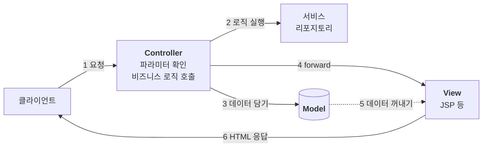

서블릿으로는 요청을 읽고 응답을 쓸 수 있다. 그런데 응답으로 화면(HTML)까지 만들기 시작하면 코드가 금세 복잡해진다. 로직과 화면이 한곳에 섞이기 때문이다.

서블릿으로 HTML을 직접 만드는 방식에서 JSP로, 다시 MVC 패턴으로 역할을 나누면 이 문제를 줄일 수 있다. 하지만 서블릿과 JSP로 MVC를 직접 구현해도 반복되는 코드는 남는다. 이 반복을 살펴보면 스프링 MVC가 어떤 문제를 해결하는지 보인다.

---

## 서블릿만으로 화면을 만들면

서블릿으로 HTML을 응답하려면 자바 코드 안에서 HTML을 문자열로 한 줄씩 써야 한다.

```java
PrintWriter w = response.getWriter();
w.write("<html><body>");
w.write("<ul>");
w.write("  <li>username=" + member.getUsername() + "</li>");
w.write("</ul>");
w.write("</body></html>");
```

동적인 값을 넣을 수는 있지만, 화면이 조금만 커져도 읽기 어렵고 태그 하나 빠뜨린 실수도 찾기 힘들다. 차라리 HTML 문서에서 필요한 곳만 동적으로 바꾸는 게 훨씬 편하다. 이 역할을 하는 것이 **템플릿 엔진**이다.

> **템플릿 엔진**: HTML 같은 문서를 기본으로 두고, 필요한 부분을 데이터로 채워 넣는 도구다. JSP, Thymeleaf, FreeMarker 등이 있다.

## JSP로 바꾸면

JSP에서는 반대로 HTML 안에 자바 코드를 끼워 넣을 수 있다.

```html
<%@ page contentType="text/html;charset=UTF-8" language="java" %>
<%
    // 파라미터와 리포지토리는 앞에서 준비했다고 가정한다
    Member member = memberRepository.save(new Member(username, age));
%>
<html><body>
<ul>
    <li>username=<%= member.getUsername() %></li>
</ul>
</body></html>
```

- `<%@ page %>`: 페이지 설정(콘텐츠 타입, import 등)을 적는다.
- `<% %>`: 자바 코드를 실행한다.
- `<%= %>`: 값을 화면에 출력한다.

HTML을 다루기는 훨씬 편해졌다. 하지만 위 코드의 윗부분을 보면 회원을 저장하는 로직이 여전히 화면 파일 안에 들어 있다.

> **참고**: 위 코드는 로직과 화면이 섞이는 문제를 보여 주기 위한 예시다. JSP를 뷰로 사용할 때는 자바 코드를 직접 넣기보다 EL과 태그 라이브러리 등으로 전달받은 데이터를 표현하는 편이 좋다.

## 로직과 화면이 섞이면 생기는 문제

서블릿이든 JSP든, 한 파일이 로직 처리와 화면 생성을 모두 맡으면 두 가지 문제가 생긴다.

- **하는 일이 너무 많다**: 파일 하나에 수백, 수천 줄의 로직과 HTML이 뒤섞여 유지보수가 어렵다.
- **바뀌는 이유가 다르다**: 화면은 디자인 때문에, 로직은 업무 규칙 때문에 바뀐다. 변경 이유와 주기가 다른 두 가지가 한 파일에 있으면 한쪽을 고칠 때 다른 쪽까지 신경 써야 한다.

해결 방향은 분명하다. 로직은 로직대로, 화면은 화면대로 나누는 것이다.

## MVC 패턴

MVC는 애플리케이션의 역할을 Model, View, Controller로 나누는 패턴이다. 웹 요청을 처리하는 흐름에서는 다음과 같이 역할을 나눌 수 있다.

| 역할 | 하는 일 |
| --- | --- |
| **Controller** | 요청을 받아 파라미터를 확인하고, 비즈니스 로직을 호출한 뒤 결과를 모델에 담는다 |
| **Model** | 뷰에 넘겨줄 데이터를 담아 둔다 |
| **View** | 모델에 담긴 데이터로 화면을 그리는 일에 집중한다 |



컨트롤러가 처리를 조율하고, 뷰는 그 결과를 보여 주는 데 집중한다. 덕분에 화면을 고칠 때는 뷰를, 업무 규칙을 고칠 때는 비즈니스 로직을 중심으로 수정할 수 있다.

> **참고**: 비즈니스 로직을 컨트롤러에 직접 두면 컨트롤러가 너무 많은 일을 맡게 된다. 그래서 보통은 서비스 계층을 따로 두고, 컨트롤러는 서비스를 호출하는 역할을 한다. 여기서 모델은 뷰에 전달할 데이터를 뜻하며, MVC에서 말하는 모델의 범위가 언제나 데이터 저장소로만 한정되는 것은 아니다.

## 서블릿과 JSP로 MVC 구현하기

서블릿을 컨트롤러로, JSP를 뷰로 쓰면 MVC 패턴을 구현할 수 있다. 뷰에 전달할 데이터를 담는 모델로는 `HttpServletRequest`의 속성 저장소를 사용한다.

```java
// 컨트롤러 (서블릿)
Member member = memberRepository.save(new Member(username, age));  // 저장 로직 호출

request.setAttribute("member", member);  // 모델에 데이터 담기

String viewPath = "/WEB-INF/views/save-result.jsp";
RequestDispatcher dispatcher = request.getRequestDispatcher(viewPath);
dispatcher.forward(request, response);  // 뷰로 넘기기
```

```html
<!-- 뷰 (JSP) -->
<li>username=${member.username}</li>
```

- `request.setAttribute()`: 현재 요청에서 사용할 속성을 저장한다. 여기서는 뷰에 전달할 데이터를 담는 모델 역할을 한다.
- `dispatcher.forward()`: 서버 안에서 다른 서블릿이나 JSP로 처리를 넘긴다. 같은 request와 response를 전달하므로 JSP에서도 저장한 속성을 읽을 수 있다.
- `${member.username}`: JSP의 EL(Expression Language, 표현 언어)로 값을 꺼낸다. 여기서는 `member` 객체의 `getUsername()`을 통해 값을 읽는다.

> **/WEB-INF**: 이 경로 안에 있는 JSP는 클라이언트가 URL로 직접 요청할 수 없다. 컨트롤러에서 내부적으로 처리를 넘겨 화면을 렌더링하는 용도로 사용할 수 있다.

> **forward와 redirect**: forward는 서버 내부에서 처리를 넘기므로 브라우저의 URL이 바뀌지 않고 기존 요청도 유지된다. redirect는 클라이언트에 다른 주소로 다시 요청하라는 응답을 보낸다. 브라우저가 이를 따르면 URL이 바뀌고 새로운 요청이 발생한다.

## 직접 구현한 MVC에 남는 반복

역할은 나뉘었다. 하지만 컨트롤러를 여러 개 만들다 보면 똑같은 코드가 반복된다. MVC 패턴 자체의 문제라기보다, 각 서블릿이 요청 처리 흐름을 개별적으로 구현하면서 생기는 문제다.

- **뷰로 넘기는 코드**: `getRequestDispatcher()`와 `forward()`가 화면을 반환하는 컨트롤러마다 들어간다.
- **뷰 경로**: `/WEB-INF/views/`와 `.jsp`가 계속 반복된다. 경로 규칙이나 템플릿 엔진을 바꾸면 여러 컨트롤러를 수정해야 한다.
- **서블릿 API 의존**: `response`를 직접 쓰지 않는 컨트롤러도 서블릿 메서드의 인자로 받아야 한다. 요청 처리 로직이 서블릿 API에 묶여 단위 테스트에도 해당 객체를 준비해야 한다.
- **공통 처리**: 로그나 인증 같은 기능을 각 컨트롤러에서 직접 호출하면 코드가 중복되고 호출을 빠뜨릴 수도 있다.

이런 반복을 줄이려면 컨트롤러 앞에 공통 입구를 두고, 요청이 먼저 그곳을 거치게 할 수 있다. 공통 입구에서 처리 흐름을 조율하고 요청에 맞는 컨트롤러에 일을 맡기는 구조가 **프론트 컨트롤러** 패턴이다.

> **참고**: 로그나 인증 같은 공통 처리는 서블릿 필터로도 분리할 수 있다. 프론트 컨트롤러는 요청 분배와 컨트롤러 호출, 뷰 처리 등 MVC 내부의 흐름을 한곳에서 조율하는 데 초점이 있다.

---

서블릿으로 HTML을 직접 만들기는 불편했고, JSP 안에서 요청 처리까지 하면 화면과 로직이 섞였다. MVC 패턴으로 역할을 나누면 이 문제를 줄일 수 있지만, 각 컨트롤러가 요청과 뷰를 직접 다루는 코드까지 사라지는 것은 아니다.

스프링 MVC는 이 반복을 프레임워크가 맡는다. 프론트 컨트롤러인 `DispatcherServlet`을 중심에 두고 요청을 분배하고, 컨트롤러의 실행 결과를 뷰로 연결한다. 다음으로 살펴볼 것은 이 공통 입구가 컨트롤러의 일을 어떻게 줄여 주는가다.
