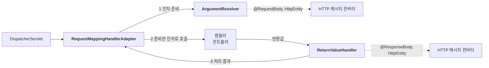

스프링 MVC로 웹 애플리케이션을 만들 때 자주 쓰는 기능을 정리한다. 요청을 어떻게 매핑하고, 데이터를 어떻게 받고, 응답을 어떻게 돌려주는지다. 마지막에는 이 편리함이 스프링 내부의 어디서 나오는지 살펴본다.

---

## 요청 매핑

요청 매핑은 **어떤 요청이 오면 어떤 메서드를 실행할지** 정하는 일이다. URL이 기본이고, HTTP 메서드나 헤더 같은 조건을 더 붙일 수 있다.

> **`@RestController`**: 클래스에 `@Controller`와 `@ResponseBody`를 함께 적용한 것과 같다. 문자열을 반환하면 뷰 이름으로 쓰지 않고 응답 바디에 넣는다. `"ok"`를 반환하면 응답으로 `ok`라는 글자가 나간다.

### URL과 HTTP 메서드

```java
@GetMapping("/mapping-get-v2")  // GET 요청을 매핑한다
public String mappingGetV2() {
    return "ok";
}
```

`@RequestMapping(value = "/mapping-get-v2", method = RequestMethod.GET)`을 줄인 것이다.

`@GetMapping`뿐만 아니라 `@PostMapping`, `@PutMapping`, `@PatchMapping`, `@DeleteMapping`도 있다. URL은 매핑되지만 지원하지 않는 HTTP 메서드로 요청하면 일반적으로 405(Method Not Allowed)를 반환한다. GET 매핑은 HEAD 요청도 지원한다.

### 경로 변수

`/users/1`처럼 URL 경로에 식별자를 넣을 수 있다. `@PathVariable`로 그 값을 꺼낸다.

```java
@GetMapping("/mapping/users/{userId}/orders/{orderId}")
public String mappingPath(@PathVariable("userId") String userId,
                          @PathVariable("orderId") Long orderId) {
    return "ok";  // /mapping/users/userA/orders/100 → userA, 100
}
```

### 조건 매핑

`@RequestMapping`과 `@GetMapping` 등에는 URL 말고도 조건을 거는 속성이 있다.

| 속성 | 확인하는 대상 | 예시 |
| --- | --- | --- |
| `params` | 요청 파라미터 | `params = "mode=debug"` |
| `headers` | HTTP 헤더 | `headers = "mode=debug"` |
| `consumes` | 요청의 `Content-Type` | `consumes = "application/json"` |
| `produces` | 요청의 `Accept`와 응답 가능한 미디어 타입 | `produces = "text/html"` |

`consumes` 조건에 맞지 않으면 보통 415(Unsupported Media Type), `produces` 조건에 맞는 응답을 만들 수 없으면 406(Not Acceptable)이 발생한다. 다른 매핑 조건도 함께 고려되므로 요청에 따라 최종 결과는 달라질 수 있다.

> **consume과 produce**: consume은 ‘소비하다’, produce는 ‘생산하다’라는 뜻이다. `consumes`는 받아들이는 요청 타입, `produces`는 만들어 낼 응답 타입을 지정한다고 생각하면 쉽다.

### 클래스 레벨과 조합하기

회원 관리 API처럼 같은 경로가 반복되면 공통 부분을 클래스에 한 번만 적는다.

```java
@RestController
@RequestMapping("/mapping/users")
public class MappingClassController {

    @GetMapping  // GET /mapping/users: 회원 목록
    public String users() { return "get users"; }

    @PostMapping  // POST /mapping/users: 회원 등록
    public String addUser() { return "post user"; }

    @GetMapping("/{userId}")  // 회원 조회
    public String findUser(@PathVariable("userId") String userId) {
        return "get userId=" + userId;
    }

    @PatchMapping("/{userId}")  // 회원 수정
    public String updateUser(@PathVariable("userId") String userId) {
        return "update userId=" + userId;
    }

    @DeleteMapping("/{userId}")  // 회원 삭제
    public String deleteUser(@PathVariable("userId") String userId) {
        return "delete userId=" + userId;
    }
}
```

같은 URL이라도 HTTP 메서드로 하는 일을 나눈다. 위 코드는 매핑 예제이며 실제 조회나 저장 로직은 생략했다.

## 요청 데이터 받기

클라이언트가 보내는 데이터를 읽는 대표적인 방법은 다음과 같다.

**GET 쿼리 파라미터**와 **POST HTML Form**은 `username=hello&age=20` 형식을 사용한다. URL과 바디라는 위치는 다르지만 서블릿에서는 **요청 파라미터**로 묶어 조회할 수 있다.

| 방법 | 데이터 위치 | 주로 쓰는 곳 | 읽는 방법 |
| --- | --- | --- | --- |
| GET 쿼리 파라미터 | URL (`?username=hello&age=20`) | 검색, 필터, 페이징 | `@RequestParam`, `@ModelAttribute` |
| POST HTML Form | 바디 (`username=hello&age=20`) | 회원 가입, 주문 | `@RequestParam`, `@ModelAttribute` |
| 메시지 바디 직접 전달 | 바디 (주로 JSON) | HTTP API | `@RequestBody`, `HttpEntity` |

여기서 POST 폼은 `application/x-www-form-urlencoded` 형식을 기준으로 한다. 파일 업로드 등에 사용하는 `multipart/form-data`는 별도 처리가 필요하다.

### @RequestParam: 요청 파라미터를 하나씩 받기

`@RequestParam`은 요청 파라미터를 이름으로 꺼내 메서드 인자에 넣는다. 문자열로 온 값을 `int` 같은 타입으로 변환하는 일도 맡는다.

```java
@ResponseBody
@RequestMapping("/request-param-v2")
public String requestParamV2(@RequestParam("username") String username,
                             @RequestParam("age") int age) {
    // ?username=hello&age=20 → username = "hello", age = 20
    return "ok";
}
```

- **`required`**: 기본값은 `true`다. 필수 파라미터가 없으면 일반적으로 400 오류가 발생한다.
- **빈 문자열**: `?username=`은 파라미터가 있는 것으로 보고 `String`에는 빈 문자열을 넣는다. 다만 `int` 같은 타입은 빈 문자열을 유효한 값으로 받을 수 없다.
- **선택적 숫자 파라미터**: `required = false`로 두면 값이 없을 수 있으므로 `int` 대신 `Integer`를 사용하거나 기본값을 지정한다.
- **`defaultValue`**: 값이 없거나 빈 문자열일 때 사용할 값을 정한다. 기본값을 지정하면 `required = false`가 암묵적으로 적용된다.

```java
@RequestParam(value = "username", defaultValue = "guest") String username
@RequestParam(value = "age", required = false) Integer age
```

> **한꺼번에 받기**: `@RequestParam Map<String, String> paramMap`으로 전체 파라미터를 받을 수 있다. 같은 이름으로 값이 여러 개 오면 `MultiValueMap<String, String>`이나 해당 파라미터의 배열·리스트를 사용한다.

### @ModelAttribute: 요청 파라미터를 객체로 받기

여러 파라미터를 받아 객체로 묶을 때는 `@ModelAttribute`를 쓴다.

```java
@Data  // 롬복: getter, setter 등을 생성한다
public class HelloData {
    private String username;
    private int age;
}
```

```java
@ResponseBody
@RequestMapping("/model-attribute-v1")
public String modelAttributeV1(@ModelAttribute HelloData helloData) {
    // ?username=hello&age=20 → helloData에 값이 채워져 있다
    return "ok";
}
```

위 예제에서는 스프링이 기본 생성자로 객체를 만들고 프로퍼티에 값을 바인딩한다. `username`은 `setUsername()`으로, `age`는 정수 변환 후 `setAge()`로 넣는다. 스프링은 생성자를 통한 바인딩도 지원한다.

`age=abc`처럼 변환할 수 없는 값은 바인딩 오류가 된다. 오류는 바로 뒤에 선언한 `BindingResult`로 확인할 수 있고, 처리하지 않으면 기본적으로 400 응답으로 이어진다. 구체적인 예외 타입은 스프링 버전과 검증 방식에 따라 달라질 수 있다.

> **애노테이션을 생략하면**: 다른 인자 처리 대상이 아닌 경우, `String`, `int` 같은 단순 타입은 요청 파라미터로, 복합 객체는 모델 속성으로 처리한다. 의도를 명확히 하고 싶다면 `@RequestParam`과 `@ModelAttribute`를 적는 편이 좋다.

### @RequestBody: 메시지 바디를 받기

JSON 바디는 요청 파라미터가 아니므로 `@RequestParam`이나 `@ModelAttribute`로 바인딩하지 않는다. `@RequestBody`로 읽는다.

```java
// 요청 바디: {"username":"hello", "age":20}
// Content-Type: application/json
@ResponseBody
@PostMapping("/request-body-json-v3")
public String requestBodyJsonV3(@RequestBody HelloData data) {
    // JSON → HelloData 변환을 스프링이 맡는다
    return "ok";
}
```

- `@RequestBody String body`는 바디를 문자열로 받는다.
- 헤더도 함께 필요하면 `HttpEntity<HelloData>`로 받을 수 있다.
- JSON 객체를 받으려는 경우 **`@RequestBody`를 생략하면 안 된다**. 일반적인 복합 객체는 `@ModelAttribute` 방식으로 처리되어 요청 파라미터를 찾게 된다.
- 요청의 `Content-Type`은 바디 형식에 맞게 지정해야 한다. JSON 변환에는 JSON을 지원하는 메시지 컨버터도 필요하다.

> **요청 파라미터와 바디 구분**: 폼 데이터도 바디에 담길 수 있다. 위치만 보고 구분하기보다 데이터 형식과 처리 방식을 봐야 한다. 쿼리와 폼 파라미터는 `@RequestParam`이나 `@ModelAttribute`, JSON 같은 바디는 `@RequestBody`로 받는다.

## 응답 만들기

대표적인 응답 방식은 세 가지다.

| 방법 | 용도 | 구성 |
| --- | --- | --- |
| 정적 리소스 | 준비된 HTML, CSS, JS 제공 | 기본적으로 `src/main/resources/static` 등에 파일을 둔다 |
| 뷰 템플릿 | 데이터를 넣어 HTML 생성 | Thymeleaf 기준 `src/main/resources/templates`에 템플릿을 두고 뷰 이름을 반환한다 |
| HTTP 메시지 바디 | HTTP API 데이터 응답 | `@ResponseBody`, `ResponseEntity`를 사용한다 |

### 정적 리소스

기본 설정에서 `src/main/resources/static/basic/hello-form.html`은 `/basic/hello-form.html`로 요청할 수 있다. 서버에서 템플릿 렌더링을 하지 않고 파일을 리소스로 제공한다.

### 뷰 템플릿

`@Controller`의 메서드가 `@ResponseBody` 없이 문자열을 반환하면 일반적으로 뷰 이름으로 해석한다. Thymeleaf 스타터를 추가하면 스프링 부트가 관련 자동 설정을 제공하며, 기본 경로는 `classpath:/templates/`, 접미사는 `.html`이다.

```java
@Controller
public class ResponseViewController {

    @GetMapping("/response-view-v2")
    public String responseViewV2(Model model) {
        model.addAttribute("data", "hello!!");
        return "response/hello";  // templates/response/hello.html
    }
}
```

> **같은 문자열, 다른 결과**: `@ResponseBody`가 없으면 `response/hello`라는 이름으로 뷰를 찾는다. 있으면 뷰 리졸버를 거치지 않고 그 문자열을 응답 바디에 쓴다.

### HTTP 메시지 바디

HTTP API에서는 뷰 대신 데이터를 반환한다. 다음 메서드는 `@Controller` 안에 있다고 가정한다.

```java
@GetMapping("/response-body-json-v1")
public ResponseEntity<HelloData> responseBodyJsonV1() {
    HelloData data = new HelloData();
    data.setUsername("userA");
    data.setAge(20);
    return ResponseEntity.ok(data);
}

@ResponseStatus(HttpStatus.OK)
@ResponseBody
@GetMapping("/response-body-json-v2")
public HelloData responseBodyJsonV2() {
    HelloData data = new HelloData();
    data.setUsername("userA");
    data.setAge(20);
    return data;
}
```

JSON 컨버터가 구성되고 JSON 응답이 선택되면 객체가 JSON으로 변환된다.

- **`ResponseEntity`**: 바디, 상태 코드, 헤더를 함께 지정할 수 있다. 실행 결과에 따라 상태 코드를 바꿀 때도 편리하다. `@ResponseBody`를 추가할 필요가 없다.
- **`@ResponseBody`와 `@ResponseStatus`**: 반환값을 바디로 쓰고, 고정된 상태 코드를 선언한다. 성공 응답의 기본 상태가 200이라 위 예제의 `@ResponseStatus(HttpStatus.OK)`는 생략해도 된다.
- **`@RestController`**: 클래스에 `@ResponseBody`를 적용하므로, 각 메서드에 반복해서 붙이지 않아도 된다.

## HTTP 메시지 컨버터

`@RequestBody`가 JSON을 객체로 읽고, `@ResponseBody`가 객체를 JSON으로 쓰는 데는 **HTTP 메시지 컨버터**가 사용된다. HTTP 메시지 바디와 자바 값을 서로 변환하는 도구다.

| 적용 대상 | 방향 |
| --- | --- |
| `@RequestBody`, `HttpEntity`, `RequestEntity` | 요청 바디 → 자바 값 |
| `@ResponseBody`, `HttpEntity`, `ResponseEntity` | 자바 값 → 응답 바디 |

대표적인 컨버터는 다음과 같다. 실제 등록 목록과 순서는 스프링 버전, 의존성, 설정에 따라 달라진다. 아래 JSON 컨버터는 Jackson 2 기반 구성의 예다.

| 컨버터 | 대상 타입 | 지원 미디어 타입의 예 |
| --- | --- | --- |
| `ByteArrayHttpMessageConverter` | `byte[]` | `application/octet-stream`, `*/*` |
| `StringHttpMessageConverter` | `String` | `text/plain`, `*/*` |
| `MappingJackson2HttpMessageConverter` | JSON으로 변환 가능한 객체 | `application/json`, `application/*+json` |

컨버터는 **자바 타입**과 **미디어 타입**을 함께 보고 선택한다.

- **요청을 읽을 때**: 대상 타입과 요청의 `Content-Type`을 기준으로 `canRead()`를 확인한 뒤 `read()`로 값을 읽는다.
- **응답을 쓸 때**: 요청의 `Accept`, 매핑의 `produces` 등으로 응답 미디어 타입을 정하고, 반환 타입과 함께 `canWrite()`를 확인한 뒤 `write()`로 바디를 쓴다.

> **어떤 컨버터가 선택될까?**: JSON 요청이라도 `@RequestBody String`이면 보통 문자열 컨버터가 원문을 읽는다. `@RequestBody HelloData`면 JSON 컨버터가 객체로 변환한다. `Content-Type: text/html`인데 `HelloData`로 읽으려 하면, 이를 지원하는 별도 컨버터가 없는 기본 구성에서는 일반적으로 415 오류가 발생한다.

## 요청 매핑 핸들러 어댑터 구조

애노테이션 기반 컨트롤러를 실행하는 핸들러 어댑터는 `RequestMappingHandlerAdapter`다. 이 어댑터는 컨트롤러를 호출하기 전후에 인자 준비와 반환값 처리를 맡긴다.



1. **ArgumentResolver**: 컨트롤러에 넘길 인자를 준비한다. `HttpServletRequest`, `Model`, `@RequestParam`, `@ModelAttribute`, `@RequestBody` 등 다양한 인자를 받을 수 있는 이유다.
2. **핸들러 호출**: 준비한 인자로 컨트롤러 메서드를 실행한다.
3. **ReturnValueHandler**: 컨트롤러의 반환값을 처리한다. 문자열을 뷰 이름으로 해석하거나, 객체를 응답 바디에 쓰는 등 반환 방식에 맞는 일을 한다.

메시지 컨버터는 이 중 바디 처리를 담당하는 구현체가 사용한다. 요청에서는 `@RequestBody`와 `HttpEntity` 등을 처리하는 ArgumentResolver가, 응답에서는 `@ResponseBody`와 `ResponseEntity` 등을 처리하는 ReturnValueHandler가 호출한다.

ArgumentResolver는 `supportsParameter()`로 지원 여부를 확인하고, `resolveArgument()`로 실제 인자를 준비한다. 컨버터의 `canRead()` → `read()`와 마찬가지로 ‘처리할 수 있는지 확인한 뒤 처리’하는 구조다.

> **argument resolver**: argument는 메서드에 전달하는 인자, resolver는 대상을 해석하고 결정하는 역할을 뜻한다. 컨트롤러가 필요로 하는 인자를 마련해 주는 도구라고 생각하면 된다.

> **확장도 가능하다**: `HandlerMethodArgumentResolver`, `HandlerMethodReturnValueHandler`, `HttpMessageConverter`는 인터페이스다. `WebMvcConfigurer`로 구현체를 추가하거나 구성을 조정할 수 있다. 다만 기본 구현체와의 처리 순서도 고려해야 한다.

## 키워드 정리

| 키워드 | 하는 일 |
| --- | --- |
| `@GetMapping` 등 | URL과 HTTP 메서드로 요청을 메서드에 연결한다 |
| `@PathVariable` | URL 경로의 값을 받는다 |
| `@RequestParam` | 요청 파라미터를 이름으로 받는다 |
| `@ModelAttribute` | 요청 파라미터를 객체에 바인딩한다 |
| `@RequestBody` | 메시지 바디를 문자열이나 객체 등으로 받는다 |
| `@ResponseBody` | 반환값을 응답 바디에 쓴다 |
| `ResponseEntity` | 응답 바디, 상태 코드, 헤더를 지정한다 |
| HTTP 메시지 컨버터 | 메시지 바디와 자바 값을 변환한다 |
| ArgumentResolver | 컨트롤러 인자를 준비한다 |
| ReturnValueHandler | 컨트롤러 반환값을 처리한다 |

---

요청 데이터는 파라미터 바인딩과 메시지 바디 변환으로 나누어 보면 이해하기 쉽다. 컨트롤러의 응답도 뷰로 렌더링할지, 바디에 직접 쓸지 구분하면 된다.

이 편리함은 `RequestMappingHandlerAdapter`가 ArgumentResolver와 ReturnValueHandler를 통해 호출 앞뒤를 처리해 주는 덕분이다. 애노테이션 하나를 붙일 때 그 뒤에서 누가 일하는지 떠올리면, 문제가 생겨도 어디를 확인해야 할지 찾기 쉬워진다.
