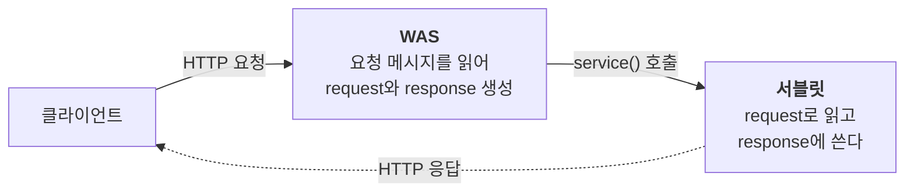

웹 브라우저와 서버는 HTTP 메시지를 주고받는다. 서버가 요청을 처리하려면 이 메시지를 한 줄씩 읽어 해석하고, 응답도 규칙에 맞춰 다시 써야 한다. 매번 이 일을 직접 한다면 정작 비즈니스 로직에는 손도 대지 못한다.

자바에서는 **서블릿**이 이 반복을 대신한다. 스프링 MVC도 내부적으로는 서블릿 위에서 동작하므로, 서블릿을 알면 스프링이 요청과 응답을 어떻게 다루는지도 보인다.

---

## 서블릿이란

서블릿은 HTTP 요청을 받아 처리하는 자바 객체다. 핵심은 HTTP 메시지를 직접 해석하지 않아도 된다는 점이다.



1. 클라이언트가 HTTP 요청을 보낸다.
2. WAS(웹 애플리케이션 서버, 예: 톰캣)가 메시지를 읽어 `HttpServletRequest`와 `HttpServletResponse` 객체를 만든다.
3. URL에 맞는 서블릿의 `service()` 메서드를 호출한다.
4. 서블릿이 request에서 필요한 값을 꺼내고, response에 결과를 담는다.
5. WAS가 response를 HTTP 응답 메시지로 만들어 돌려준다.

개발자는 4번, 즉 **request에서 읽고 response에 쓰는 일**에만 집중하면 된다.

### 서블릿 등록하기

스프링 부트에서는 `@ServletComponentScan`을 붙이면 `@WebServlet`이 붙은 클래스를 찾아 서블릿으로 등록해 준다.

```java
@ServletComponentScan  // 서블릿 자동 등록
@SpringBootApplication
public class Application { ... }

@WebServlet(name = "helloServlet", urlPatterns = "/hello")
public class HelloServlet extends HttpServlet {

    @Override
    protected void service(HttpServletRequest request, HttpServletResponse response) throws IOException {
        String username = request.getParameter("username");  // 요청에서 읽고

        response.setContentType("text/plain");                // 응답에 쓴다
        response.setCharacterEncoding("utf-8");
        response.getWriter().write("hello " + username);
    }
}
```

`/hello`로 요청이 들어오면 WAS가 `service()`를 호출한다.

## HttpServletRequest로 요청 읽기

`HttpServletRequest`는 HTTP 요청 메시지를 편하게 읽을 수 있게 해 주는 객체다. HTTP 요청 메시지는 크게 세 부분으로 나뉘고, 각각 얻는 방법이 있다.

```text
POST /save HTTP/1.1                                 ← 시작 라인
Host: localhost:8080                                ← 헤더
Content-Type: application/x-www-form-urlencoded

username=kim&age=20                                 ← 바디
```

| 부분 | 담긴 정보 | 읽는 방법 |
| --- | --- | --- |
| 시작 라인 | 메서드, URL, 쿼리 스트링, 프로토콜 | `getMethod()`, `getRequestURI()`, `getQueryString()` |
| 헤더 | 호스트, 언어, 쿠키, Content-Type 등 | `getHeader()`, `getCookies()`, `getContentType()` |
| 바디 | 폼 데이터, 텍스트, JSON 등 | `getParameter()`, `getInputStream()` |

> **참고**: request에는 메시지 조회 외에도 편의 기능이 있다. `setAttribute()`와 `getAttribute()`로 요청이 끝날 때까지 쓸 임시 저장소를 쓸 수 있고, `getSession()`으로 세션을 다룰 수 있다.

> **HTTP를 알아야 하는 이유**: `HttpServletRequest`는 HTTP 메시지를 편하게 읽게 도와줄 뿐이다. 어떤 값이 어디에 담겨 오는지는 결국 HTTP 스펙을 알아야 이해할 수 있다.

## 클라이언트가 데이터를 보내는 세 가지 방법

클라이언트가 서버로 데이터를 보내는 방법은 사실상 세 가지뿐이다.

| 방법 | 데이터 위치 | 주로 쓰는 곳 |
| --- | --- | --- |
| GET 쿼리 파라미터 | URL (`/url?username=kim&age=20`) | 검색, 필터, 페이징 |
| POST HTML Form | 바디 (쿼리 파라미터와 같은 형식) | 회원 가입, 주문 등 폼 제출 |
| HTTP 메시지 바디 | 바디 (주로 JSON) | HTTP API |

### 쿼리 파라미터와 HTML Form은 같은 방법으로 읽는다

HTML Form은 데이터를 바디에 담지만, 형식이 쿼리 파라미터와 똑같다(`username=kim&age=20`). 이때 Content-Type은 `application/x-www-form-urlencoded`다. 그래서 서버는 둘을 구분하지 않고 같은 메서드로 읽는다.

```java
String username = request.getParameter("username");          // 단일 값
String[] usernames = request.getParameterValues("username"); // 같은 이름이 여러 개일 때
Map<String, String[]> all = request.getParameterMap();       // 전체 파라미터
```

> **참고**: `?username=kim&username=lee`처럼 같은 이름이 여러 개면 `getParameterValues()`로 모두 받는다. 이때 `getParameter()`를 쓰면 첫 번째 값만 돌아온다.

> **Content-Type의 차이**: GET 쿼리 파라미터는 바디가 없으므로 Content-Type도 없다. Content-Type은 바디에 담긴 데이터의 형식을 알려 주는 헤더라, POST HTML Form처럼 바디가 있을 때만 붙는다.

### 메시지 바디는 스트림으로 읽는다

HTTP API에서는 바디에 텍스트나 JSON을 직접 담는다. 이 데이터는 `getParameter()`로 읽을 수 없고, 바디를 바이트 스트림으로 꺼내 문자열로 바꿔야 한다.

```java
ServletInputStream inputStream = request.getInputStream();
String body = StreamUtils.copyToString(inputStream, StandardCharsets.UTF_8);  // 바이트 → 문자열
```

JSON도 결국 문자열이다. 읽어 온 문자열을 Jackson의 `ObjectMapper`로 자바 객체에 옮기면 된다.

```java
// 바디: {"username": "kim", "age": 20}
HelloData data = objectMapper.readValue(body, HelloData.class);
```

> **참고**: HTML Form 데이터도 바디에 담기므로 `getInputStream()`으로 읽을 수는 있다. 다만 `getParameter()`가 훨씬 편해서 그렇게 할 일은 거의 없다.

## HttpServletResponse로 응답 쓰기

`HttpServletResponse`는 HTTP 응답 메시지를 만드는 객체다. 상태 코드, 헤더, 바디를 채울 수 있고, 자주 쓰는 헤더는 편의 메서드로도 제공한다.

```java
response.setStatus(HttpServletResponse.SC_OK);          // 상태 코드 200
response.setHeader("Cache-Control", "no-cache");       // 헤더 직접 설정
response.setContentType("text/plain");                // Content-Type 편의 메서드
response.setCharacterEncoding("utf-8");
response.addCookie(new Cookie("myCookie", "good"));    // 쿠키
response.sendRedirect("/basic/hello-form.html");      // 리다이렉트(302 + Location)
```

### 응답 데이터의 세 가지 형태

응답도 요청과 마찬가지로 형태가 세 가지다. Content-Type만 맞춰 주고, 바디는 모두 `getWriter()`로 쓴다.

| 형태 | Content-Type | 바디에 쓰는 것 |
| --- | --- | --- |
| 단순 텍스트 | `text/plain` | 문자열 그대로 |
| HTML | `text/html` | HTML 코드를 문자열로 |
| JSON | `application/json` | `ObjectMapper`로 객체를 변환한 문자열 |

```java
response.setContentType("application/json");
String result = objectMapper.writeValueAsString(data);  // 객체 → JSON 문자열
response.getWriter().write(result);
```

> **참고**: `application/json`은 스펙상 UTF-8을 쓰도록 정해져 있어서 `charset=utf-8` 같은 추가 파라미터가 의미가 없다. 단, `getWriter()`를 쓰면 charset이 자동으로 붙는데, 이걸 피하려면 `getOutputStream()`으로 출력하면 된다.

---

서블릿 덕분에 HTTP 메시지를 직접 해석하지 않고, request에서 읽고 response에 쓰는 것만으로 요청을 처리할 수 있다. 데이터가 들어오고 나가는 형태는 세 가지뿐이고, 각각 읽고 쓰는 방법도 정해져 있다.

그래도 매번 파라미터를 꺼내고, 스트림을 문자열로 바꾸고, `ObjectMapper`를 부르는 코드는 반복된다. 스프링 MVC는 이 서블릿 위에서 그 반복을 대신 처리해 준다.
