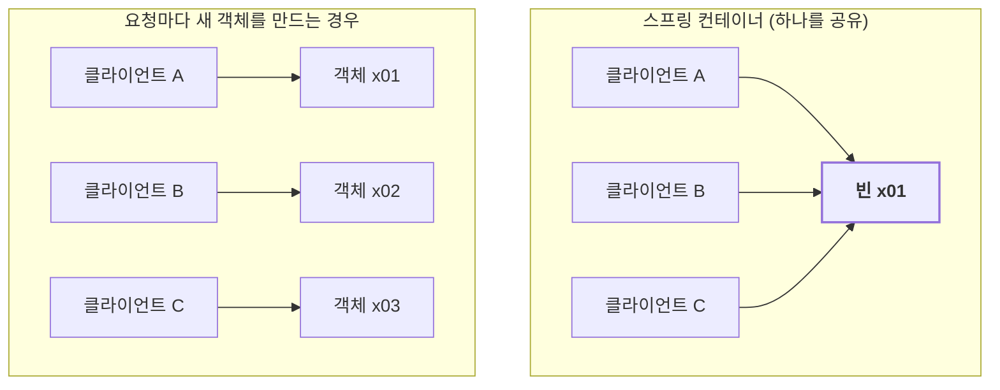

스프링 컨테이너에 등록된 빈은 기본적으로 딱 하나만 만들어진다. 왜 하나만 만드는지, 그리고 그게 어떻게 보장되는지 차례로 살펴본다.

---

## 요청마다 객체를 만들면 생기는 문제

웹 애플리케이션에서는 여러 사용자의 요청을 동시에 처리한다. 요청이 올 때마다 같은 역할의 객체를 `new`로 만들면, 초당 요청이 100개일 때 그 객체도 초당 100개씩 생성된다. 요청마다 새로 만들 필요가 없는 객체라면, 반복적인 생성과 가비지 컬렉션에 드는 비용을 줄일 수 있다.

해결책은 간단하다. 객체를 딱 하나만 만들고 모두가 공유하면 된다.



## 싱글톤 패턴과 그 한계

클래스의 인스턴스가 딱 하나만 생기도록 보장하는 디자인 패턴이 **싱글톤 패턴**이다.

```java
public class SingletonService {
    // 1. static 영역에 미리 하나 만들어 둔다
    private static final SingletonService instance = new SingletonService();

    // 2. 이 메서드로만 꺼내 쓴다
    public static SingletonService getInstance() { return instance; }

    // 3. 외부에서 new 하지 못하게 막는다
    private SingletonService() {}
}
```

하나만 만든다는 목적은 이루지만, 대가가 크다.

- 패턴을 위한 코드가 클래스마다 들어간다.
- 클라이언트가 `SingletonService.getInstance()`처럼 구체 클래스를 직접 부른다. 추상화가 아닌 구체 클래스에 의존하니 DIP를 위반하고, OCP도 깨지기 쉽다.
- 내부 상태를 바꾸거나 초기화하기 어려워 테스트가 어렵다.
- private 생성자 때문에 자식 클래스를 만들기 어렵다.

결국 유연성이 떨어져 안티패턴이라고 불리기도 한다.

## 싱글톤 컨테이너

스프링 컨테이너는 싱글톤 패턴을 쓰지 않고도 빈을 하나만 만들어 관리한다. 이렇게 싱글톤 객체를 만들고 관리하는 기능을 **싱글톤 레지스트리**라고 한다. 싱글톤 스코프에서는 하나의 컨테이너 안에서 빈 정의마다 하나의 인스턴스를 관리한다. 같은 클래스라도 서로 다른 빈으로 등록하면 인스턴스가 여러 개 생길 수 있다.

```java
Repo repo1 = ac.getBean("repo", Repo.class);
Repo repo2 = ac.getBean("repo", Repo.class);
// repo1 == repo2 : 같은 인스턴스
```

덕분에 클래스마다 싱글톤 패턴을 직접 구현할 필요가 없다. 클라이언트는 인터페이스에 의존하도록 설계할 수 있고, 테스트에서는 컨테이너 없이 객체를 직접 생성하거나 다른 구현을 주입할 수도 있다.

> **빈 스코프**: 스프링의 기본 빈 등록 방식은 싱글톤이지만, 요청할 때마다 새 객체를 만드는 방식도 지원한다.

## 싱글톤 빈은 상태를 갖지 않게 만든다

객체 하나를 여러 클라이언트가 공유하므로, 요청마다 달라지는 상태를 싱글톤 빈의 필드에 저장하면 안 된다. 요청 처리 로직은 **무상태**(stateless)로 설계하는 것이 기본이다. 의존 객체나 변경되지 않는 설정을 필드에 두는 것까지 금지한다는 뜻은 아니다.

- 특정 클라이언트에 의존하거나, 특정 클라이언트가 바꿀 수 있는 필드를 두지 않는다.
- 필드는 가급적 읽기만 가능하게 한다.
- 요청별 데이터는 지역변수, 파라미터, 반환값으로 전달한다.

> **ThreadLocal**: 스레드마다 값을 따로 저장하는 자바 클래스다. 꼭 필요한 경우에만 사용하고, 스레드 풀에서는 스레드가 재사용되므로 사용 후 `remove()`로 값을 정리해야 한다. 그렇지 않으면 다음 요청에 이전 값이 남을 수 있다.

```java
// 나쁜 예: 공유 필드에 상태를 저장한다
class OrderService {
    private int price; // 모든 클라이언트가 공유하는 필드

    void order(String user, int price) {
        this.price = price; // A가 10000을 넣고 B가 20000을 넣으면
    }
    int getPrice() { return price; } // A가 조회해도 20000이 나온다
}

// 좋은 예: 상태를 필드에 두지 않고 바로 돌려준다
class OrderService {
    int order(String user, int price) {
        return price; // 파라미터와 반환값으로 처리
    }
}
```

이런 버그는 요청이 겹치는 시점에 따라 발생하므로 재현이 어렵고, 실무에서 큰 장애로 이어질 수 있다. 공유 빈에 요청별 상태를 저장하지 않는 것이 중요하다.

## @Configuration과 바이트코드 조작

그런데 이상한 점이 있다. 설정 클래스를 다시 보자.

```java
@Configuration
public class AppConfig {
    @Bean public AService aService() { return new AService(repo()); }
    @Bean public BService bService() { return new BService(repo()); }
    @Bean public Repo repo() { return new MemoryRepo(); }
}
```

`repo()`는 컨테이너가 빈을 등록할 때 한 번, 두 서비스가 호출할 때 한 번씩, 총 세 번 불린다. 그러면 `MemoryRepo`도 세 개 생겨야 할 것 같다. 하지만 실제로는 한 번만 실행되고, 모두 같은 인스턴스를 쓴다.

비밀은 `@Configuration`에 있다. 스프링은 **CGLIB**라는 바이트코드 조작 라이브러리로 설정 클래스를 상속한 다른 클래스를 만들고, 원본 대신 그것을 빈으로 등록한다. 이 클래스의 `@Bean` 메서드는 대략 이렇게 동작한다.

```text
repo() 호출을 가로챈다.
  컨테이너에 repo 빈이 있으면 기존 빈을 반환한다.
  없으면 원래 메서드로 생성하고 컨테이너에서 관리한다.
```

그래서 메서드를 몇 번 호출하든 싱글톤이 보장된다.

설정 클래스가 `@Component`로 등록되는 등 `@Bean`이 처리되는 조건에서 `@Configuration` 없이 사용하거나, `@Configuration(proxyBeanMethods = false)`로 설정하면 메서드 호출을 가로채지 않는다. 이때 `repo()`를 직접 호출하면 일반 자바 메서드처럼 새 객체를 만든다. 컨테이너가 관리하는 싱글톤 빈이 여러 개가 되는 것은 아니지만, 서비스에 별도의 인스턴스가 전달될 수 있다.

이런 설정에서는 메서드를 직접 호출하는 대신, `@Bean` 메서드의 파라미터로 의존 객체를 주입받으면 된다.

```java
@Bean
public AService aService(Repo repo) {
    return new AService(repo);
}
```

즉, 기본 `@Configuration`은 `@Bean` 메서드 사이의 직접 호출에서도 컨테이너가 관리하는 빈을 사용하게 해 준다.

---

요청이 몰려드는 웹 애플리케이션에서 공통으로 사용하는 객체를 매번 새로 만들 필요는 없다. 그래서 스프링 컨테이너는 빈을 하나만 만들어 공유하고, 싱글톤 패턴의 번거로운 코드 없이도 그 하나를 지켜 준다. `@Configuration`이 메서드 호출까지 가로채는 것도 같은 이유다.

대신 지켜야 할 약속이 하나 생긴다. 여럿이 함께 쓰는 빈이니, 상태를 갖지 않게 만들어야 한다.

