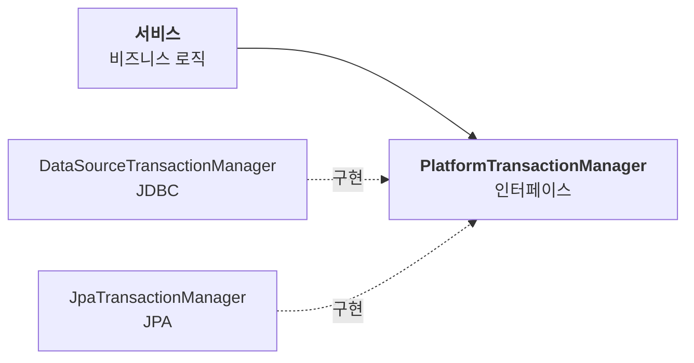
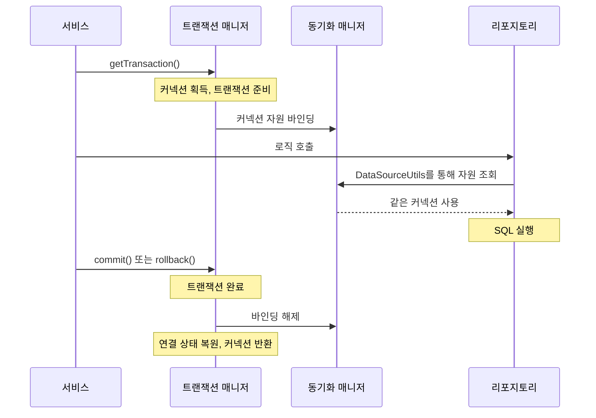
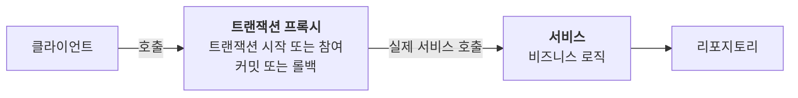

JDBC만으로 트랜잭션을 적용하면 동작은 하지만 대가가 크다. 비즈니스 로직을 담아야 할 서비스가 `Connection`, `commit()`, `rollback()` 같은 JDBC 코드로 복잡해지고, 리포지토리는 커넥션을 파라미터로 받아야 한다.

스프링은 이 문제를 트랜잭션 추상화, 트랜잭션 동기화, 트랜잭션 AOP로 풀어낸다. 서비스 코드가 단계별로 어떻게 단순해지고, 마지막에는 `@Transactional`만 남는지 살펴보자.

---

## 서비스 계층은 기술 의존을 줄인다

애플리케이션은 보통 다음과 같이 역할을 나눈다.

| 계층 | 맡는 일 | 관련 기술 |
| --- | --- | --- |
| 프레젠테이션 계층 (`@Controller`) | 웹 요청과 응답, 입력 처리 | 서블릿, HTTP, 스프링 MVC |
| 서비스 계층 (`@Service`) | 비즈니스 작업의 흐름 조율 | 도메인 객체, 리포지토리 인터페이스 등 |
| 데이터 접근 계층 (`@Repository`) | 데이터 저장과 조회 | JDBC, JPA, Redis, MongoDB 등 |

UI나 데이터 접근 기술이 바뀌어도 비즈니스 로직은 최대한 유지하고 싶다. 그러려면 서비스가 JDBC 같은 구체적인 기술에 의존하는 부분을 줄여야 한다. 테스트를 구성하기도 쉬워진다.

이는 서비스에서 모든 프레임워크 의존을 반드시 없애야 한다는 뜻은 아니다. `@Transactional`처럼 선언적인 의존은 허용하면서, 연결 제어 같은 세부 구현을 분리하는 것이 이 글의 목표다.

## JDBC 트랜잭션이 남긴 세 가지 문제

JDBC로 직접 트랜잭션을 관리하는 서비스는 다음 흐름을 갖는다. 아래는 문제를 보여 주기 위한 축약 코드이며, 롤백 실패와 자원 정리의 세부 처리는 생략했다.

```java
public void accountTransfer(String fromId, String toId, int money)
        throws SQLException {
    Connection con = dataSource.getConnection();
    try {
        con.setAutoCommit(false);
        bizLogic(con, fromId, toId, money);
        con.commit();
    } catch (Exception e) {
        con.rollback();
        throw new IllegalStateException(e);
    } finally {
        release(con);
    }
}
```

여기에는 세 가지 문제가 있다.

1. **기술 종속**: `DataSource`, `Connection`, `SQLException`이 서비스에 드러난다. JPA의 직접 트랜잭션 제어 방식은 다르므로 기술을 바꾸면 서비스도 수정해야 한다.
2. **커넥션 전달**: 같은 트랜잭션을 유지하려고 리포지토리에 커넥션을 넘긴다. 기존 API와 함께 쓰면 커넥션을 받는 메서드와 받지 않는 메서드가 나뉘기도 한다.
3. **반복 코드**: 시작, 커밋, 롤백과 정리가 트랜잭션이 필요한 메서드마다 반복된다.

스프링은 이 문제를 하나씩 해결한다.

## 트랜잭션 추상화

기술별 트랜잭션 제어에서 공통 기능을 뽑으면 트랜잭션 얻기, 커밋, 롤백으로 정리할 수 있다. 스프링은 이를 `PlatformTransactionManager`로 제공한다.

```java
public interface PlatformTransactionManager extends TransactionManager {
    TransactionStatus getTransaction(TransactionDefinition definition);
    void commit(TransactionStatus status);
    void rollback(TransactionStatus status);
}
```

`getTransaction()`은 무조건 새 트랜잭션을 시작하는 메서드는 아니다. 전파 설정에 따라 기존 트랜잭션에 참여할 수도 있다.



- 서비스는 구체적인 JDBC 매니저 대신 공통 인터페이스를 사용한다.
- JDBC에는 `DataSourceTransactionManager`, JPA에는 `JpaTransactionManager` 같은 구현체가 있다.
- 트랜잭션 경계 제어 코드는 유지하면서 구성하는 쪽에서 구현체를 선택할 수 있다. 다만 리포지토리와 트랜잭션 자원의 설정은 사용하는 기술에 맞아야 한다.

이 글에서는 인터페이스와 구현체를 통틀어 **트랜잭션 매니저**라고 부른다.

> **JdbcTransactionManager**: 스프링 5.3부터 제공하는 JDBC용 구현체로, `DataSourceTransactionManager`를 상속한다. 커밋과 롤백 과정의 SQL 예외를 스프링의 데이터 접근 예외로 변환하는 기능 등을 더한다.

## 트랜잭션 동기화

일반적인 로컬 JDBC 트랜잭션에서는 같은 커넥션을 사용해야 한다. 커넥션을 파라미터로 전달하는 대신, 스프링은 현재 실행 흐름에 연결 자원을 보관한다. 이때 사용하는 도구가 `TransactionSynchronizationManager`다.



새 JDBC 트랜잭션의 기본 흐름은 다음과 같다.

1. 트랜잭션 매니저가 데이터소스에서 커넥션을 얻고, 필요하면 자동 커밋을 끈다.
2. 커넥션을 담은 자원을 동기화 매니저에 바인딩한다.
3. 리포지토리가 같은 데이터소스로 연결을 요청하면 바인딩된 커넥션을 사용한다.
4. 트랜잭션 완료 시 커밋 또는 롤백하고, 바인딩 해제와 상태 복원, 반환을 처리한다.

> **스레드마다 따로 보관한다**: 여기서 다루는 명령형 트랜잭션은 `ThreadLocal` 기반으로 자원을 관리한다. 새 스레드나 `@Async` 작업에 같은 트랜잭션이 자동 전달되는 것은 아니다. 리액티브 트랜잭션은 다른 컨텍스트 관리 방식을 사용한다.

### 리포지토리는 DataSourceUtils를 사용한다

```java
private Connection getConnection() {
    return DataSourceUtils.getConnection(dataSource);
}

private void close(Connection con, Statement stmt, ResultSet rs) {
    JdbcUtils.closeResultSet(rs);
    JdbcUtils.closeStatement(stmt);
    DataSourceUtils.releaseConnection(con, dataSource);
}
```

- `getConnection()`은 해당 데이터소스에 바인딩된 커넥션이 있으면 재사용하고, 없으면 데이터소스에서 얻는다.
- `releaseConnection()`은 현재 트랜잭션에 묶인 커넥션을 성급하게 닫지 않는다. 그렇지 않은 연결은 반환하거나 닫는다.

리포지토리가 직접 `con.close()`를 호출해 버리면 트랜잭션 매니저가 관리할 자원을 사용할 수 없게 된다. JdbcTemplate은 이런 자원 획득과 반환을 내부에서 처리한다.

### 서비스에는 트랜잭션 매니저만 남는다

다음 예제부터 `bizLogic()`은 체크 예외를 밖으로 던지지 않는다고 가정한다. JDBC 예외가 아직 체크 예외로 노출된다면 별도 처리나 예외 변환이 필요하다.

```java
private final PlatformTransactionManager transactionManager;

public void accountTransfer(String fromId, String toId, int money) {
    TransactionStatus status = transactionManager.getTransaction(
            new DefaultTransactionDefinition());
    try {
        bizLogic(fromId, toId, money);
    } catch (RuntimeException | Error e) {
        transactionManager.rollback(status);
        throw e;
    }
    transactionManager.commit(status);
}
```

커넥션을 리포지토리에 넘기지 않아도 된다. `TransactionStatus`는 트랜잭션 상태를 나타내며 완료 처리에 사용한다. `DefaultTransactionDefinition`은 전파, 격리 수준 등 옵션의 기본값을 제공한다.

위 코드에서는 커밋을 비즈니스 예외 처리 블록 밖에 둔다. 커밋 호출이 실패했다고 이미 완료 처리 중인 상태에 다시 `rollback()`을 호출해서는 안 되기 때문이다. 직접 관리할 때 고려할 점은 여전히 남아 있다.

## 반복 코드 줄이기: TransactionTemplate

기술별 연결 제어는 사라졌지만, 시작하고 커밋하고 롤백하는 틀은 반복된다. 달라지는 것은 비즈니스 로직뿐이다.

스프링은 고정된 틀을 템플릿이 담당하고 실행할 로직만 콜백으로 받는 `TransactionTemplate`을 제공한다.

```java
public class MemberService {
    private final TransactionTemplate txTemplate;
    private final MemberRepository memberRepository;

    public MemberService(PlatformTransactionManager transactionManager,
                         MemberRepository memberRepository) {
        this.txTemplate = new TransactionTemplate(transactionManager);
        this.memberRepository = memberRepository;
    }

    public void accountTransfer(String fromId, String toId, int money) {
        txTemplate.executeWithoutResult(status -> {
            bizLogic(fromId, toId, money);
        });
    }

    // bizLogic() 생략
}
```

- 반환값이 필요하면 `execute()`, 필요 없으면 `executeWithoutResult()`를 사용한다.
- 정상 완료되면 커밋을 진행하고, `RuntimeException`이나 `Error`가 전파되면 롤백한다.
- 필요한 경우 콜백에서 `status.setRollbackOnly()`로 롤백을 지정할 수도 있다.

반복은 줄었지만 서비스에는 여전히 트랜잭션 경계를 다루는 코드가 남는다.

## 트랜잭션 AOP와 @Transactional

트랜잭션 제어를 서비스 밖으로 옮기려면 클라이언트와 서비스 사이에 **프록시**를 둘 수 있다.



프록시가 트랜잭션을 준비하고 서비스를 호출한 뒤, 반환이나 예외에 따라 완료 처리를 한다. 스프링은 트랜잭션 AOP를 통해 이 프록시를 구성한다.

```java
@Service
@RequiredArgsConstructor
public class MemberService {

    private final MemberRepository memberRepository;

    @Transactional
    public void accountTransfer(String fromId, String toId, int money) {
        bizLogic(fromId, toId, money);
    }

    // bizLogic() 생략
}
```

`@RequiredArgsConstructor`는 롬복이 생성자를 만들어 주는 애노테이션이다. `@Transactional`은 스프링의 `org.springframework.transaction.annotation.Transactional`을 사용한다.

- 메서드에 트랜잭션 속성을 선언할 수 있고, 클래스에 붙여 공통 기본값을 지정할 수도 있다.
- 프록시 방식에서는 외부에서 프록시를 거친 호출에 적용된다. 같은 객체 내부의 자기 호출에는 새 트랜잭션 경계가 적용되지 않는다.
- 프록시는 인터페이스 기반 JDK 프록시나 클래스 기반 프록시를 사용할 수 있다. 항상 CGLIB인 것은 아니다.
- 클래스 기반 프록시는 `final` 메서드 등을 가로챌 수 없다. 메서드 접근 수준의 지원도 버전과 프록시 방식에 따라 달라지므로, 외부에 공개된 `public` 서비스 메서드에 경계를 두면 이해하기 쉽다.
- 스프링이 관리하는 서비스와 적절한 트랜잭션 매니저, 트랜잭션 AOP 활성화가 필요하다.

### 기본 롤백 규칙

`@Transactional`의 일반적인 기본 규칙은 **런타임 예외와 Error는 롤백, 체크 예외는 커밋**이다. 체크 예외도 롤백해야 한다면 다음처럼 지정한다.

```java
@Transactional(rollbackFor = SQLException.class)
public void accountTransfer(String fromId, String toId, int money)
        throws SQLException {
    bizLogic(fromId, toId, money);
}
```

이 코드는 JDBC 체크 예외가 아직 노출되는 경우의 별도 예제다. 스프링 버전과 전역 설정에 따라 기본 롤백 정책을 바꿀 수도 있다. 예외를 서비스 안에서 잡고 정상 반환하면 프록시가 실패를 알지 못할 수 있다는 점도 주의해야 한다.

### 전체 흐름

새 JDBC 트랜잭션을 시작하는 일반적인 흐름은 다음과 같다.

1. 클라이언트가 서비스의 프록시를 호출한다.
2. 프록시의 트랜잭션 인터셉터가 속성과 사용할 매니저를 확인한다.
3. 매니저가 커넥션과 트랜잭션을 준비하고 현재 스레드에 자원을 바인딩한다.
4. 실제 서비스와 리포지토리가 실행된다. 리포지토리는 트랜잭션에 연결된 커넥션을 사용한다.
5. 반환이나 예외와 롤백 규칙에 따라 트랜잭션을 완료하고 자원을 정리한다.

기존 트랜잭션에 참여했다면 메서드가 끝나도 물리 커밋을 바로 하지 않을 수 있다. 완료 시점은 전파 설정과 바깥 트랜잭션 경계에 따라 달라진다.

### 선언적 방식과 프로그래밍 방식

| 방식 | 방법 | 특징 |
| --- | --- | --- |
| 선언적 트랜잭션 관리 | `@Transactional` | 비즈니스 코드와 경계 제어를 분리한다 |
| 프로그래밍 방식 트랜잭션 관리 | 매니저, `TransactionTemplate` | 코드에서 범위를 명시적으로 제어하며 AOP 없이도 사용할 수 있다 |

일반적인 서비스 경계에는 선언적 방식이 편리하다. 메서드 내부에서 일부 작업만 트랜잭션으로 묶는 등 명시적인 범위가 필요하면 템플릿도 유용하다.

## 스프링 부트의 자동 설정

스프링 부트는 관련 의존성과 설정, 기존 빈의 유무 등 조건을 확인해 데이터소스와 트랜잭션 매니저를 구성한다.

```properties
spring.datasource.url=jdbc:h2:tcp://localhost/~/test
spring.datasource.username=sa
spring.datasource.password=
```

- **데이터소스**: 일반적인 JDBC 스타터 환경에서는 HikariCP가 우선 선택된다. 드라이버 의존성과 접속 가능한 DB도 필요하다.
- **JDBC 매니저**: 최근 부트의 일반적인 JDBC 자동 구성에서는 `JdbcTransactionManager`를 사용한다. 버전과 설정에 따라 구현체는 달라질 수 있다.
- **JPA 매니저**: JPA 구성에서는 `JpaTransactionManager`를 사용한다. 같은 데이터소스와 적절한 설정을 사용하는 JDBC 접근을 함께 참여시킬 수도 있지만, 임의의 다른 DB까지 자동으로 묶는 것은 아니다.
- **사용자 정의 빈**: 직접 등록한 빈이 있으면 관련 자동 설정이 조건에 따라 물러난다. 모든 자동 설정이 한꺼번에 꺼지는 것은 아니다.

여러 데이터소스나 매니저를 사용한다면 어떤 매니저를 쓸지도 명확히 지정해야 한다. 단순한 단일 DB 구성에서는 자동 설정 덕분에 직접 작성할 설정이 크게 줄어든다.

## 문제와 해결 한눈에 보기

| 문제 | 스프링의 해결 |
| --- | --- |
| 서비스가 기술별 트랜잭션 코드에 의존한다 | `PlatformTransactionManager`로 추상화 |
| 커넥션을 파라미터로 넘겨야 한다 | 트랜잭션 동기화와 `DataSourceUtils` |
| 트랜잭션 코드가 반복된다 | `TransactionTemplate` |
| 비즈니스 로직과 경계 제어가 섞인다 | 트랜잭션 AOP와 `@Transactional` |

---

커넥션을 얻고 수동 커밋으로 바꾸고 커밋과 롤백을 챙기던 코드가 서비스 밖으로 이동했다. 트랜잭션 매니저는 기술별 차이를 감추고, 동기화는 자원을 이어 주고, 프록시는 경계 처리를 맡는다.

다만 트랜잭션 추상화만으로 데이터 접근의 모든 문제가 사라지지는 않는다. 리포지토리가 `SQLException`을 그대로 노출한다면 예외를 통한 기술 의존은 남고, JDBC 반복 코드도 별도 문제다. 예외 변환과 데이터 접근 도구까지 함께 살펴봐야 서비스와 JDBC를 더 분명하게 분리할 수 있다.
