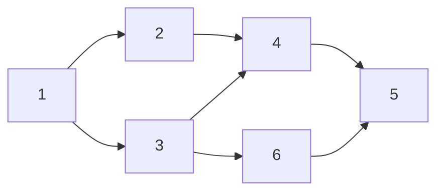

위상정렬(topological sort)은 먼저 할 일이 정해진 일들을 그 순서를 어기지 않게 한 줄로 세우는 방법이다.

작업 사이에 선후 관계가 있으면 아무 순서로나 처리할 수 없다. 위상정렬은 이런 관계를 방향 그래프로 나타내고, 모든 조건을 만족하는 처리 순서를 찾는다.

---

이름을 풀어 보면 뜻이 보인다.

- **위상(位相):** 한자로 '자리 위' + '서로 상', 즉 "서로의 자리 관계"이다.
- **위상정렬:** 누가 누구보다 먼저인가만 보고 줄을 세운다. 연결 관계(위상)를 지키면서 줄 세우기(정렬).

예를 들어 아침에 옷을 입을 때 양말은 신발보다 먼저, 바지도 신발보다 먼저 입어야 한다. 이런 "이건 저것보다 먼저" 조건이 여러 개 있을 때, 모든 조건을 지키는 순서를 찾는 것이 위상정렬이다.

- 화살표(간선) A → B는 "A가 B보다 먼저 와야 한다"는 뜻이다.
- **사이클이 없는 방향 그래프**(DAG)에서만 가능하다. A → B → C → A처럼 돌고 돌면 누가 먼저인지 정할 수 없다.
- 답이 하나가 아닐 수 있다. 서로 관계없는 일들은 어떤 순서로 둬도 된다.

## 필요한 배경지식

| 배경지식 | 종류 | 위상정렬에서 쓰이는 곳 |
| --- | --- | --- |
| 그래프 기본 개념 | 이론 | 노드, 간선, 방향 그래프, 진입차수/진출차수 같은 용어 |
| 인접 리스트 | 자료구조 | `graph.get(a).add(b)`처럼 그래프를 코드로 저장 |
| 배열 | 자료구조 | 진입차수 `indeg[]`, 방문 여부 `visited[]` 저장 |
| 큐 | 자료구조 | 진입차수 0인 노드를 대기시킴 |
| BFS | 알고리즘 | Kahn 알고리즘의 뼈대 |

## Kahn 알고리즘 (진입차수 + 큐)

가장 많이 쓰는 방법이다. **진입차수**(indegree)는 한 노드로 들어오는 간선의 수, 즉 "아직 끝나지 않은 선행 작업의 수"다.

> 옷 입기로 예를 들면, 신발은 양말과 바지를 모두 입은 뒤에야 신을 수 있다. 신발로 들어오는 화살표가 2개(양말 → 신발, 바지 → 신발)이므로 신발의 진입차수는 2다. 양말을 신으면 1로, 바지까지 입으면 0으로 줄고, 0이 되는 순간 신발을 신을 수 있다. 즉 진입차수가 0인 일은 지금 바로 할 수 있는 일이다.

1. 모든 노드의 진입차수를 계산한다.
2. 진입차수가 0인 노드(바로 할 수 있는 일)를 큐에 넣는다.
3. 큐에서 하나를 꺼내 결과에 붙이고, 그 노드에서 나가는 간선을 지우며 도착 노드의 진입차수를 1씩 줄인다. 이때 진입차수가 0이 된 노드는 큐에 넣는다.
4. 큐가 빌 때까지 반복한다.

### 예시

아래 그래프를 Kahn 알고리즘으로 정렬해 보자. 화살표는 "앞 노드가 뒤 노드보다 먼저"라는 뜻이다.



| 단계 | 꺼낸 노드 | 지우는 간선 | 새로 큐에 들어감 | 큐 | 결과 |
| --- | --- | --- | --- | --- | --- |
| 시작 | - | - | 1 | [1] | - |
| 1 | 1 | 1→2, 1→3 | 2, 3 | [2, 3] | 1 |
| 2 | 2 | 2→4 | - | [3] | 1, 2 |
| 3 | 3 | 3→4, 3→6 | 4, 6 | [4, 6] | 1, 2, 3 |
| 4 | 4 | 4→5 | - | [6] | 1, 2, 3, 4 |
| 5 | 6 | 6→5 | 5 | [5] | 1, 2, 3, 4, 6 |
| 6 | 5 | - | - | [] | 1, 2, 3, 4, 6, 5 |

### 코드

Kahn 알고리즘은 BFS와 뼈대가 같다. 다른 곳은 두 군데뿐이다.

- **시작:** BFS는 시작 노드 하나를 큐에 넣고, 위상정렬은 진입차수가 0인 노드를 전부 넣는다.
- **큐에 넣는 조건:** BFS는 "아직 방문 안 했으면", 위상정렬은 "진입차수가 0이 됐으면" 넣는다.

```java
import java.util.*;

public class TopologicalSort {
    // n: 노드 수(1번부터), edges: {a, b}는 a → b
    static List<Integer> topoSort(int n, int[][] edges) {
        List<List<Integer>> graph = new ArrayList<>();
        for (int i = 0; i <= n; i++) graph.add(new ArrayList<>());
        int[] indeg = new int[n + 1];
        for (int[] e : edges) {
            graph.get(e[0]).add(e[1]);
            indeg[e[1]]++;
        }

        Queue<Integer> q = new ArrayDeque<>();
        for (int v = 1; v <= n; v++) {
            if (indeg[v] == 0) q.offer(v);
        }

        List<Integer> result = new ArrayList<>();
        while (!q.isEmpty()) {
            int u = q.poll();
            result.add(u);
            for (int v : graph.get(u)) {
                if (--indeg[v] == 0) q.offer(v);
            }
        }

        if (result.size() < n) return null; // 처리 못 한 노드가 남음 → 사이클 존재
        return result;
    }

    public static void main(String[] args) {
        int[][] edges = {{1, 2}, {1, 3}, {2, 4}, {3, 4}, {3, 6}, {4, 5}, {6, 5}};
        System.out.println(topoSort(6, edges)); // [1, 2, 3, 4, 6, 5]
    }
}
```

## DFS 방식

DFS로 탐색하다가 **더 이상 갈 곳이 없어 빠져나올 때** 노드를 리스트에 넣고, 마지막에 리스트를 뒤집으면 위상정렬 결과가 된다. 어떤 노드가 끝나는 시점에는 그 뒤에 와야 하는 노드들이 이미 모두 끝나 있기 때문이다.

```java
static List<List<Integer>> graph;
static boolean[] visited;
static List<Integer> order;

static List<Integer> topoSortDfs(int n, List<List<Integer>> g) {
    graph = g;
    visited = new boolean[n + 1];
    order = new ArrayList<>();
    for (int v = 1; v <= n; v++) {
        if (!visited[v]) dfs(v);
    }
    Collections.reverse(order);
    return order;
}

static void dfs(int u) {
    visited[u] = true;
    for (int v : graph.get(u)) {
        if (!visited[v]) dfs(v);
    }
    order.add(u); // 빠져나올 때 추가
}
```

DFS 방식으로 사이클을 판별하려면 "방문 중" 상태를 따로 두어야 해서 조금 번거롭다. 또 Java는 기본 스택이 작아서, 노드가 수만 개 이상 일렬로 이어지면 재귀가 `StackOverflowError`를 낼 수 있다. 그래서 처음에는 Kahn 방식을 먼저 익히는 것이 좋다.

## 시간복잡도와 사이클 판별

두 방법의 시간복잡도는 모두 **O(V + E)**. 모든 노드(V)와 간선(E)을 한 번씩만 보기 때문이다.

Kahn 알고리즘에서 결과 길이가 n보다 짧으면 사이클이 있다는 뜻이다. 사이클 안의 노드들은 진입차수가 끝까지 0이 되지 않아 큐에 들어갈 수 없다. 그래서 Kahn 알고리즘은 사이클 판별에도 그대로 쓸 수 있다.

